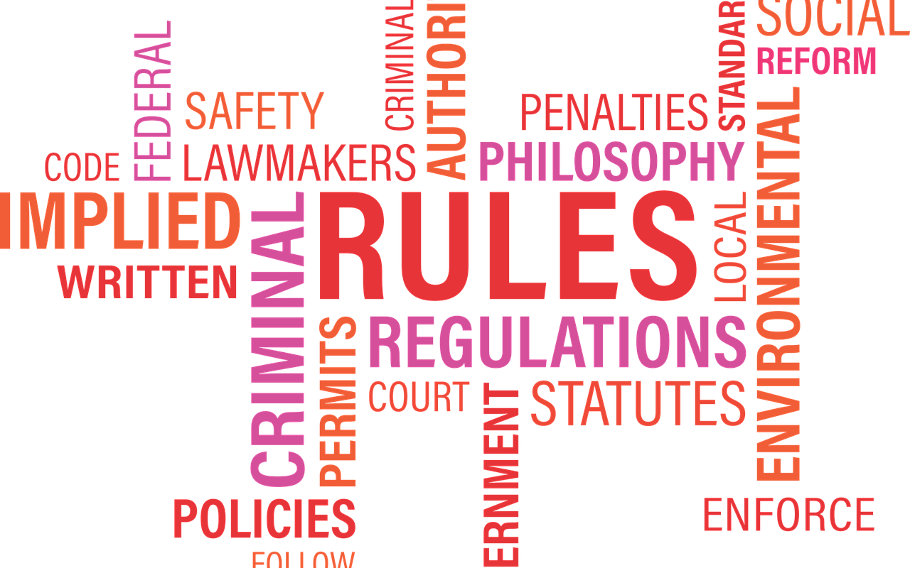

## 背景

2016年8月份，我在1号商城开设的阿根廷马黛茶专卖店不幸遭遇职业打假人，起因是商品评情页当中有一张“宣传功效”的图片。  
 实际上，图片所引用的文字内容，都来自于正规的、有出处的专业论文，并非我凭空捏造。  
 职业打假人一面向工商投诉，一面向法院提起诉讼。  
 商品金额大约6000元，若按退一赔三处理，那就要赔1.8万。这是我感情上所不能接受的，当时我做好了打官司的准备，在网上查阅资料，并且与律师探讨，决心要让职业打假人付出高昂的诉讼成本。  
 以下是我从网上查阅资料中提炼出来的要点，供各位商家参考。  
 这个案子最后以和解告终，鉴于和解协议的保密约定，我不能公布和解的金额。

## 请求法院驳回原告诉讼请求

如果谁先起诉，听上去又占理，谁就能赢得官司，那还要法官干什么？还要律师干什么？  
 被告了不用怕，咱们找到了鸡毛也要当令箭使。

> 被告销售商品宣传内容有所夸大或违反有关行政管理法规，系行政部门管辖范畴，对于此种情形在认定欺诈时应不予考虑，请求法院驳回原告诉讼请求。

## 被告应提出管辖权异议

**本案的管辖权应在上海法院，而不是广州法院。所以必须先提管辖权异议，把案件移到上海来审。**  
 购物合同发生纠纷，有事先约定起诉地的，应该从约定。这是网络购物合同纠纷案。  
 原告在１号店注册用户时有确认《1号店用户协议》。

> 《1号店用户协议》  
>  十一、适用的法律和管辖权  
>  本协议的订立、执行和解释及争议的解决均应适用中华人民共和国的法律。如就本协议内容或其执行发生任何争议，则双方应首先通过友好协商方式解决；协商不成的，任何一方均应向上海市浦东新区人民法院提起诉讼。

据说广州的法院基本是倾向于消费者，一定会驳回管辖权异议。但是我们不能因为肯定会被驳回，就主动放弃提出管辖权异议的权利。

## 原告指出被告“虚假夸大宣传”，而事实上：

虚假宣传作为一种恶性竞争行为，直接规范该行为的法律主要有新《消法》第20条、第45条、第50条，《反不正当竞争法》第9条、第24条，《广告法》第37条、第38条，《食品安全法》第94条、《产品质量法》第59条以及《刑法》第222条。然而，上述条款并未定义何为虚假宣传，因此严格来讲，虚假宣传并非一个严谨的法律概念。

被告可以提交数篇国内外公开发表的针对马黛茶的科研论文证明马黛茶的功效，因此最多认定是一种夸大的宣传，而不是虚假的宣传。  
 举个例子：人参是普通食品，商家宣传人参具有补气固脱，健脾益肺，宁心益智，养血生津的功效。这是虚假宣传吗？  
 **准确地说，被告进行了法律所禁止的宣传。**

## 被告进行了法律所禁止的宣传是否一定构成欺诈？

作为传统的欺诈构成要件有：欺诈故意、欺诈行为、被欺诈方的错误认识与欺诈行为之间有因果关系、被欺诈方因错误而做出意思表示。  
 《民通意见》第68条认为“一方当事人故意告知对方虚假情况，或者故意隐瞒真实情况，诱使对方当事人作出错误意思表示的，可以认定为欺诈行为”，确立了欺诈四要件的权威解释。同时，《消法》调整的是“处于特定身份和特定社会范围的民事主体”，新《消法》第55条所调整的是一个合同欺诈问题，因此自然适用民法之一般规定，因此，从司法裁判的原理来讲，其应遵守的是《民通意见》的“四要件说”。  
 \* 欺诈故意：被告没有欺诈故意。截屏内容是在新广告法实施之前，被告制作的，被告制作这些内容也是基于对公开发表科研论文的信任。  
 \* 欺诈行为：被告对商品进行了法律所禁止的宣传不等于欺诈行为。**被告销售商品宣传内容有所夸大或违反有关行政管理法规，系行政部门管辖范畴，对于此种情形在认定欺诈时应不予考虑。**  
 \* 被欺诈方的错误认识与欺诈行为之间有因果关系：这个案子里，没有欺诈行为，何来因果关系？再说，对于花5940元购买一堆他从来没喝过的（被告曾建议他保留茶叶，他说不要，不好喝）外国茶叶这样的大额消费，消费者是不是也尽到了谨慎义务？被告在1号店的商铺，即便是挂着截屏所示的宣传，两个月只有4个订单，还包括原告的订单，这说明大多数消费者是谨慎的。  
 \* 被欺诈方因错误而做出意思表示：被告认为原告购买马黛茶不是其真实意思的表示，就是说其目的不是想保留马黛茶（且不论其用途），而**只是想利用“新消法”条款向被告索取赔偿。**我们从这从被告一系列行为就可以看出：由于被告是货票分开发送，货先发给原告（8月7日晚上７点多完成收货），发票是被告在8月6日发出（中间原告还问过被告，估计是8月9日或10日收到，待查）。原告收到发票后8月10日先跑去法院起诉（原告提交的截屏时间点在8月9日下午），然后（8月10日下午4点左右，从时间点可以推断是去法院起诉归来）在1号店在线提交投诉。**有真实意思的消费者，都会先与商家投诉交涉，和解不成之后再诉之法律。**

## 应对策略小结

不要畏惧与职业打假人对簿公堂，你拿到法院传票后不必自乱阵脚，马上退一赔三甚至退一赔十（除非你的钱来得容易）。这种几万元的小案子，职业打假人起诉你，只是一种恐吓手段。  
 既然是职业打假，是门生意，做生意肯定讲投入产出比啊！谁都不想被一个小案子牵涉上半年到一年的精力，到时候不是钱的问题了，你是争一口气，他是要争财。起诉你是他的王牌，而当你知道最坏的结果时仍然准备应诉，他这张王牌就失效了。  
 ”民不畏死，奈何以死惧之？“

不要害怕市场监督管理局的约谈。职业打假人手里的另一张王牌是举报到商家所在地的市场监督管理局，让他们查你。  
 不过，所有的市场监督管理局都讨厌职业打假人，通常情况下，市场监督管理局并不会积极地响应职业打假人的举报，他们更愿意大事化小、小事化无。因此，当市场监督管理局约谈你的时候，你就去呗，虚心接受批评，积极配合整改。  
 市场监督管理局会建议你与职业打假人尽快达成和解，然后让职业打假人撤销举报。民不告，官不究。举报都没了，市场监督管理局还会处罚你吗？除非你所在地的市场监督管理局急需政绩，那你只好自认倒霉。

当你知道了双方的牌和玩法之后，和职业打假人达成和解就比较容易了。就我遇到的案子，职业打假人还蛮有”职业精神“，  
 若你是光脚的不怕穿鞋的，不应诉、不和解、不赔偿……要钱没有要命有一条，那也是一种选择。但是你要考虑清楚”耍赖“的后果，也许某一天你会因为失信而坐不了高铁飞机、出不了国境。  
   
 **说了一大堆，最最最重要的是，苍蝇不盯无缝的蛋。自查，自查，再自查，不要让职业打假人抓到把柄。**
