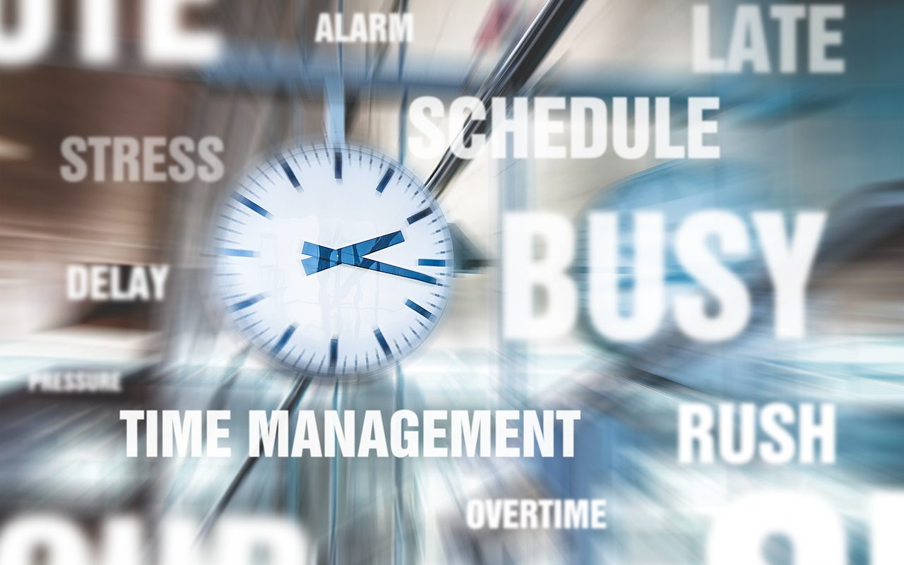

最近几个月我一直玩《模拟城市》（SimCity）。我曾在课堂上说起，有同学噗哧乐了：这是小孩子玩的。我非常严肃地说：Ｎo，一个人如果能玩好模拟城市，他一定能当好一个生产计划调度员。  
 《模拟城市》的本质，就是在有限的生产线上尽快按订单生产各种原料和预制件，满足城市发展的需要。订单无非来源于建筑物升级、客户（机场、轮船……）。  
 玩任何游戏都必须沉迷（至少一阵子），不沉迷游戏就不是一个合格的游戏玩家。我玩游戏只有到万不得已的时候才掏钱，在我看来，掏钱就是沉迷的最好标志。为了扩充《模拟城市》仓库容量、地皮，我不得不充值——那些扩容、扩地皮的道具，爆得太慢了。  
 当我意识到照此形势发展下去，《模拟城市》可能会成为一款烧钱的游戏时，于是我思考了几个问题：

## 我是在和谁比速度？

没有。没有任何一个领导给我下KPI，要求我在某年某月某日前达到。  
 先发的玩家，领先好多年，我赤了脚也追赶不上，再说追赶上了又如何？除了搭上钱和时间，什么奖励也得不到。  
 既然不需要和谁比速度，急个毛？

## 我的城市发展目标是什么？

人口规模增长到200万？  
 地皮扩张到地图的极限？  
 不是。我要发展一个小而美的宜居城市，那就不必追求摩天大楼林立的效果。

## 是不是所有的订单都要去满足？

一开始，我总试图满足所有的订单，而实际产能有限，其结果必然是顾此失彼，捉襟见肘。  
 现在我的策略是，尽可能先保有每个品种的最低库存，对于与库存差距太大的订单就主动放弃。

我现在可以做到，每天只打开《模拟城市》一次，每次只玩半小时。原因是我成功克制了自己的欲望：我不再扩仓库容量、不再扩张地皮，不和别人攀比，不接与库存差距太大的订单（错过就错过，来日方长）。  
 游戏如此，人生也可如此。不是吗？
