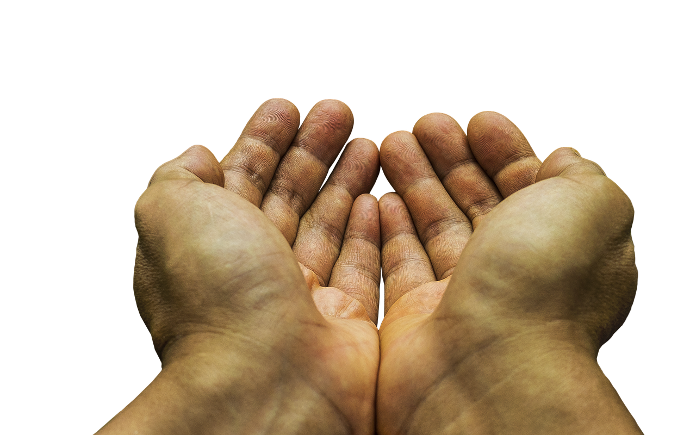

“罗一笑”事件的过程我就不说了，关注过的都知道，没关注的可以去搜索一下。我简单说一下我的观点：

- 当我读到《罗一笑，你给我站住》一文，读了个开头，我就关闭了，我对网络上任何请求（转发）捐款一事，默认是不接受。因为我没有时间和精力去判断这类事情的真伪，我不想最后有剧情反转导致自己的同情心受到伤害——老子省下钱捐给你，你拿去买房买车……那我干吗不自己买房买车？
- 即便甲的事情为真，那么我捐了甲，接下来又出现了乙，他的事情也是真的，此时，我又应该作出什么样的选择？我凭什么只捐给甲而不捐给乙？
- 社会主义非常优越，不应该存在“朱门酒肉臭，路有冻死骨”的现象，解决此类民生疾苦的难道不应该是民政部门和已经与郭美美撇清干系的红十字会吗？因此，作为公民不应该越俎代庖，必须要给他们这些单位以履行法定责任和义务的机会。
- 罗一笑的父亲是不是可以被原谅？孩子的病情为真，不等于可以不择手段——用暧昧不清的文字（我必须感叹中国文字绝对奥妙），暗示自己已经走投无路，忽悠网友“打赏”（捐款）。被揭穿后，废话连篇，哭诉无人关心他的女儿——我靠，无人关心你女儿，那200多万又是从哪儿来的。道歉又是如此不真诚——错了就是错了，解释个屁。我认为他毫无认错之心，不可以被原谅。
- 是否一定要一贫如洗才能求助社会？我所在的“IT老友群”里的王东临先生说得好：我是这么理解的，应该是富人帮助穷人，或至少境遇好的帮助境遇差的。如果如实说明自己情况，还有人愿意帮助，那没问题，就像追星少女掏钱支持比自己富上千倍的明星一样，但如果隐瞒实际情况导致许多比他更穷的人在不知情的情况下出于善良掏钱帮助他，那就是消费善良。

今天，12月2日，最高人民法院第二巡回法庭对原审被告人聂树斌故意杀人、强奸妇女再审案公开宣判，宣告撤销原审判决，改判聂树斌无罪。可是聂树斌早已化成骨灰二十多年了。  
 聂树斌被冤杀，这是我国一味追求结果正义（命案必破），忽略程序正义（警方多是重口供轻实证）的后果。  
 罗一笑事件，如果我们只关注结果正义——罗一笑的确病了，而不去批评其程序不正义——信息披露不完整，那么未来再有罗二笑罗三笑，恐怕她们再也得不到帮助了。  
 不过也难说，中国人口太多，傻瓜的比例少，绝对数不少。我的朋友圈就有仍然执迷不悟的，说不在意这10元20元，说批评罗一笑父亲的都是道德婊……所以我说：罗一笑，又一个撕裂“朋友圈”的话题。
