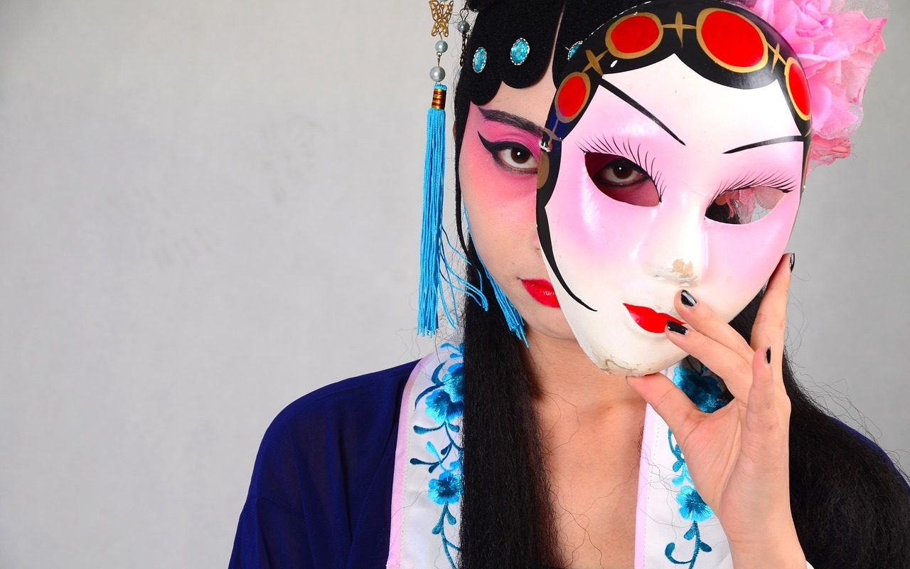

**Day112（2018年4月29日，周日）**

4月26日，中国西南民族大学副教授宋石男在新浪微博上发布了辞职信，辞职是因为校方要收他的护照而引发，他认为这是违法行为，愤然辞职。当然他辞职的深层原因，自不在此。  
   
 

> ……我向来看重价值，所做之事是否有价值，于他人或无关痛痒，于我则刻骨铭心。14级学生中有好几位是我从教以来遇到最好的学生，他们是传我衣钵最多、也最富理想主义的学生，但他们在毕业求职中却四处碰壁，若没有理想，他们也可以去传统媒体做个理中客，去网络媒体攒稿，或者去今日头条等地方做个审核员，但他们有理想，而越有梦，越痛苦。
> 
> 
> 
> 新闻当然不会死，但新闻在此间也从未活过。时局如此，我不能再误人子弟，以我不合时宜的思想与技艺，让少数有理想的孩子痛苦。当然，更多的孩子会对我的思想与技艺无动于衷甚至避之不及。职是之故，我深感在新闻系教书已不再具备价值，这并非愤激之言，而是深思熟虑之后的肺腑之言。

   
 ……  
   
 玻璃房子里的小鸟最痛苦，貌似天高任鸟飞，实际飞起来就撞一头包。  
 依我之见，咱们的宪法都修了，新闻系统换个方式运作也没什么不可以，何况中国本来就没有新闻法。声明，我不是故意说反话，这次我是站在系统运行效率最优角度来考虑的。  
 文字和图片新闻采编和发布权全部收归新华社所有，视频新闻采编和发布权全部收归央视所有。新华社和央视7X24小时持续推送内容给分发单位，在线分发即由各大门户和视频网站进行，内容同质化就同质化好了，总会有人看的——《新闻联播》收视率不也挺高的嘛。补充一点，各个在线分发单位应该禁止用户对新闻发表评论。  
 这样一套单向传播的新闻系统，有利党国全面掌控长城（防火墙）之内舆论导向，令党国领导不再有面对所谓舆论监督时的那种野火烧不尽春风吹又生的烦恼。党国领导腾出时间和精力，可以做更多的为人民服务的实事。

有人会说了，你这不是主张专制吗？没错，对国家治理而言，专制也是一种选择。虽然我说过民主是最不坏的一种制度，比专制要好。  
 但是国家治理和公司治理一样，在基本方针政策上不可显示出摇摆不定，否则员工无法理解领导意图，就不知道怎么做才是对的。好比你开车，打的是右转灯，实际在往左转，你叫后面跟的车子怎么作出反应？  
 中国人民已经被专制了数千年，血液里流淌的都是顺民的基因，我们从未有过公民的传统。顺民就是老老实实种田纳赋，逆来顺受（除非官逼民反），做皇恩庇护下的子民。你们不要以为当年给皇军带路的一定都是十恶不赦的汉奸，在普通老百姓眼里，这不就是一次改朝换代吗？日本人是异族有什么关系？汉族被异族统治又不是第一回了。  
 适合中国国情的制度，就是好制度。假如“我们”要建设“1984”那样的“美丽新世界”，那么请直截了当地说出来、画出来，只要建设者们相信并且他们自己也愿意生活在那样的乌托邦，我觉得真没什么丢人的。这个世界本来就是多元化的，国家治理也应如是。  
 一个被普世价值观统一的地球，见不到金三胖的表情包，其实也挺无趣的。
