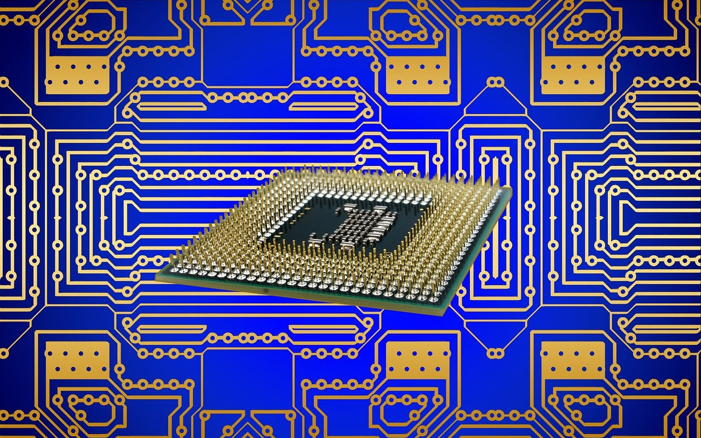

**Day121（2018年5月8日，周二）**

《王炸！国家突然宣布一个大消息！巨头们彻夜无眠！》  
 《此人突然回国，美国慌了，日本傻眼，世界惊呆》  
 ……  
 看了上述吓人的标题，你是点呢，还是不点呢？  
 真点进去一看，虚头巴脑，意淫连篇：“当所有的巨头还在为10nm、7nm技术大肆进军的时候，中国中微正式宣布掌握5nm技术。”

上述文章的主角，中微董事长兼CEO尹志尧博士不得不站出来辟谣：中微作为设备公司，不是制造芯片的，而是为芯片厂提供设备的。中微向他们提供可加工先进器件的设备，协助他们实现新一代器件的开发和生产。中微不可能脱离他们的5纳米技术开发，而独立地掌握5纳米技术。  
   
 我们看看知乎网友怎么说：

> ……  
>  所以视频里说搞定了满足5nm制程的刻蚀设备题主不必太过兴奋，国产设备还有很长路要走，什么时候国产EUV能横空出世，那才是真的不得了，真正的弯道超车，要知道ASML的EUV一台就超过一亿欧元啊。

我们不需要懂EUV是什么，只要知道它是芯片生产过程中必须的高技术（设备）就行了，一台EUV价值一亿欧元，折合人民币7亿多。

中国的芯片业与美国相比，肯定处于全线落后的状态，最乐观的说法是5年差距，我估计至少得20年差距。就算人家原地停下来等咱们赶上去，中国的量产芯片与人家有得一拼了，中国芯片就能成为客户首选吗？  
 当然不是，芯片只是一个部件，不是产品。没有与芯片适配的“生态系统”：硬件，操作系统、应用软件，一块芯片还不如一枚硬币有价值。
