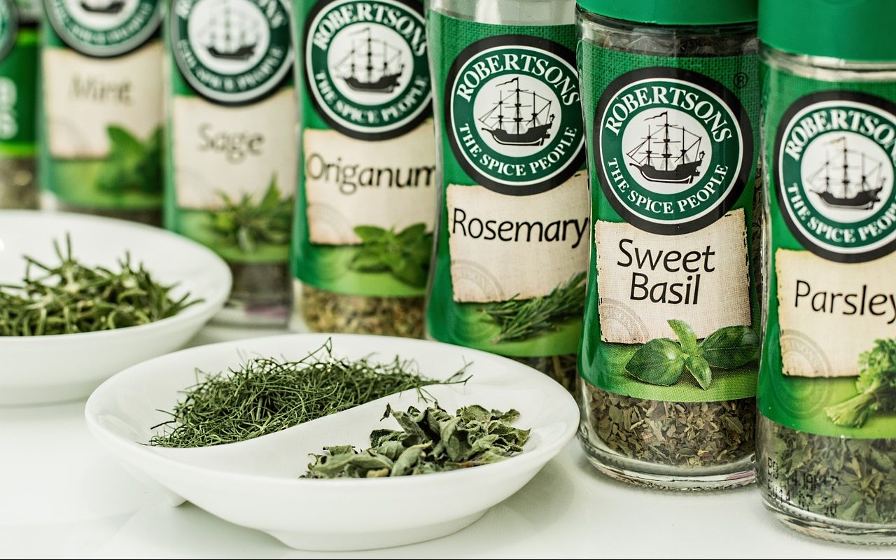

**Day123（2018年5月10日，周四）**

中医，现在也是一个可以让朋友割席断交的话题。  
 家庭群中某个长辈转了个全世界都在疯抢中医文化的帖子。  
 我婉转地表达了自己看法：“中医理论更近乎哲学、玄学，所有的中药，没有一款药能够通过【大样本随机双盲实验】，所以只能成为一种文化。和茶一样，大家知道茶有保健功效，但不能当作药。”  
 另一个长辈举出屠呦呦的例子，以证明中医有效。  
 后来我就没说一句话，我知道中医在长辈心目中的地位不容质疑。

其实青蒿素这事，我所见过最客观的评论（来自果壳网）是这样的：

1. 植物学所称黄花蒿（Artemisia annua），就是中药所用“青蒿”，含有青蒿素，具有抗疟作用。中医常将“青蒿”用于清热解暑及拔毒治疮，或可兼治疟疾，但很多时候炮制手法不恰当，青蒿素很可能已被部分或全部破坏，因此是否真有药效是有疑问的。葛洪《肘后方》并不属于正规中医典籍，直到今天中医内科学教材的疟疾部分依然把青蒿和大批其他未得到验证的中药相提并论，因此有多少人真的受益于青蒿直接治疗也是可疑的。
2. 植物学所指青蒿（Artemisia carvifolia），虽然是黄花蒿（Artemisia annua）的近亲，但描述与古本草书上的“青蒿”不符，且不含青蒿素，并无抗疟作用。
3. 《中华人民共和国药典》2010年版关于“青蒿”原植物的叙述“本品为菊科植物黄花蒿Artemisia annua的干燥地上部分”是准确的，并非淆乱视听。
4. 屠呦呦等人发现青蒿素的过程受到了传统医学的启发。
5. 屠呦呦等人提取青蒿素的过程用的是现代医学的方法。

由此可见，支持中医的人认为青蒿素的发现应归功于中医，是中医药对人类健康的巨大贡献，这显然不能成立；而反对中医的人试图以“青蒿”不是黄花蒿为由，撇清青蒿素的发现与古医书的关系，这样论证也不合事实。

【大样本随机双盲实验】是现在医学界公认的确定药物疗效的机制？  
   
  
 首先把一定数量（人还不能太少，几百甚至几千人）的病人随机分为三组。  
  
 第一组是对照组，不做任何治疗，用来观察病人疾病在没有治疗情况下的自愈效果。  
  
 第二组是安慰剂组，给病人吃没有治疗成分的“假药”，用来观察病人的心理作用对疾病的影响。  
  
 第三组是治疗组，给病人吃真药，观察这种药物或疗法的真实治疗效果。  
  
 病人们不知道自己属于哪一组，医生不知道自己身处哪一组（避免医生偏见或暗示影响病人）。  
 统计工作由第三方来进行，只有第三组的治疗效果明显高于前两组，才能证明该药物或疗法的有效性是真实的。

支持中医的人也会说【大样本随机双盲实验】是西医的玩法，咱们中医最讲究辩证治疗，治病除根……  
 那我倒要问一句，既然中医这么牛逼，那么还要西医何用？什么中西医混合治疗，和尚和尼姑怎么能在一起？真的是不清不楚。  
 支持中医的人也会说要取其精华，去其糟粕。“取梁上灰治病”的糟粕显而易见，可那些“精华”整明白了吗？“精华”真能治病的话，又是什么成分在起作用？副作用是什么？不能总是“尚不明确”啊！是药三分毒貌似也是中医说的吧。  
 你会发现，一旦中医整明白了这些“精华”，将其成分的化学分子式标出来，它不就是成分提取自植物的西药吗？

反正，我不相信现在还有哪个中医粉一辈子不看西医，不用西药。
