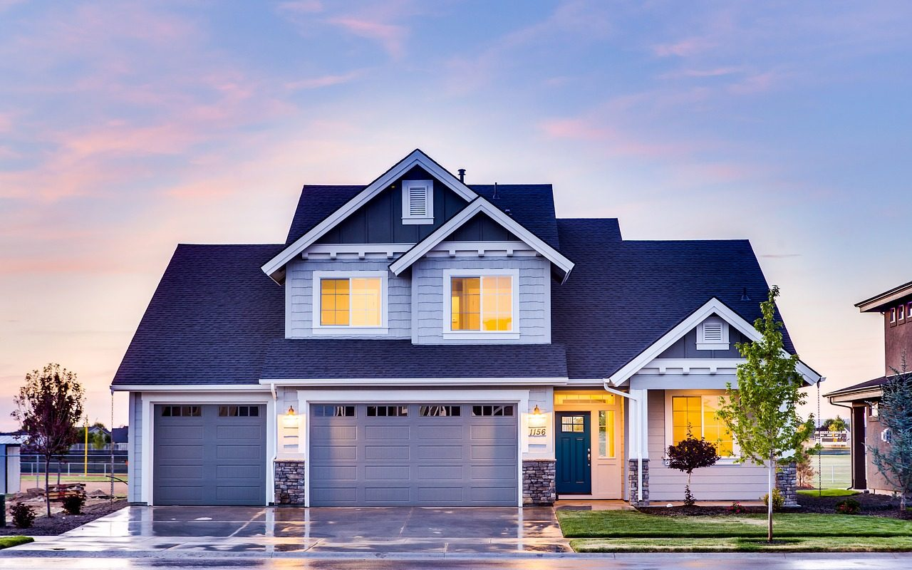

**Day153-154（2018年6月9日-6月10日，周六、周日）**

新西兰要禁止外国人买房。不仅“外国人”不能买房，在新西兰持有学签、工签、甚至居民身份（非永久）生活工作的人，都将被排除在住房市场之外。  
   
 禁止不在新西兰工作生活的外国人买房，可以理解。而禁止在新西兰生活工作的外国人买房，这个就说不过去了。　　  
 想必新西兰政府也奉行“房子是用来住的，不是用来炒的”的理念。而防止炒房，像中国某些城市一样用限购的办法，其实是最差的一种选择。

大家不要以为政府里都是精英，智囊团都是专家，精英和专家脱离群众太久了，他们的智慧远不及劳动人民，因此在实施房产政策时会出现排队离婚、开宝马住经适房的怪象。像经济学家茅于轼提出＂经适房不应该建独立卫生间＂，虽然被某些人批得体无完肤，但是我认为他老人家对中国国情有着深入骨髓的了解，有着真正的智慧——如果一个人根本不在乎房子里有没有厕所，那才是真的需要住房，政府应该先帮助他。

防止炒房，最简单的方法就是对长期空置的房屋征收空置税，增加炒房者的持有成本。空置时间越长，税收就越高，倒逼炒房者将房屋对外出租，从而免交空置税。  
 以前科技不发达，数据采集不易又分散，单从数据来判断房屋空置非常不便。时至今日，大数据时代，任何一户的水电煤、宽带的日常使用数据，我们稍加比对分析，就可以知道该房屋是否处于空置状态。  
 我不否认这种数据作弊可能性的存在，比如在空置房间配上电冰箱等。但是，一个人要在一个很长的周期内，从水电煤、宽带多个维度“伪造”使用数据，“伪造”本身就需要一定的成本。再加上这些数据需要通过系统大数据审查——波动不能太规律也不能太不规律。因此，除非他能勾结有关部门的技术人员，否则“伪造”时间一长，马上就被识破。  
   
 新西兰的邻居澳大利亚，在2017年11月正式通过了针对海外购房者的房产空置税政策。新政规定，海外购房者所拥有的澳洲本地住宅，如果一年内无人居住的时间超过6个月，且未对外出租的话，将强制缴纳房屋空置税。  
 维多利亚州是全澳最早开始实行空置税政策的州，对一年中空闲6个月以上的房屋按照其价值征收1%的空置税，这一政策适用于在墨尔本内城区和近郊区购买第二套房产的海外买家。

也许有人担心空置税会导致房价继续上涨，我觉得不必担心，因为空置税会让出租房源增加，假如租房的性价比高过买房，没有人会选择买房。此时，政府要出台强力措施，保障租房者的权益。  
   
 德国在这方面做得就比较好，好到夸张，貌似跑步进入了共产主义：德国的租房合同大部份是无期限期，除非房主要收回房子自己住，否则不能要求房客搬走，如果房主强行赶房客走，那么房客可以将房东告上法庭。房主也不能随意提高房租，如果房租超过当地“房租指导价”的20%，那么房客可诉诸法律，如果超过50%，法庭甚至可判房主最高三年的有期徒刑。  
   
 我在想，要是中国的房产政策效仿澳大利亚和德国，那接下来房价走势会怎么样呢？
