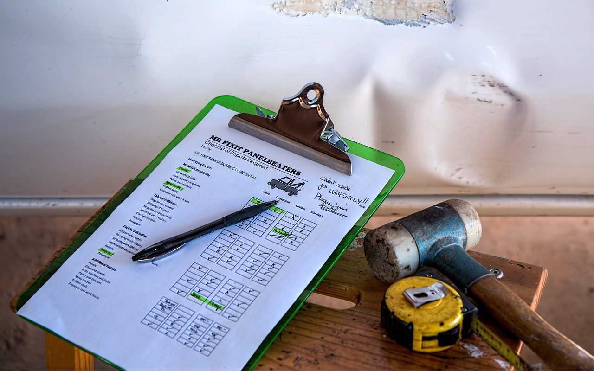

**Day170-171（2018年7月11日-7月12日，周三、周四）**

接着上回保险的话题，我想介绍下我在新西兰的两次保险理赔经历。  
   
 留学新西兰自然要购买留学保险。David的公司为国际留学生统一代购了南十字星公司（Southern Cross Travel Insurance）的国际留学生旅游保险，我也不例外。

> Southern Cross Travel Insurance (SCTI) 是新西兰最受认可和信赖的旅游保险公司之一。国际留学生旅游保险的投保资格是：
> 
> 
> 
> 必须：  
>  (a) 已经或准备持有在新西兰留学期间的有效新西兰学生签证  
>  （如果学习时间少于三个月，您需持有有效的旅游签证）；并且  
>  (b) 在一家新西兰教育机构注册入学。
> 
> 
> 
> 投保覆盖范围  
>  该保单承保医疗及运送、旅程变更、人身意外伤害、个人责任、租  
>  车事故自付款，以及现金、旅行证件、行李和个人物品的丢失。

网上有人吐槽这个保险公司：

> 如果你索赔的项目是100新元以下的开支，比如像生病去看医生。一般的常规检查southern cross是不负责任的!如果款额稍微大一点儿的(尤其是接近你交给他们的保费)，公司会死缠烂打能不给你就不给你。  
>  当你有需要给他们南极星留学保险的工作人员打电话，每次他们都会拒绝你，并且找出万年不变的借口——经理不在或者经理在忙。所谓经理们，我不知道大家和我的领会是不是一样的，他/她们能做到经理的水平，肯定是在公司当职员的时候吝啬的出头、拒绝索赔案件最多的。他们对公司写得超级下流(能不赔你就不赔你，把所有责任都推到索赔户的身上)的“条款”记得都是倒背如流，能从他们嘴里讨出个说法比登天还难。

不过，在这段话中，我只看到了作者的观点，除了发泄不满，没有阐述任何具体的事实（时间、地点、人物、经历）。  
 我先后两次向SCTI申请理赔，都获得了理赔，虽然第二次不太顺利。

第一次在2月下旬，我因眼睛不舒服去看家庭医生，被诊断出结膜炎。诊断费纽币95元，药费纽币18.50元。事后，我向保险公司申请理赔，并将收据原件邮寄给保险公司。几天后，保险公司回复邮件说全额理赔。（谁说常规检查SCTI不负责任？）  
   
 第二次在5月中旬，我因便血去看家庭医生，被推荐去专科医院检查，诊断为（内）痔疮。两次看医生的总费用为纽币580元。我照例向保险公司申请理赔，保险公司（Email）要求我提供家庭医生转诊证明和专科医生的诊断证明。当我提交上述证明后，保险公司以我有病史（10年前做过痔疮切除手术）为由拒绝理赔。  
 不过，我的常识告诉我，10年前得的是（外）痔疮，现在则是（内）痔疮，两者虽然共用一个名字，但位置大不同，（外）痔疮似乎不应被视为（内）痔疮的病史。于是我联系了家庭医生，家庭医生同意我的看法，为我出具了一封解释信，当然她说不确定SCTI会不会采纳她的意见。我说试试亦无妨，死马当活马医了。  
 SCTI收到我转发的解释信，回复说将重新审查我的案子，让我等回音。  
 7月3日，我在国内收到SCTI的邮件，说他们在重新评估我的案子之后，接受我的理赔申请。当然，他们不忘声明以后不承保相同的病。3天后，我收到了SCTI的理赔款。（谁说能不赔你就不赔你？）  
   
 两次理赔，后一次与SCTI多次交涉，全部是Email往来，我从未、也不需要与工作人员见面或通电话。再说，我的英语口语水平也不支持这么复杂沟通。  
 我不知道那个吐槽SCTI的作者究竟遭遇了什么，反正我从SCTI获得的理赔款已经超过了我缴纳的保费。况且保险公司的商业模式，从来不是按人头赚钱，即给一个人的赔付金额不应超过他缴纳的保费——这种想法真的是很傻很天真。  
 我不得不再次感叹东西方思维模式的差异，西方社会就是“讲道理”。联想起中美贸易战，美国人抛出的是一份逻辑清晰内容翔实的调查报告（且不论是否与事实相符，至少逻辑自洽，有说服力），而天朝上国除了把口号喊得震天响，还有什么可以示人？
