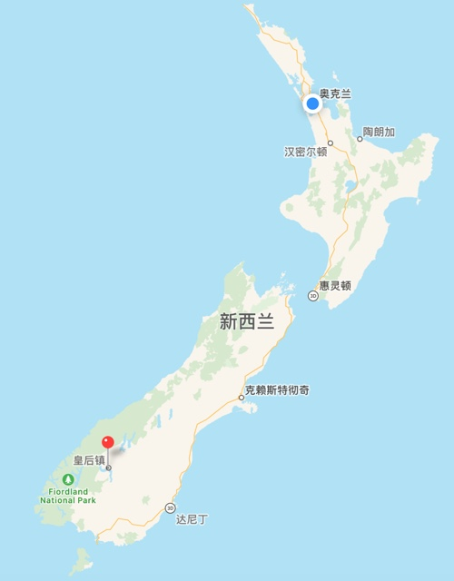
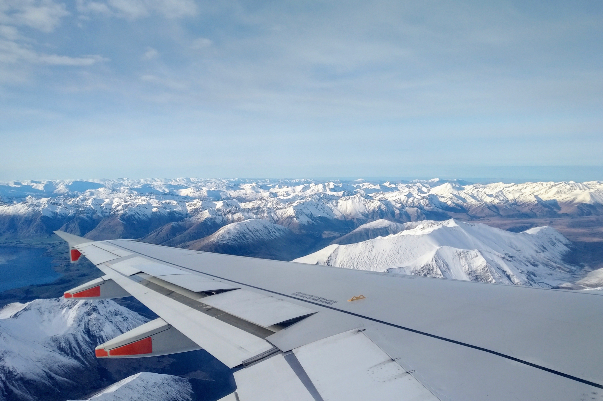
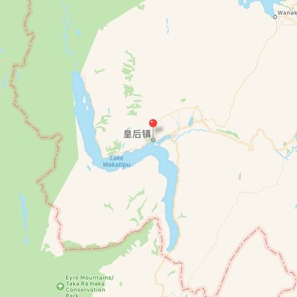
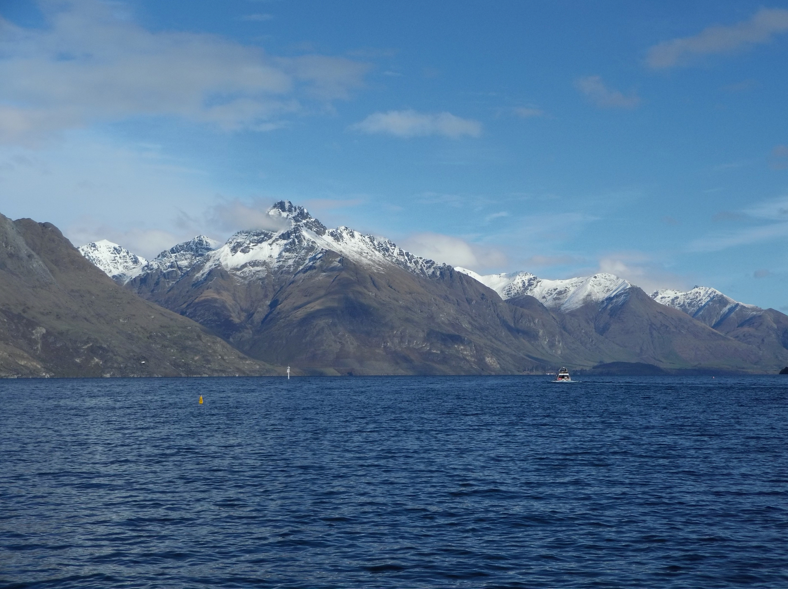
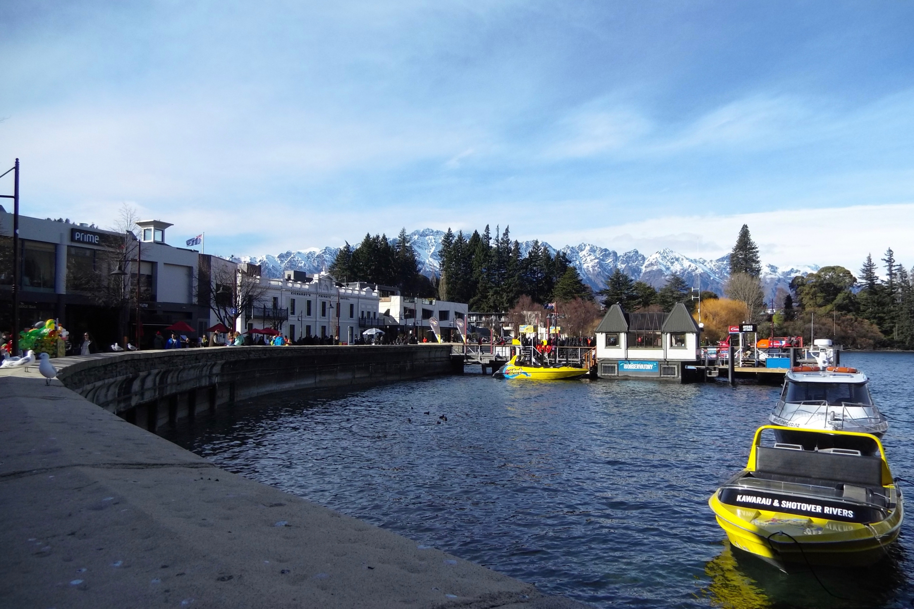
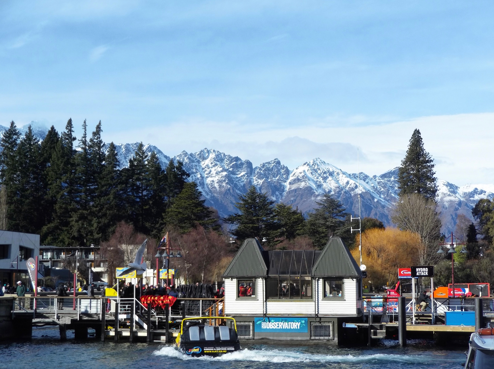
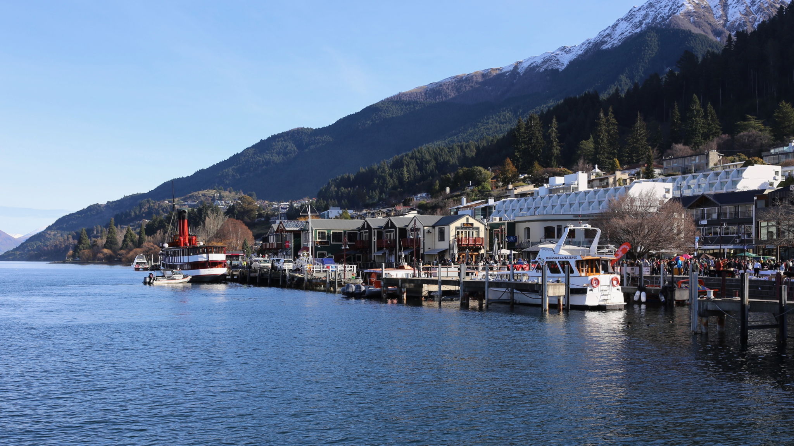
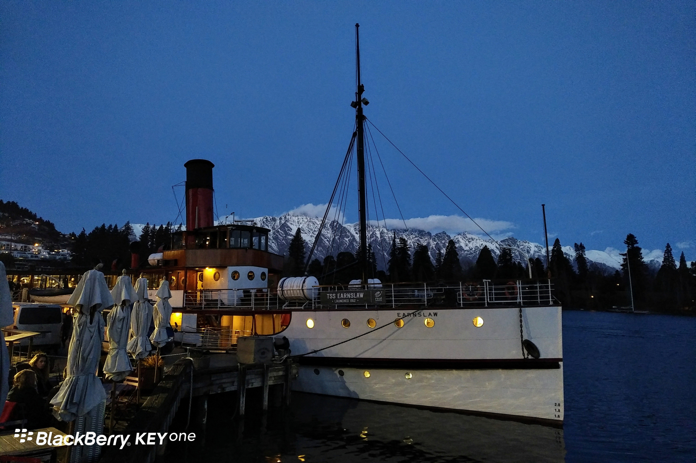

**Day174-176（2018年7月14日-7月16日，周六、周日、周一）**

7月14日至7月16日三天跟随Choose NewZeaLand的同学们一起去QUEENSTOWN（皇后镇）旅游。顺便说明一下：Choose NewZeaLand实际是Novo公司的服务品牌。我这个David同学在自身品牌建设方面不吝投入，公司里面放着各种带有Choose NewZeaLand品牌标识的东东，连超市的购物袋都为访客准备好了。



皇后镇现在是新西兰南岛著名的旅游景点，成了游客必去之地。又逢双休日，镇中心人头攒动，堪比上海南京路步行街。我是不太喜欢。  
 话不多说，一图胜千言，上照片。

1、飞机即将抵达皇后镇机场，机翼下连绵的雪山，相当震撼。　  
   
 

2、皇后镇紧临一条狭长的瓦卡蒂普湖。这湖在地图上看起来像是一条河。











3、下图为“TSS厄恩斯劳号”，一艘拥有100年历史蒸汽船，据说乘坐蒸汽船是体验皇后镇美景的最佳方式之一。伊丽莎白女王、菲利普王子、克林顿总统、日本天皇和皇后都坐过这艘船。不巧的是，我们抵达当天，蒸汽船在维护保养，不对外开放。后来，我们乘坐水上TAXI去高地牧场吃BBQ烧烤晚餐，观看农场秀。



我以为农场秀就是剪羊毛表演，心想既然来了就瞅瞅吧。但见工作人员叽哩呱啦讲了五分钟，拖出一头羊来，仅仅做了个两三分钟的示范就草草收场。然后他转身打开灯光，照亮了一片山地，山顶有五六只羊若隐若现，只听得山下两条牧羊犬兴奋地大叫起来。我猜测是要表演赶羊入圈。  
 果然，工作人员放出一条牧羊犬，牧羊犬汪汪叫着直冲山顶。狗通人性，知道要配合表演，非常积极。那几只羊才不管，下到一半就赖着不动。现场光线不好，我看不清楚山上的状况，就听到牧羊犬在叫，工作人员在催促，羊群就是不下山。另一只牧羊犬见它的兄弟搞不定，急得汪汪叫。最后，工作人员不得不放开它，上去增援。  
 的确，狗多力量大，增援一到位，羊群开始下山。这时候，我发现有一只羊挺调皮，下山途中一有机会就转身往山上跑，甚至到了山下还想往山上逃。不过，两条牧羊犬在，一条赶羊群，另一条盯死这只捣蛋羊，它的逃跑自然无法得逞。（估计之前就是这只羊在搞怪，与一条牧羊犬周旋，导致整个羊群不能下山。）  
 有牧羊犬，牧羊人果然可以轻松许多。不然自己天天爬山赶羊，累个半死。
