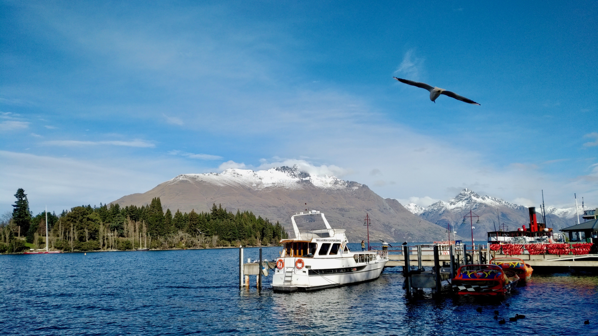
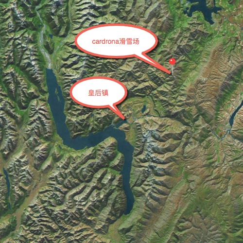
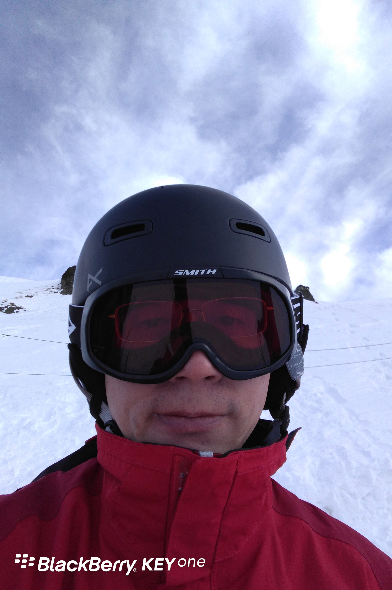
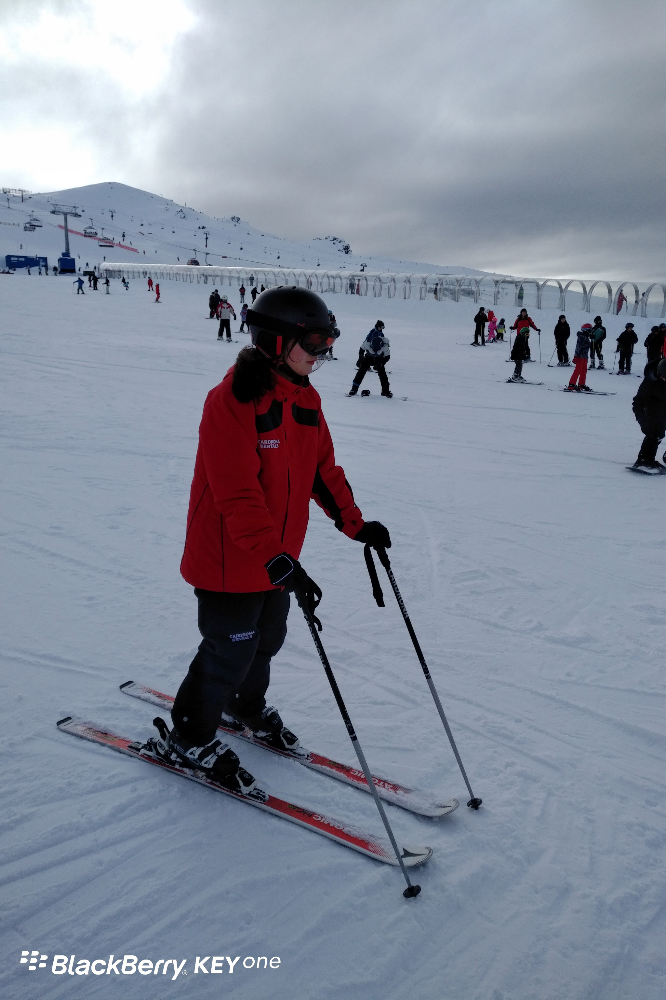
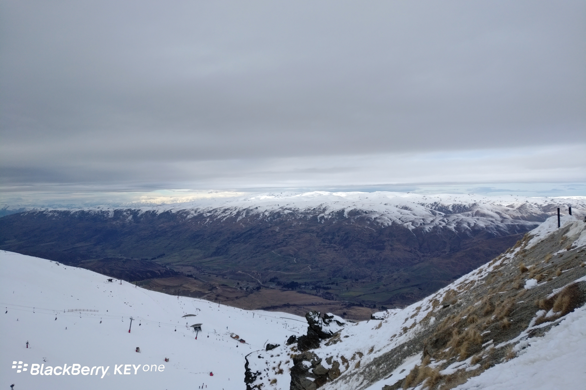
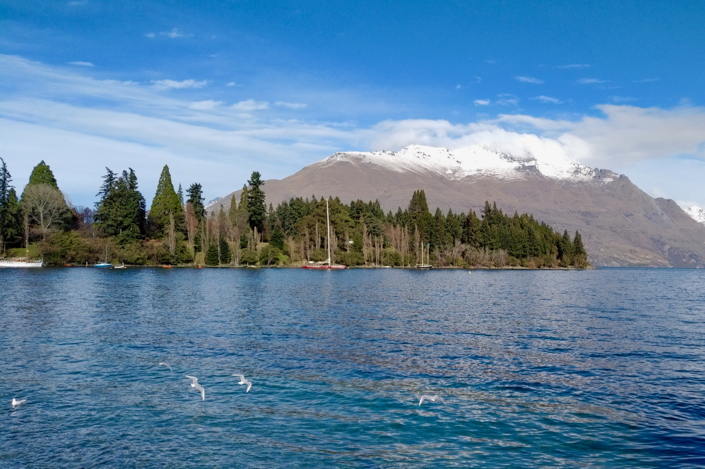

**Day177-179（2018年7月17日-7月19日，周二、周三、周四）**

不好意思，旅游归来，公众号更新的节奏有点乱。这篇更新后，接下来仍然两天一更。  
   
 7月15日（周日）Choose NewZeaLand旅行团的行程是去Cardrona滑雪场滑雪。  
 Cardrona距皇后镇约一个多小时的车程。起初同行的范老师一直在念叨单程要三个多小时，还买了干粮带上路，着实把我吓到了。后来她解释说去年恰逢大雪，车子绕路，才花了这么多时间。  
   
 

滑雪，本人是一只菜鸟。很久以前，带儿子在上海的银七星室内滑雪场滑过一次，当时还上了私教课。不过到现在早就没印象了，一切要从头学起。  
 Cardrona的更衣室与装备（附件）租借处合在一个大房间里。来宾人手一张IC卡（在另一个办公室购买），个人自行在电脑上激活——输入身高、体重、性别、鞋码等数据，然后到各柜台刷卡租借装备（附件）。滑雪手套如果没有自备，那就必须购买——害得我花了20纽币，买了一副等同义乌小商品市场品质的手套，想想也心痛。  
 当我积极为同学们拍照的时候，背后突然冒出个（普通话）声音：“不要发朋友圈啦。”回头一看，是一个扮作卡通鸡的工作人员。当时我心头一阵不悦，心想老子拍照发不发朋友圈关你鸟事……我向来不喜欢这种自来熟的说话方式。  
 午餐时分，这个工作人员卸下装扮跑过来与我们一群人聊天。她是深圳人，原来做国际贸易，拿了一年的工作假期签证（打工度假计划）来这里打工。了解客户反馈是她的工作之一，于是我提了个在我看来他们必须采纳的建议：既然滑雪场都引进中国人服务中国人，那么为什么不增加中文标识呢？做几块牌子又花不了多少钱。

> 打工度假计划是新西兰与其它国家/地区签署的一项协议，获得此类签证者可以在新西兰工作或学习长达一年。不同于假期只能旅行而不允许从事其它活动的访客签证，持打工度假计划签证者可以从事各种工作——从采摘水果、酒店接待乃至于与特定职业相关的工种，类别多样。中国大陆地区每年只有1000个名额。

上图啦。

1、本人滑雪定妆照，无美颜。



2、我为同行的小朋友拍的。重点看背景，初学者区域，人口密度相当高。那根透明“隧道”，是自动扶梯，初学者们用这个上斜坡，再滑下来。再过去可以看到缆车，那里坡陡，是高手驰骋的天地。  
 对初学者来说，下陡坡就是噩梦。下午结束前，我似乎找到点感觉，自以为能控制速度缓慢下坡，于是挑战30度斜坡。刚拉开架式滑出几米，我就发现偏离预期方向，并且速度不减反增，结果一阵手忙脚乱，倒地不起。“不起”不是受伤，而是脚踩雪板，不易起身，最后只好卸下雪板了事。



3、左下为滑雪场的一部分，这块区域人很少。对面的雪山与白云近乎无缝衔接。



这次滑雪，见识了各式各样的专业滑雪装备，让我想起《林海雪原》，那些士兵滑雪用的又是什么装备呢？木板？烧火棍？

补上两张我在皇后镇拍的照片，飞鸟入镜纯属偶然，却给照片添加了几分动感。  
 


