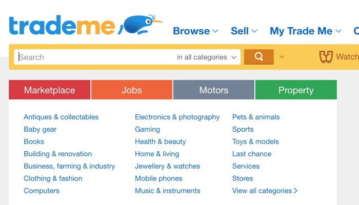
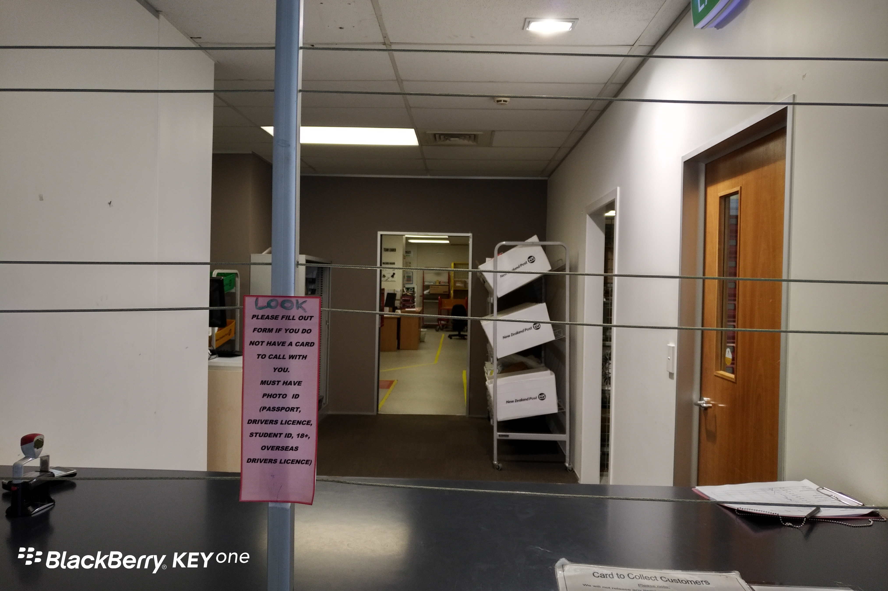
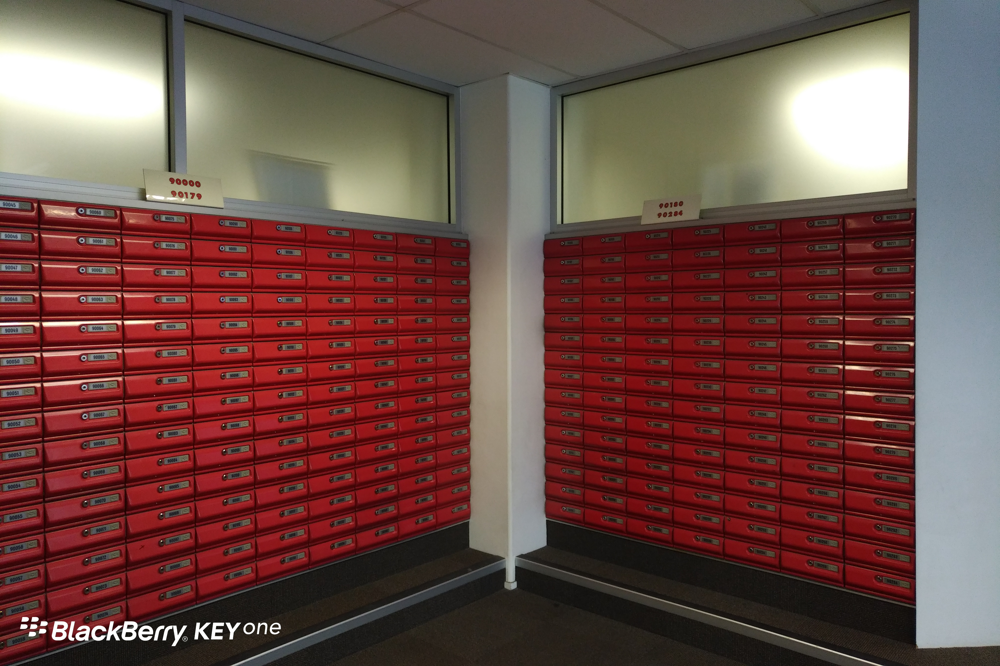

**Day196-197（2018年8月5日-8月6日，周日、周一）**

出于好奇，我体验了一回新西兰的网购。  
   
 新西兰也有“淘宝”，叫做Trade Me。和淘宝一样，啥都有，吃穿住行一网打尽。  
   
   
   
 去年底，我曾试图在Trade Me上租房，但没有成功。因为房东或中介都是老外，沟通起来不顺畅，估计是被嫌弃。后来是上“天维网”（华人网站），非常顺利地找到了中意的公寓，关键是语言没障碍！  
   
 对Trade Me来说，我想它遇到最大的问题是：新西兰人口太少了。即使全新西兰的人都上这个网站，也不超过500万啊！  
 刚到新西兰那会儿，我打算卖掉我的 MOTO Z PLAY 手机，挂上去好几周，价格降了两次，还是卖不掉。凭我的经验，要是挂到“闲鱼”（淘宝二手），早就出手了。  
   
 网购实验从Elastic Mobile Phone Wallet（粘在手机背面的卡套，可插信用卡、交通卡）开始。淘宝上最便宜卖2块钱人民币，这里是7个纽币（包邮）！（你有木有想运一批进来卖？）  
 我不知道卖家是怎么包邮的，反正你敢包邮，我就敢买。  
 8月1日 晚上8:09 我成功下单  
 8月3日 我在公寓信箱里收到了领取包裹通知单。起初我以为公寓门房代收了，定睛一瞧，原来是通知我上“邮局”（nzpost.co.nz）网站查询或者带上身份证明和通知单直接去某处领包裹，不领取的话10天后自动退回发货地。  
 根据通知单提供的一个查询网址，我并没有查到我的包裹。我在想会不会系统滞后，国内也有这种情况，单据先行，单号后进系统。于是我在周日又查了一遍，还是没有，这让我百思不得其解。无奈之下，我尝试在首页找查询入口，居然查到了我的包裹……搞不清楚到底是系统问题还是人品问题了。  
 接下来又遇到一个严峻的问题，领包裹邮局在哪里？通知单上虽然有载明站 点名称，但是没有标明门牌号。也许本地人都知道，可我是外地人啊！滑稽的是，在邮局网站直接搜索站点名称，没有任何结果，当我祭出谷歌大法，谷歌带我跳转到了邮局的某个网页，站点名称和地址赫然在上。  
 我只能说，邮局的服务太粗糙，有待提高。  
   
 站点门口放着一排自助取快递的柜子，和国内的柜子基本一样。  
   
 下图为站点领包裹窗口。去的时候没有工作人员，按了铃等了有两分钟才有人慢吞吞走出来接待我。  
 

下图我也不知道是啥，像银行回单箱一样。我猜测是留局待领的信箱？  
 
