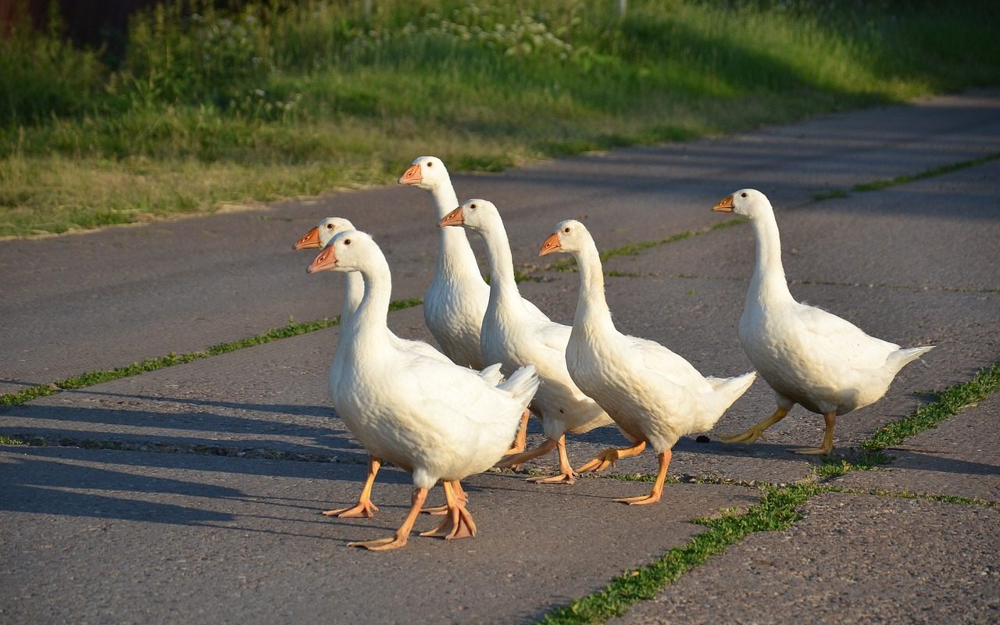
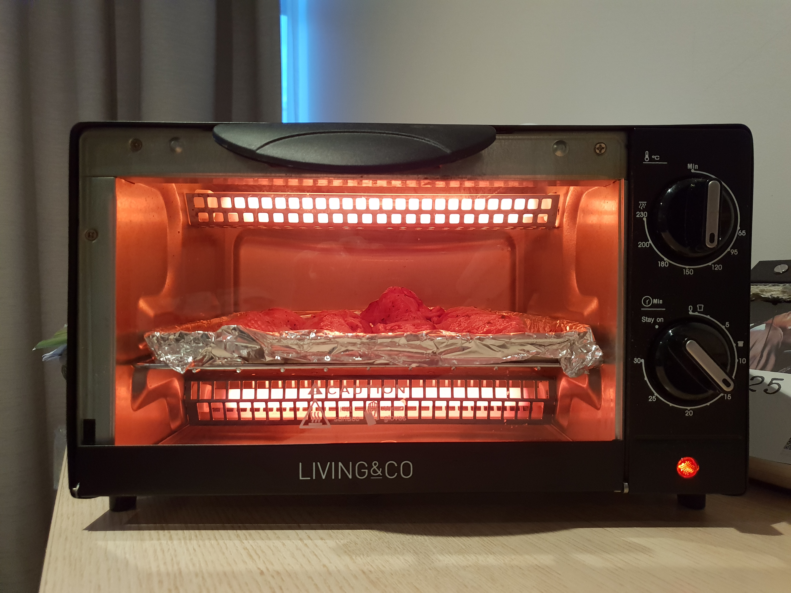

**Day204-205（2018年8月13日-8月14日，周一、周二）**

那个不会画图的智利小孩子又回来了，貌似他妈妈也来跟他一起上语言班了……明天再确认下坐我边上的是不是他妈妈。  
 铁打的营盘流水的兵，我看用来形容这类语言班最为贴切。

英国经济学家哥尔柏说过一句很有名的话：“税收这种技术，就是拔最多的鹅毛，听最少的鹅叫。”   
 传说房产税已经列入大一统国的立法规划，我实在弄不明白，这个国家没有一寸土地是属于我的，买的房子也只有七十年使用权（“产权”），即便是自动续期，可对个人来说依然不是“恒产”——随时可能被一纸条文收回或强拆。这种情况下，收房产税的立法依据何在？  
 再说，收房产税要解决什么问题？调控房价么？调控房价有N种更加合情合理的手段，精英们不至于蠢到想不到。惟一的解释是，以前拔的鹅毛都用完了，养鹅场又没有新的鹅加入，场主只好再拔一轮鹅毛。  
 鹅的毛快被拔光了，还要让鹅不叫，童话故事也不敢这么写。  
   
 今天研发新菜，烤鸡翅，大获成功——必须感谢上一届租客留下的小烤箱，尽管比较脏，让我花了15分钟清理干净。  
 托盘铺上锡纸，摆上Countdown出售的腌制鸡翅。温度调到150度，定时15分钟，然后翻了一次面，再烤15分钟。  
 
