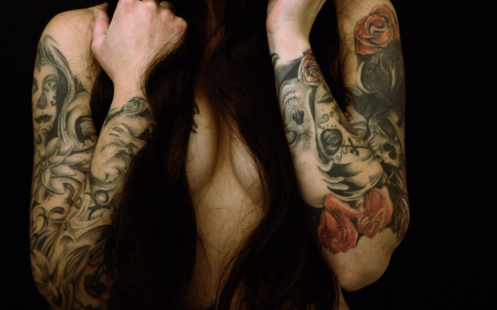

**Day206-207（2018年8月15日-8月16日，周三、周四）**

果然，我现在的同桌是智利小孩子的妈妈。哈哈，不知道和妈妈做同学是一种什么样的感受。

> 最近，天维网报道了一名女子因后背的文身申请加入新西兰航空遭拒绝，引起广泛讨论。  
>  在新西兰航空的官网上有明文规定：所有的工作人员在身着银蕨制服时，不得有文身裸露在外面。  
>  正因为这个规定，46岁的Lynley Baker在申请新西兰航空在陶朗加机场的一个客服职位时遭拒，原因就是她后背上一个文身会在她穿着新西兰航空的标志性制服时露在外面。对于这个规定，Baker表示很难接受，她这是一种带有歧视性的规定，应该废除。因为她觉得自己可以通过选择公司的其它制服或者用遮瑕膏遮住这个文身。  
>    
>  老外文身的现象还是比较普遍的。美国有一则调查数据显示，30%的美国人有文身。据估计85万新西兰人身上有文身。新西兰Otorohanga市市长Dale Williams，左手的手臂全是文身。  
>    
>  我从来没有觉得文身是美丽的，不论面积是大是小，不论是什么图案，我看到文身，第一反应是“皱眉”（心里）。然后就给对方直接打上“非我同类”的标签，即如果工作需要，我可以和你相处，但是其他时间我会敬而远之。  
>  假如我在面试的时候，看到求职者有文身，我肯定不会录用他（她）。这话听上去政治不太正确，但是我有我的理由：

1. 我无法事先了解我的客户对文身是否存在反感。在这种情况下，没有文身最好。
2. 我不想花钱聘请一个让我每天浑身不自在的员工。或许其他同事也有同感。

支持文身者，肯定认为我（某些中国人）对文身有偏见。其实你应该感叹自己不幸，生在了一个两种文化交替的时代。  
 中国社会的主流意识形态一直是汉族的儒家文化，儒家文化认为身体发肤受之父母，不可随便伤害。文身向来是尚未开化的游牧山野民族的代表特征，再加上这几十年大量影视作品将文身与黑帮紧密联系起来，于是文身的负面形象在大多数中国的人的脑海中是根深蒂固。  
 我当然知道，文身不是区分“好人”“坏人”的标志，文身这个行为不存在对或错。  
 所以，不是我对文身有偏见，而是主流文化在当前时期内还不接纳文身，和N多年前拒绝喇叭裤一样。我相信，随着时间的推移，中国文身的人也会越来越多。将来某一天，不文身反而会彰显个性。

最后我想说，既然你决定文身了，又何必在意主流文化的看法呢？只要他们不强制抹去你的文身就好。世界这么大，总有你和你的文身的一席之地。
