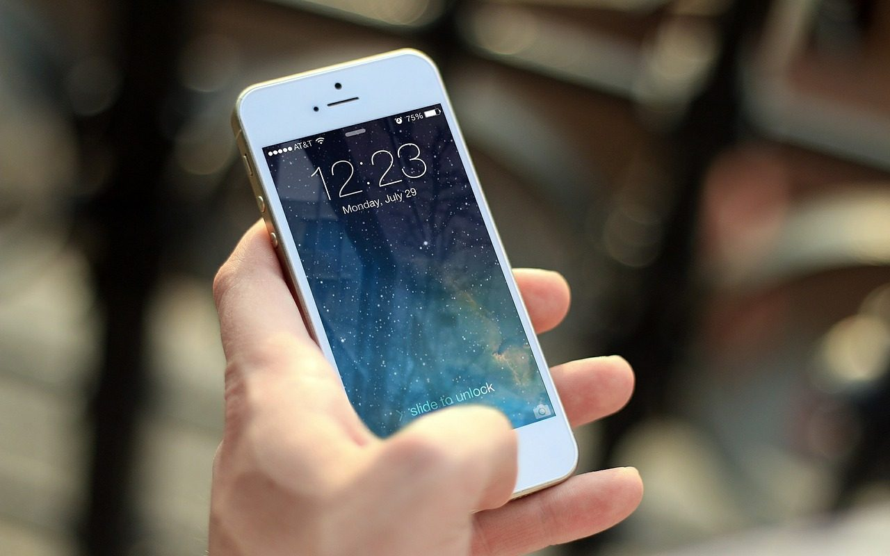

**Day222-223（2018年8月31日-9月1日，周五、周六）**

> 从今年9月份开学起，法国将实施一项新法规，禁止3至15岁的学生在校园里使用智能手机。一位法国母亲在谈到智能手机的使用资格时说，“孩子还不够成熟，有些成年人也不行。”  
>    
>  显然，这是一条防止未成年人玩手机上瘾的法律。令人哭笑不得的是，前两天中国则以预防未成年人近视为由，对网络游戏实施总量调控，其用意和法国差不多。  
>  在我看来，对网游实施总量调控和所谓适龄提示，除了增加政府的寻租空间，滋生更多的审批腐败，没有任何用处。
> 
> 
> 
> 8月30日周四晚间，教育部等八部门关于印发《综合防控儿童青少年近视实施方案》的通知显示，国家新闻出版署将对网络游戏实施总量调控，控制新增网络游戏上网运营数量，探索符合国情的适龄提示制度，采取措施限制未成年人使用时间。

好逸恶劳是人类的天性。尽管不是所有的电子游戏都是毒品，但是有的电子游戏一定是“香烟”、“酒”，甚至是“大麻”或“海洛因”，令人上瘾。  
 在现实世界中，我们无法禁止“香烟”和“酒”的生产和销售，不过我们通过立法，可以禁止向未成年人出售烟酒。  
 不要试图仅仅用“说服”来解决未成年人的网瘾问题，如果说服对大多数人有效，那么中国办一百所北大和清华都装不下学生了。  
 中国有个成语，形容小孩子的调皮，“三天不打，上房揭瓦”，固然有夸张的成份。可对于不能说服的未成年人，如今打又打不得，惟一的办法只有“上手段”，例如罚抄作业、没收玩具。谁都知道，对未成年人不加管教，一味放任自流，最后受苦的是家长自己。

法国立法禁止3至15岁的学生在校园里使用智能手机，给学校老师暂时没收学生的智能手机提供了法律依据。相比之下，中国的老师仍然会面临进退两难的尴尬，总不见得以预防近视的理由去“上手段”吧。
