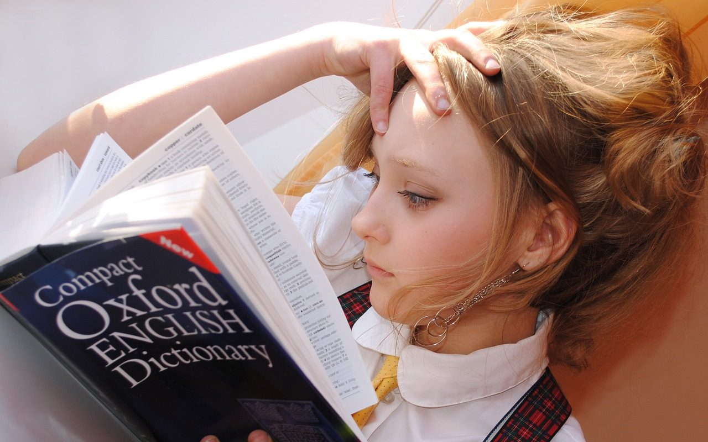

**Day232-233（2018年9月10日-9月11日，周一、周二）**

PETER的教学风格虽然比较活泼，批改作业也认真，但是我不认为他非常走心。如果我教外国人几十年中文，那我一定会了解外国人学中文时候的思维方式，积累一些适合外国人学语言的教学方法，主动帮助他们理解英语思维。

我们有时候会问出一些让他很惊讶的问题，他总问WHY：为什么你们会这么想？其实这有什么好问的，中国人学英语的思维方式就是这样。况且你又不是第一天教中国人英语。  
   
 昨天我在课堂上就跟他搞了一会儿脑子，关于“married”(形容词：已婚的)。  
 我问我能不能说：I've married.（我已经结婚了。）  
 他说不行，必须说：I'm married. 然后问我：你为什么要这样说？  
 我目瞪口呆。他以为我没理解词性，又解释了一番。  
 我想了想，回答说：marry是个动词，我用present perfect符合语法，没毛病。  
 他终于明白我的意思了。他说语法是对的，但是从来没有人会这么讲。  
 今天我继续追问：我能不能说 I‘ve already married for twenty years。（我已经结婚二十年了。）  
 他习惯性闭上眼睛说：你这样讲，除非你想表现出不情愿，讨厌这二十年的婚姻生活。  
 啊，那应该怎么讲？  
 I‘ve married for twenty years. 把already去掉。  
   
 I‘ve already married for twenty years.  
 I‘ve married for twenty years.  
 英语地道或不地道，差异就在这一词之间。当然，我不认为当我说前一句时native speaker（英语为母语的人士）会不理解我想表达的意思，如同我们能够理解老外说出中文“我结婚了二十年”所表达的意思一样。
