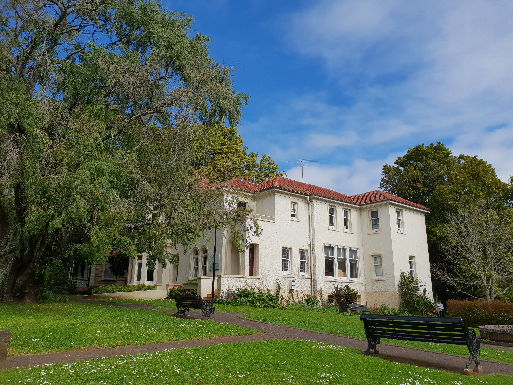

**Day242-243（2018年9月20日-9月21日，周四、周五）**

昨天上午PETER分析周三的试卷。这回不是我一支独秀了，一共有四个高分学生。因为下午去另一个语言学校体验半天，所以到目前我还没搞清楚我是不是第一名。  
   
 我去体验的那所语言学校叫做：Languages International（国际语言学院）

> 国际语言学院奥克兰校区位于奥克兰市中心，购物、娱乐和交通设施近在咫尺。 学院享有得天独厚的校园环境：三座古色古香的文物建筑坐落于漫林碧透的艾伯特公园之内。 学院与奥克兰大学也只是一路之隔，在这里无论是吃午餐，到书店寻找参考书，还是乘搭交通工具都非常方便。

国际语言学院也是我儿子留学新西兰的第一站，他在这里学了半年英语。它的收费标准比我现在的语言学校贵一倍。选择这所学校的一个重要原因是中国学生少。

看了我拍的这张校园照片，你是不是觉得贵一倍贵得有道理？地段！地段！地段！  
 



下午的课是12：50开始，分两节，每节1小时。我被安排到LEVEL 4。这个分级应该是这所学校自己命名，我儿子介绍说一共有8个LEVEL。我查了下，它的LEVEL4相当于欧洲语言共同参考框架下的B1-。  
 老师是菲奥娜·希里夫。班级里不算我，一共十一个学生，只有1个中国人。学校官网介绍平均每个班十一个学生，诚不我欺。  
   
 老师先让大家把昨天布置的作业“小作文”拿出来，与同学交换阅读。  
 小作文的主题是介绍一个餐厅，包括三个重要元素：氛围、服务、菜品。  
 交换阅读完后，老师要求大家把“小作文”钉在墙上，三个同学一组，边看边讨论，看完后说出自己最想去的餐厅以及原因。  
 说实话，我看到的作文全是白开水。这和非母语写作并没有太多关系，我经常跟同学们说，中文的作文写得好，英语的作文一定也写得好。当然这所谓的好是同一级别的横向比较，打个比方，在小学三年级的时候，我作文写得好，这是和三年级同学相比，和成人自然没法比。

我发现有篇小作文写了“上海1号”，上海的一个餐厅，于是我就找谁是作者。在十个来自不同国家的学生中识别出中国人不难，放学后我就直接问她，你是不是上海人，果然是上海人，还是会说上海话的上海人……老乡见老乡……要知道这年头，上海人不一定会说上海话哪，我儿子就是不会说上海话的上海人。  
 我问老乡：这里有没有教材，她从书包里拿出一本我从没见过的剑桥英语教材，反正我知道不是FACE2FACE。果然，收费贵有贵的道理  
 老乡来这所学校前，在另一所语言学校，每周290纽币。她对前一所语言学校非常满意，她说那里下午两节课都在锻炼听说。可惜那所语言学校因为挣不到钱，所以关掉了，她不得不转学到这里。  
 我问她你来新西兰又是为什么？她说她就是纯读语言。她说她在国内本科已经毕业，修的是影视专业，可是新西兰这里的影视专业（硕士？），只招收有工作经验的本科生，她想进修也不能。  
 我感觉有点奇怪，这么重要的信息出国前为什么不了解清楚？但是又不便追问。我猜测是：她原计划来留学，可是英语基础太差，雅思6.5短期内够不到，所以改变了留学计划，变成纯读语言。

回归正题。  
 撇开学校背景不谈，菲奥娜·希里夫的教学风格还是传统的，和教过我的Ewen和老太太属于一个教学流派的，中规中矩。PETER属于教师中的非主流：表演派。

小结如下：  
 “好学校”有不会教的老师，“差学校”也有会教的老师。  
 “好学校”的学习氛围相对好一些。收费贵隐含的一个道理是：好学的人愿意付出更多的钱来投资到学习中去，甚至为学习氛围买单。
