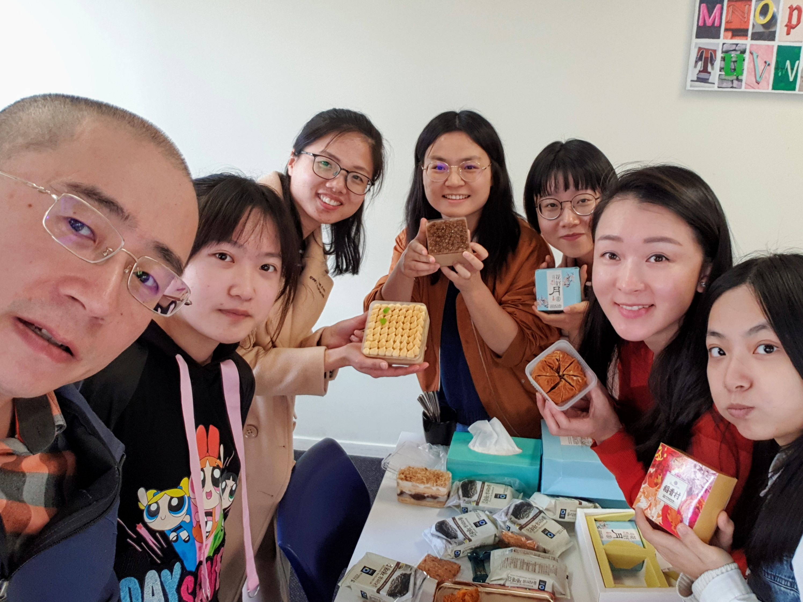

**Day246-247（2018年9月24日-9月25日，周一、周二）**

昨天是中秋节，我和另一个同学Maggie(下图右二)组织了一次茶话会。这是我生平第一次在海外过中秋节，估计也是最后一次吧。一不小心，做了一回党代表。  
   
 

2005年，钱学森向温家宝总理提出一个问题，后来被称为“钱学森之问”：为什么我们的学校总是培养不出杰出人才？比“钱学森之问”更为一般、更具准确性的问题是：相对于我们的人口规模，相对于我们的经济总量，相对于我们的教育投入，从我们的教育体制中走出来的具有创造力的人才为什么这么少？中国到目前为止只有1人获诺贝尔科学奖，中国内地至今还没有产生获得菲尔兹奖的数学家。我们缺乏创造性人才的原因是什么？具有创造性思维的人才通常具有哪些要素？  
 《超长待机的中国学生为何缺乏探索新知的能力？》一文试图解答“钱学森之问”。（[点击这里可阅读此文](https://mp.weixin.qq.com/s/OVm1oAXQb8hlSaKfPZYHeQ)）  
 文章写得看起来很有道理的样子，但问题是：皇帝有没有穿新衣，其实谁都看得到，需要动用教育家、科学家去研究这个课题吗？  
 中国学生缺乏探索新知的能力，根源不是中国人口的基因问题，也不是中国的教育问题，虽然表面看起来是。  
 请问，军队能培养出来探索新知的士兵吗？士兵天天学习创造性思维、批判性思维，问指挥官十万个为什么并且七嘴八舌出谋划策，那这个仗怎么打？  
 陈胜、吴广两位同学掌握了批判性思维，创造性地喊了一声：王侯将相，宁有种乎？一个王朝就被颠覆了。  
   
 大一统国，已经掌握了宇宙真理，根本不需要国民再探索新知……舵手说得没错：知识越多越反动。
