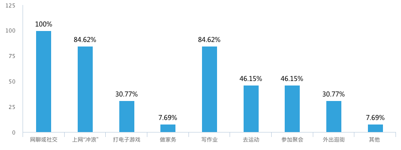
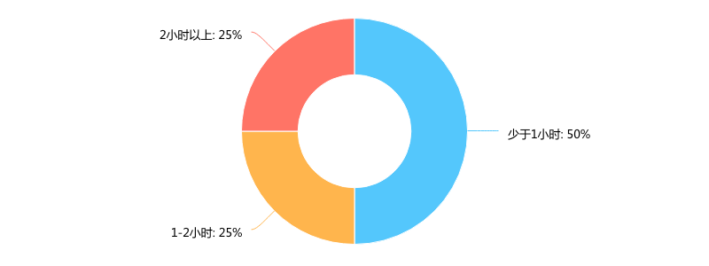
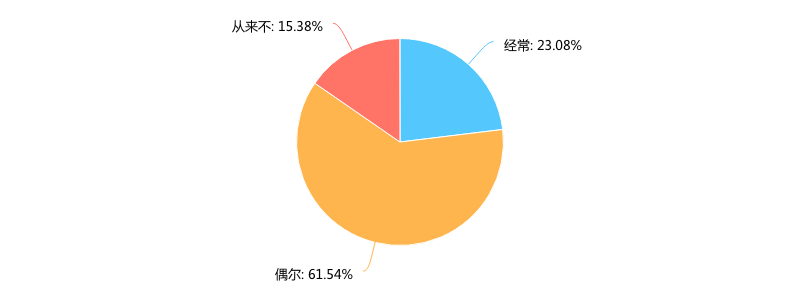
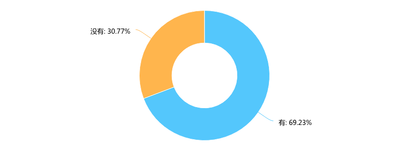
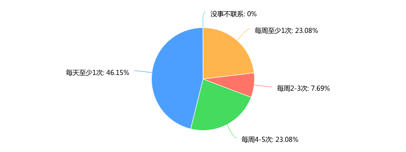
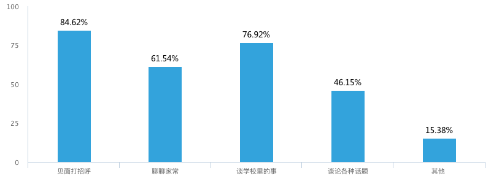
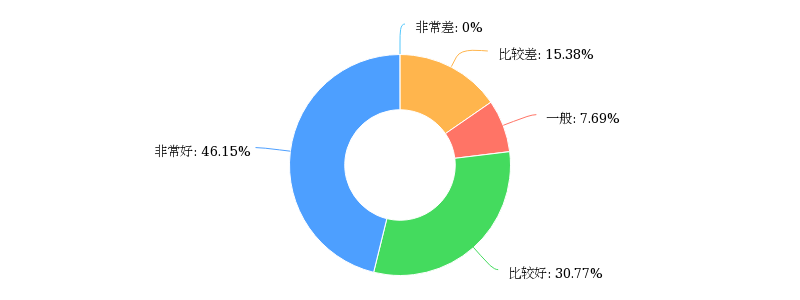
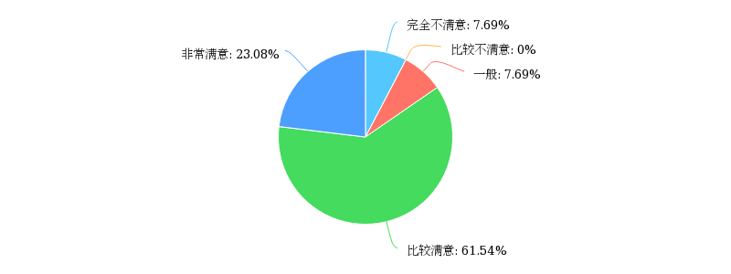
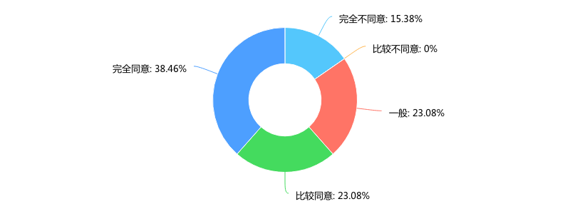
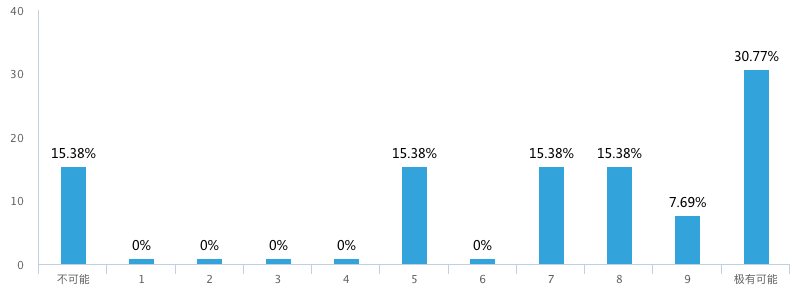

**Day254-255（2018年10月2日-10月3日，周二、周三）**

上篇用数据阐述了中国孩子在新西兰读高中又是一种什么样的体验？接下来，我们看看孩子们在这里的业余生活情况。

您在业余时间（包括周末）通常会做哪些事？\[多选题\]　　  
   
 这是一道多选题。可以看到，上网已经成为业余生活的“标配”，做家务的人很少——住HOMESTAY（寄宿家庭），也很少有家务要做吧。  
   
 请您对每天花在电子游戏上的时间做个估计　　  
   
 前一道题选择电子游戏的孩子，需要回答这道题。不过，我认为人们总是会低估自己在电子游戏上所花的时间。

您平时是否会感觉无聊？  
   
 从来不感觉无聊，代表着内心强大，这样的孩子占少数，也不奇怪。

在这里，您是否有知心朋友？  
   
 这个30%只是说孩子在新西兰没有知心朋友，不代表孩子在国内没有知心朋友。

您与家人的联系频度……  
   
 每天至少1次的占一半，倒是我始料未及的。

您与HOMESTAY（寄宿家庭）主人的沟通内容包括……\[多选题\]  
   
 这是一道多选题。“谈论各种话题”，会受到自身英文水平的制约。

您在HOMESTAY的睡眠质量……  
   
 总的来说，这里青少年的睡眠不是问题，很少有作业需要做到半夜12点。上次和一帮孩子出去旅游，有几个嚷嚷着要写论文作业，晚上没法睡了，非常悲壮……我最终也不晓得他们写了没有。

您对HOMESTAY提供的日常饮食……  
   
 总体满意度为80%。对寄宿家庭来说，让孩子寄宿是个贴补其家用的生意，因此在日常饮食方面，会尽量令孩子满意，避免“客户”不满意而流失。

HOMESTAY在学习和生活上给予您很多帮助……  
   
 这个结果还是符合二八定律的。

如果其他同学正在找HOMESTAY，您向他们推荐当前这家HOMESTAY的可能性有多大？  
   
 这是一道NPS量表题。69.22%的同学选择了满意（7-10分）。选择0分的，说明他对当前HOMESTAY非常不满意。出现这种情况，孩子可以向校方提出更换HOMESTAY的要求，当然，他必须提出令人信服的理由（证据）：比如HOMESTAY的主人晚上经常不回，要孩子自己解决晚上的伙食，又不退给孩子钱。（晚餐费本来是包含在HOMESTAY费用中的）

净推荐值（NPS）又称净促进者得分，是一种计量某个客户将会向其他人推荐某个企业或服务可能性的指数。它是最流行的顾客忠诚度分析指标，专注于顾客口碑如何影响企业成长。通过密切跟踪净推荐值，企业可以让自己更加成功。  
 确定您的净推荐值是直接了当的：问您的客户一个问题－“您是否会愿意将“公司名字”推荐给您的朋友或者同事？”  
 根据愿意推荐的程度让客户在0－10之间来打分，然后你根据得分情况来建立客户忠诚度的3个范畴：

- 推荐者（得分在9－10之间）：是具有狂热忠诚度的人，他们会继续购买并引见给其他人。
- 被动者（得分在7－8之间）：总体满意但并不狂热，将会考虑其他竞争对手的产品。
- 批评者（得分在0－6之间）：使用并不满意或者对你的公司没有忠诚度。
