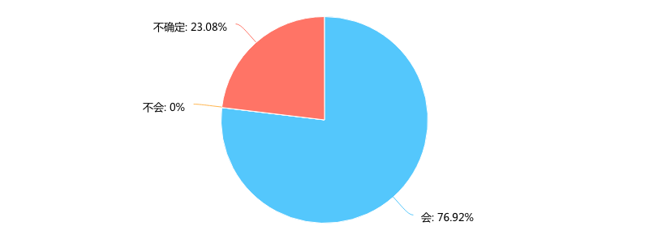
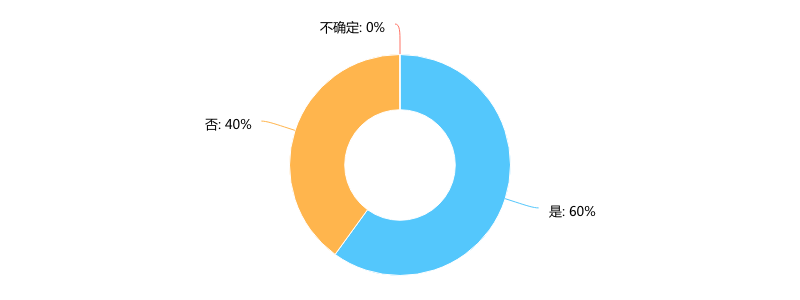
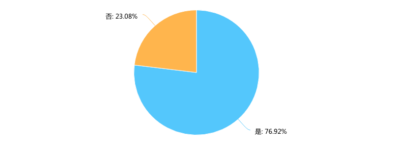
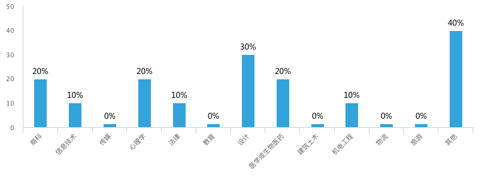
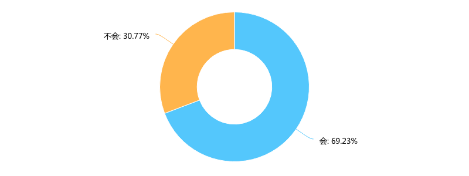

**Day256-257（2018年10月4日-10月5日，周四、周五）**

中国孩子在新西兰读高中又是一种什么样的体验。  
 今天是最后一篇，我们看看孩子们对未来有什么设想。

您是否会在新西兰上大学？  
   
 有23%的孩子，不确定将来是否会在新西兰上大学。

大学毕业后是否倾向于留在新西兰？　  
   
 确定在新西兰上大学的孩子中，有40%在大学毕业后不倾向于留在新西兰。

您是否已经考虑过进大学后的专业方向  
   
 仍然是23%的孩子，没有考虑过进大学后的专业方向。

您的大学专业方向是……\[多选题\]  
   
 这是一道多选题，最多三项。其他需要被调查者手动输入，我查看了后台，填写的是“数学”“兽医”“科学”。“兽医”可归入“医学或生物医药”。这样的话，最受欢迎的两项是“设计”和“医学或生物医药”。

假如上天再给你一次机会，时间退回到出国前，您还会选择来新西兰留学吗？  
   
 我还没有问过填“不会”的孩子为什么选择“不会”。就我在语言学校观察到的情况来推断，孩子们不想再选择来新西兰留学，应该有两个因素，一是这里不如中国繁华热闹，二是缺少合适的玩伴，毕竟中国同学还是少数。

微信询问了一个小朋友，她给出了一些理由，【】里是我的话：

- 不适合年轻人【我儿子说适合养老】
- 生活节奏慢到令人崩溃【我的感觉恰恰相反，慢一点，挺好的】
- 种族歧视逐渐变强【我相信种族歧视肯定存在，变强？我不知道】
- 物价xxx贵【这个小朋友挺持家】
- 网速慢得上天【我不打游戏，没感觉】
- 很多事效率低(eg一堆地方周末不上班，比如银行和快递)【即生活节奏慢】
- 大学的知名度……【肯定不能和美国比】
- 加一个治安问题，朋友和她叔叔晚上开车回家被人砸车……←\_←【这种事在中国也常见】
