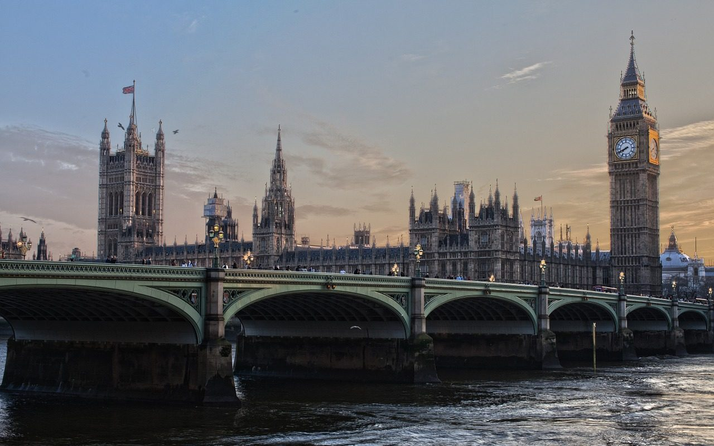
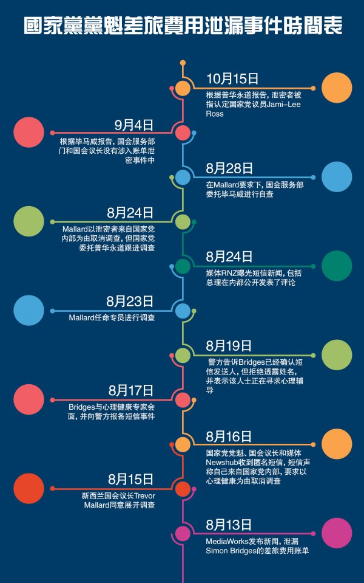

**Day266-267（2018年10月14日-10月15日，周日、周一）**

14日是我48岁的生日。12日（上周五）花55刀买了只生日蛋糕，在教室里庆生，几个同学合伙买了瓶红酒送给我，挺好，省得我买酒啦。  
   
 

方才看了一个新西兰先驱报中文网的新闻，我弄得一头雾水，搞不清到底是新闻报道的角度有问题还是事件本身有问题？大概是这么个情况：

10月15日，国家党在奥克兰天空塔召开新闻发布会。新西兰史上最年轻的国会议员Jami-Lee Ross被指认为泄漏党魁的差旅费用的“元凶”，但这位“85后”愤怒否认了指控。  
 事件的起因是：  
 8月13日MediaWorks提前曝光新西兰国家党党魁Simon Bridges过去三个月的旅行开支。开支显示Bridges的费用超过10万纽币，其中8万纽币都用于租用豪华加长轿车。  
 整个过程可以看这张图：



我的一头雾水是：为什么大家这么关心是谁泄的密而不关心被泄密的差旅费费用是不是合理？毕马威和普华永道这两家会计师事务所什么时候变成侦探事务所了？  
 我特地询问新西兰先驱报中文网的记者：国家党党魁的差旅费到底是党员交的党费？还是纳税人的钱？记者说是纳税人的钱，她请我关注后续报道。  
 那答案不是很明摆着的吗？保护纳税人的利益高于一切，去追查举报人干吗？除非举报内容不实。如此积极地追查举报人，只能解释为党同伐异。看来不管东方西方，人性的恶是一致的。  
 不同的是，西方政治体制的运作相对透明，能够抑制人性之恶的危害。而在大一统国，统领百万警察的头头都能瞬间失踪，若是出个举报人泄露党魁的公款消费金额，还能让他多活2个月？
