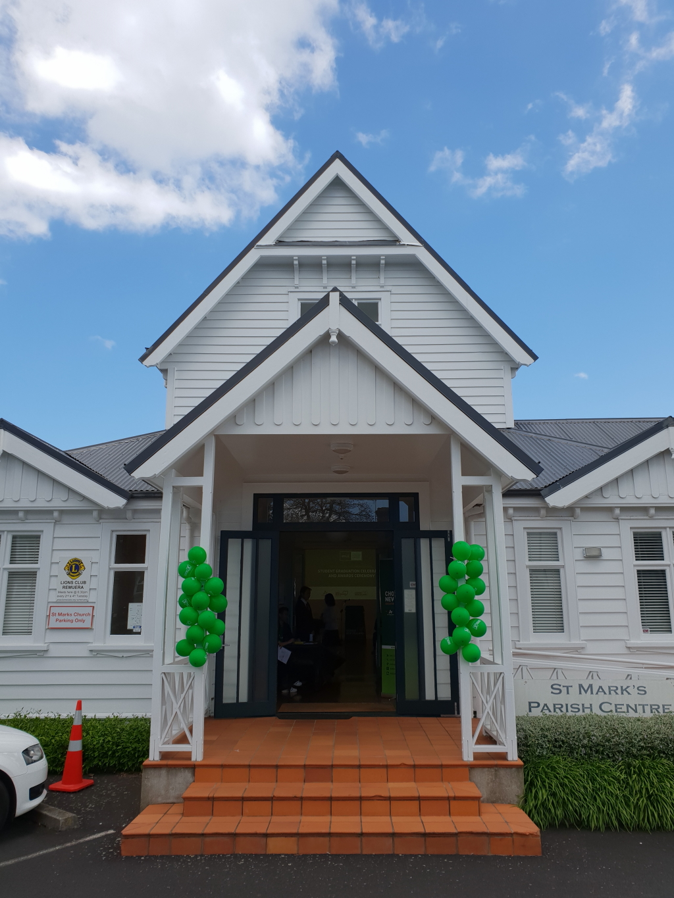
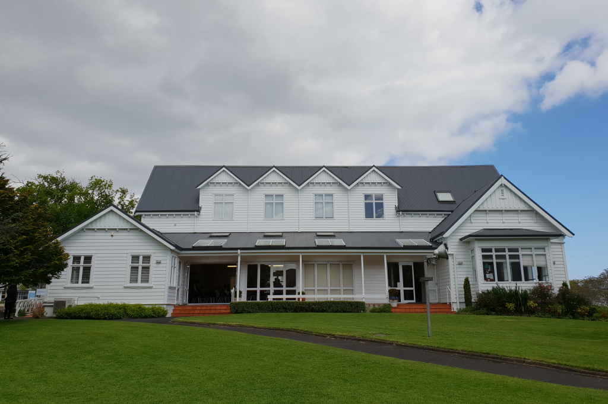
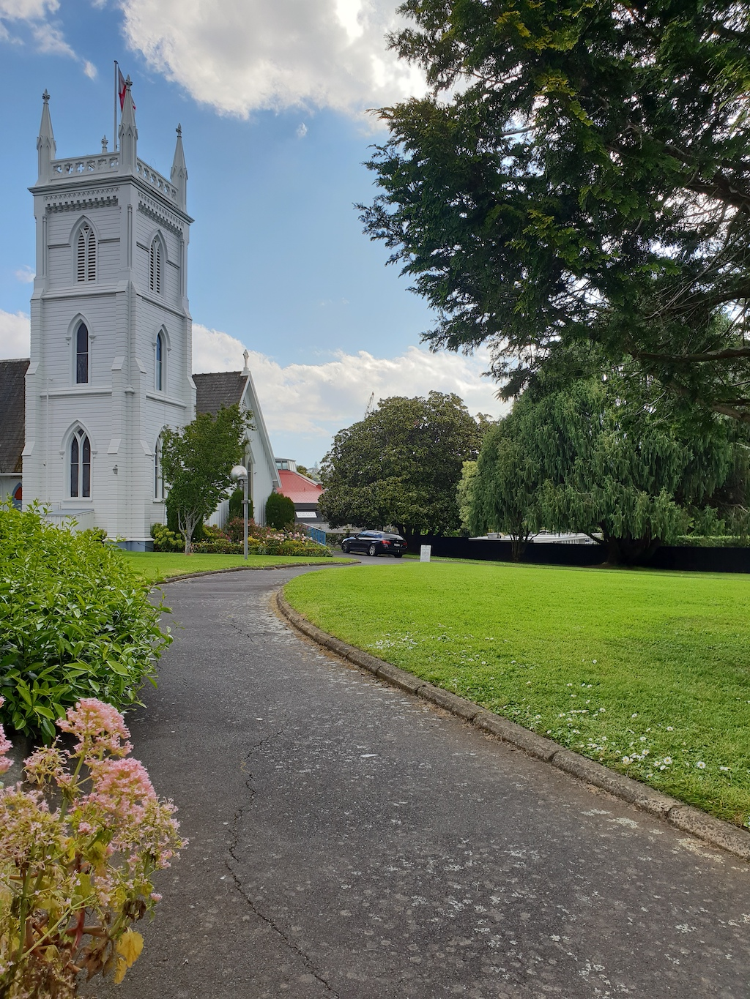
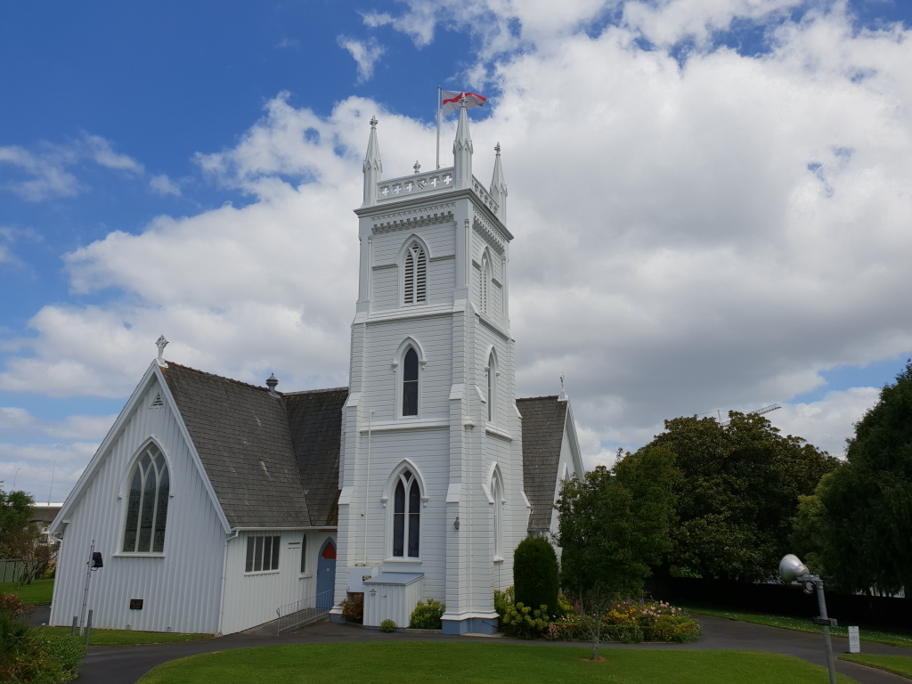
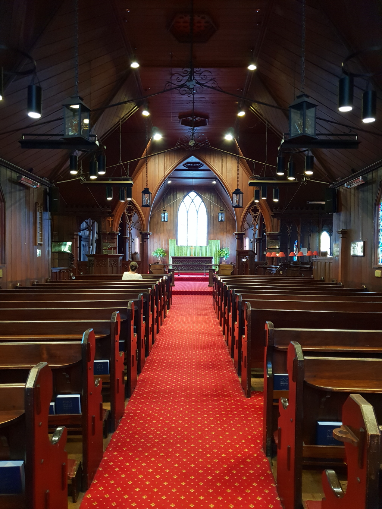
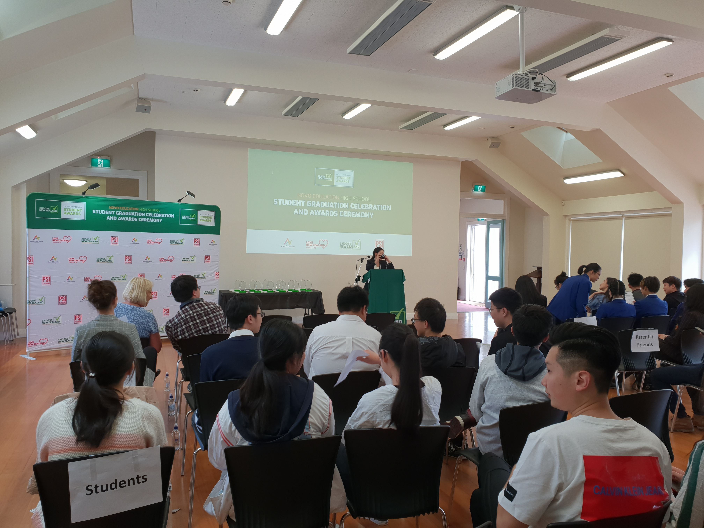

**Day272-273（2018年10月20日-10月21日，周六、周日）**

周六，David的公司（Novo教育）为他们服务的学生们举办了一个盛大的颁奖典礼。出席典礼的除了学生，还有学校的老师和几个像我一样在新西兰的陪读家长。  
 典礼之于Novo教育的意义，是他们三年工作的一次总结汇报，三年前他们开始涉足低龄留学市场——服务初中毕业生，三年后这些学生即将高中毕业。  
 这样的场面，上台发言的，没有不提前准备讲稿的，除了一个菲律宾裔的男老师。　　他结合自我成长，鼓励孩子勇于尝试，不断努力，克服困难，发现自己的兴趣和天赋所在。  
 这位老兄不是很高，但很壮实，穿着休闲西装，上臂部分像充了气一样鼓鼓的，有随时爆裂之感。 我正揣测他是不是运动员出身，他讲话就提到自己12岁开始打篮球，16岁因为受伤不得不放弃成为篮球运动员的梦想。  
 由于他是即兴演讲，一讲一大段，边上的翻译人员就有点犯难，只能翻个大意，而且我怀疑翻译人员考虑到国内家长在收看直播，故意遗漏他提到玩电子游戏的一段。  
 代表学生发言的是平时活蹦乱跳的假小子，先用英文发言。估计她已练习多时，有个段落居然一口气念完，引发全场鼓掌。她的中文发言里有一句话，令我印象深刻：本以为新西兰是诗和远方，来了新西兰，发现只有远方没有诗。  
 可以理解。一个走马观花的旅行者，眼睛看到的都是风景，脑海中充斥的当然都是诗。而独在异乡为异客的留学生（或移民），面对的是全然陌生却又必须去熟悉的学习、工作、生活环境，和人（英语）沟通都有困难，怎么可能还有诗？

会堂正门  
 

会堂的外景  
 

会堂旁边有一个教堂，外观有点像童话城堡。  
 

教堂外边看起来不大  
 

教堂里边可不小，还挺深  
 

典礼现场  
 

获奖学生，后排右二是我儿子
