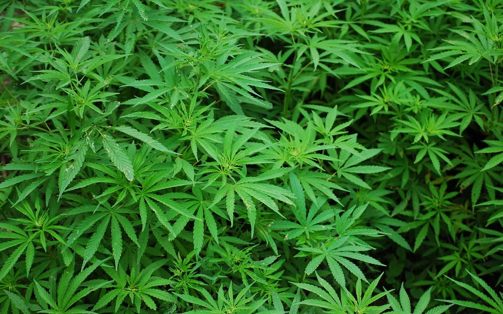

**Day278-279（2018年10月26日-10月27日，周五、周六）**

周四，我边上坐了个来试听课的小伙子，22岁，成都人，来新西兰上学已经有五年了。他自称在这里上过高中、预科，LEVEL 6（相当于大专？）已毕业，需要雅思成绩报考大学。我说你要考雅思，直接去报雅思班好了，来这种班做什么，纯粹浪费时间。依我看，这也是个浑浑噩噩的主。

加拿大的“大麻合法化”，一石激起千层浪，一些微信营销号传递的信息，让人有世界末日的即视感。我曾以为新西兰早已实现大麻合法化，事实并没有，听说2019年新西兰会就大麻合法化一事做全民公投：代理总理Winston Peters在Newstalk ZB节目上告诉主持人Mike Hosking，决定大麻是否应该合法化，取决于公众而不是政府成员。  
 医学不是我的专业，大麻对人类身体究竟有多大的危害，我不知道。专业的人做专业的事，既然荷兰可以容许大麻，那么就说明大麻对身体的危害是可被接受的，不会比香烟和酒精高太多。再说，我不抽烟、不酗酒，别说大麻合法化了，就算海洛因合法化，跟我也没半毛钱的关系。  
   
 知乎网友介绍：  
 注意，大麻在荷兰并不是legal的，而是tolerated。荷兰制定的关于毒品的政策主要有四个目的：

1. 阻止精神性药物的使用，治疗和康复上瘾者
2. 减少对上瘾者的伤害
3. 减少上瘾者对公共秩序和公共安全的干扰
4. 打击生产以及贩卖精神性药物

这便是以荷兰为代表的以“公共卫生 (public-health-oriented)”为导向的禁毒模式。相比之下，其他大多数国家采取的是以美国为代表（包括我国在内）的以“司法惩治(punitivecriminal-justice-oriented)”为导向的禁毒模式。

荷兰的禁毒模式下产生的最著名的制度便是咖啡馆模式（coffeeshop system），即政府批准咖啡馆合法地出售允许个人使用的哈希什和大麻。在荷兰公共检查院2001年1月1日颁布的规定下，咖啡馆只要遵守如下规定，它们将不会因出售大麻而被起诉：

1. 向每人每天出售的大麻不得超过5克；
2. 不得出售迷幻药或硬性毒品；
3. 不得为毒品打广告；
4. 必须保证在其附近没有滋扰行为；
5. 禁止18岁以下的人入内或向其出售毒品。

加拿大作为北美教育优质大国，赴加拿大高中留学的学生日益增多。加拿大的大麻合法化，经过微信营销号一系列文章的煽风点火，让中国的家长着实大吃一惊，差点以为留学的孩子掉进毒品窝了。今天反海外谣言中心发表[《细数“加拿大大麻合法化坑中国人”系列文的硬伤，营销号别啥事都往中国人身上扯》](https://mp.weixin.qq.com/s/7nFs4Z0ys0lUsrQwCgmn6Q)一文进行辟谣：

大麻食品在加拿大，目前并没有合法化，它的合法化或将在大麻合法化的一年内；即便合法化了，也有专卖许可证制度与包装规范，而且相当贵，你无法“随便”地买到大麻食品，更不可能“不知情”地买到。

相信大家从小到大没少听这句话：“规定是死的，人是活的”。所以，“未成年人不得入内”“禁止向未成年人出售烟酒”，在中国，就如同“富强、民主、文明、和谐”一样，是刷在墙上仅供观赏的一句口号，当不得真。

这也是中国家长对“加拿大的大麻合法化”心生恐惧的原因之一，未成年人会不会因此能“随便”地买到大麻或大麻食品？

但凡在这些国家有些生活经验，就知道这种担忧大可不必。以烟酒为例，店家对购买者的年龄稍有不确定，就会要求购买者出示身份证明。

去年12月，我和我儿子在超市购物，购物篮中有一瓶红酒，自助结帐时，刷到红酒条码，机器立即弹出提示信息且闪烁红灯。不一会儿，工作人员走过来确认，要求我儿子出示身份证明。他已是成年人，只是看起来不像。

那天不巧，我儿子没有带护照，他介绍说这酒是我爸爸买的，我马上点头称是，说：“He's my son.”（他是我儿子）。工作人员上下打量我一眼（看我们父子长得像不像？），没说什么，刷卡放行。

出来后，我问儿子：为什么她要盘查得这么仔细？他说是防止未成年人买酒，临时拉个陌生的成年人来帮着结帐。
