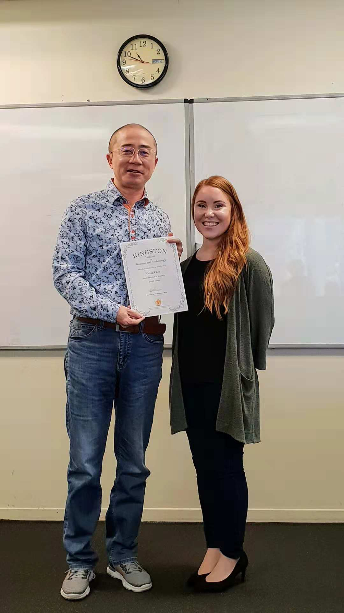
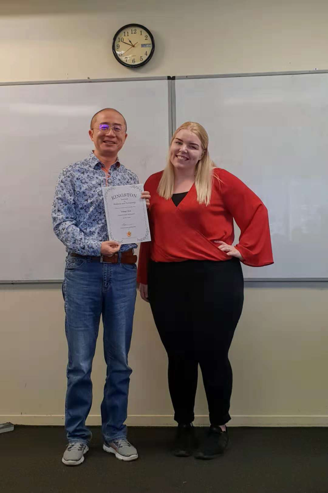

**Day292-293（2018年11月9日-11月10日，周五、周六）**

经过40周的英语学习，11月9日我“毕业”了。凑巧的是，这也是Maynah在Kingston工作的最后一天，她准备回美国去。  
接下来是我的旅游季，直至11月29日回国。期间我还会更新本系列文章，但不承诺更新频率。

Maynah与我合影  


Ewen与我合影  


胖妹子与我合影  


前天读到一篇文章《一位16岁留学生的自白：我的勤奋，激怒了美国的寄宿妈妈》，不免有点惊诧。[点击这里可阅读全文](https://mp.weixin.qq.com/s/4h-V0oFAD7pl7EsYpDCVFg)。

我的看法是，这个寄宿家庭的妈妈，个人存在着一定的心理问题。不过东西方文化隔阂、思维方式的不同引发的一些矛盾，却不是“心理问题”四个字能抹去的。

如同我们不理解西方人的“懒散”一样，西方人一样不理解东方人的“勤奋”。  
以前我不理解西方（或非西方）国家为什么要“排华”，曾简单归咎于“种族歧视”、“弱国无外交”，后来慢慢了解到，华人被排挤的主要原因是吃苦耐劳，极端能忍（从来不罢工）。  
牺牲个人权益的“吃苦耐劳”，在中国是司空见惯。但到了西方国家，为何就变得讨人嫌？我开玩笑说一句：上帝花了六天创造世界，到第七天都休息了，你们华人为什么不休息？  
有人说牺牲个人权益只求温饱是我的人生选择，我心甘心愿拿最低工资，心甘情愿不休息并且放弃加班费。嗯，快跑的马儿吃得少，资本家当然举双手双脚给你点赞。  
可是你有没有想过今天看似天经地义的八小时工作制的由来？这可是西方世界的工人与资本家经过长期艰苦卓绝的斗争乃至付出生命赢得的。背后的工作伦理是：只有好好休息，才能避免人们憎恨劳动，所以缩短工时、增加休闲娱乐时间，反过来促进人们勤勉工作。

> 1866年，第一国际日内瓦会议提出八小时工作制的口号。1886年5月1日，以美国芝加哥为中心，在美国举行了约35万人参加的大规模罢工和示威游行\[1\]，示威者要求改善劳动条件，实行八小时工作制。5月3日芝加哥政府出动警察镇压，并向人群开枪，打死了四个人，受伤者无数。这件事引起了整个芝加哥城沸腾，各工会决议于5月4日在干草市广场举行群众大会，约2,500名劳工，情绪虽然激昂，过程却非常和平。一场突如其来的大雨将群众淋得只剩两百多人左右。正当劳工正要开始收场时，忽然开来一队180名全副武装的警察，将现场包围起来，命令他们马上解散。就在双方在争论的时候，突然发生了爆炸事件，场面顿时大乱。在黑暗中，警察向群众开火，人们四处逃窜。 共计有十名劳工当场被打死，而警察也因彼此误射而死伤惨重，这就是历史上闻名的“干草市广场惨案”。  
> 事后警察与新闻界一口咬定是无政府主义者丢的炸弹，要求处以极刑。因此，警方大事逮捕劳工领袖，最后以谋杀罪起诉八个人。其中有五个人那晚根本没到会场，只不过他们都是工会运动的活跃份子，警方正好借机一网打尽。  
> 审判最后，除了一人被判十五年外，二人被判无期徒刑外，五人都判死刑。 而其中的一位工运领袖奥古斯都.史比司（August Spies）在临刑前说：“总有一天，我们的沉默 ，会远比今天你们所要压制的言论更为宏亮有力！”。直到1889年，为了纪念这段壮烈的历史，在巴黎举行的第二国际成立大会通过决议，将5月1日定为国际劳工节，要求各国的劳工共同努力，为八小时工作日而奋斗。今日有“干草市场烈士纪念碑”（Haymarket Martyrs' Monument）以纪念此事殉难者。  
> 美国直到1935年罗斯福总统执政时，八小时工作制定于法律中才予以确立。

八小时工作制，也是中国的法律。1994年7月5日，八届全国人大常委会第八次会议通过了《中华人民共和国劳动法》，将8小时工作制上升为法律。第三十六条规定，“国家实行劳动者每日工作时间不超过8小时，平均每周工作时间不超过44小时的工作制度。”  
既然是法律，就应该遵守。若有人不遵守，而从中受益，守法者的利益势必受到损害。假如政府执法不严，那么结果就是八小时工作制形同虚设，所有劳动者最终都沦为奴隶。

> 2017年，在阿根廷La Pampa省，华人超市业主们在星期天照常营业的做法被控违反了“周日休业法”。按照上述法律要求，在La Pampa省内所有超过40平米经营场地的商家，都必须遵守星期天开业及歇业的时间规定。  
> 当地商会主席达里奥·菲佛(Darío Pfeiffer)对此表示：这种违法行为导致了当地商家的不当竞争，致使有些人受益，而那些守法的人却遭受经济损失，甚至可能造成就业岗位的减少。
