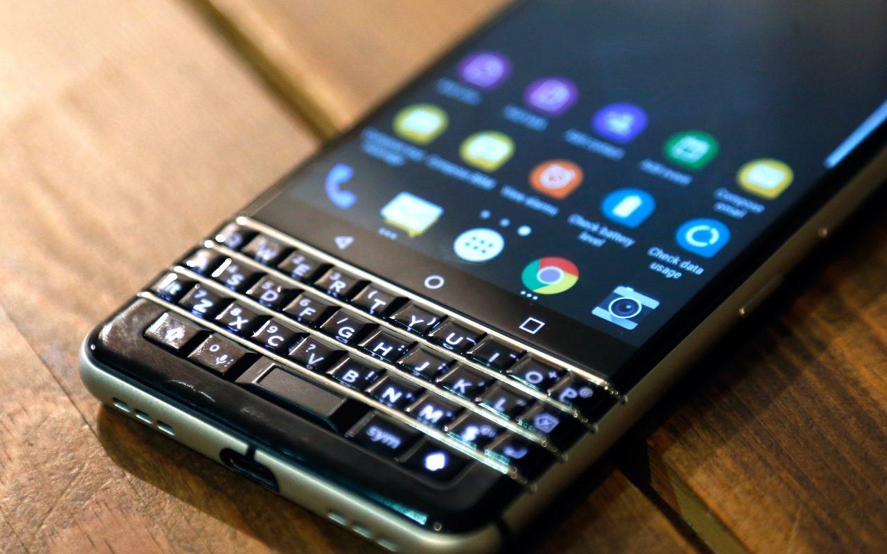
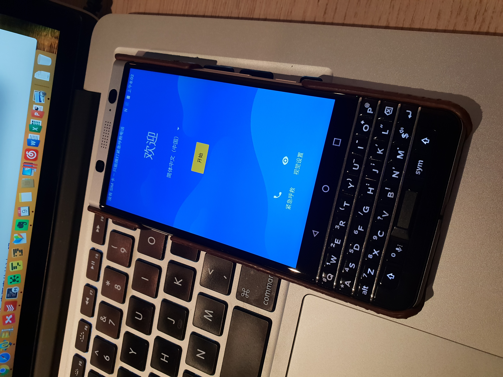

**Day202-203（2018年8月11日-8月12日，周六、周日）**

忘记说了，本次大考，我得了LEVEL 3的第一名，继续保持了“学霸”地位。而这届LEVEL 2全军覆没，没有人能够升级到LEVEL 3。  
   
 继体验新西兰网购之后，我再接再厉，不过这次转变角色，我成了卖家——在Trade Me上卖掉了我黑莓手机（BlackBerry KeyOne）。  
 周五晚上放到Trade Me，标价298纽币，没有配件。这款机型整个网站只有3台，其他2台是新的，642纽币。  
 周五晚上有四个人在线咨询，其中一个越南人（后来知道的）很爽气地拍下。网站当场就收取我7%的手续费，然后提醒我自行安排交易。  
 到目前为止，我尚不清楚网站有没有类似“支付宝”一样的服务，就是买家先把钱打给网站，买家确认交易完成后网站再打钱给我。我上架的时候，选择的是“发货待定“，意思是双方商量着办。  
 越南人迅速发邮件给我，他解释他现在用的是BlackBerry Priv，想升级换代。  
 把2015年出品的BlackBerry Priv当主力机的，可是真“莓粉”啊！我们来回沟通了几次，交换了手机号，改用短信联系。我原来的计划是帮他安装好谷歌全家桶，明天上午交易。  
 凑巧的是，我们住得很近，他出门到我楼下只要5分钟。他迫不及待要求马上交易，那时已经晚上11点了。我考虑了下，公寓楼下大堂晚间出入有门禁，又有监控，应该不会有安全问题，便答应了。  
 买家是个小伙子，挺白净，戴副眼镜，书生气十足，彻底颠覆了我对越南人的印象。我本以为越南人都是矮矮瘦瘦，黑不溜秋。  
 交易非常顺利。他验机无误，给了我300纽币。我说没零钱找，他说不用。我说我们大概创下了Trade Me上最快的交易记录。哈哈哈哈。  
   
 此处放上BlackBerry KeyOne“遗照”。　　　　  
 

卖掉BlackBerry KeyOne当然不是为了在新西兰体验当卖家的滋味，而是因为我在这里买了一台三星S9，无它，只为追求Android（安卓）“血统”的纯正。或许你会感到奇怪，安卓不就是一个手机操作系统吗？全世界都一样，何来纯正不纯正一说？  
 事实并非如此，国内生产销售的安卓手机，由于不可描述之原因，对安卓全部进行了“阉割”，术语叫做“深度定制”。后果之一就是预装一堆APP、自启动、静默安装、相互唤醒，内存越来越不够用，系统越用越卡顿。  
 之前我用安卓手机，一般都要重新解锁刷机，翻墙安装谷歌的“全家桶”（一堆服务的昵称）。现在有些国内厂家比较良心，只对系统做轻度“阉割”，安装一个APP后，也能安装上谷歌的“全家桶”，当然得先翻墙再安装。这样的系统，我总觉得“血统”不够纯正。

有的人觉得谷歌的“全家桶”费电，翻墙要花钱，再说翻到墙外也没啥好看的。国外有的，咱们也都有。百度有莆田系，不代表不能用啊，平时长点心眼就是了。我觉得这话也没错，对于大多数人来说，没有翻墙的需求。  
 这事就变得很吊诡，一座风景如画的公园，既然多数人都没有进去的欲望，那为什么要建一堵墙挡在那里不让人进去呢？  
 还是应该换个角度想？一所监狱，四周的墙建得高高的，监狱里生活还不错（像新西兰的奥塔哥监狱），于是大家反而不关心自由，更没有了越狱的想法。  
   
 我为什么要翻墙？借用一个网友的话来说：**我不是偏要看什么，我只是不想被代表，我不想被思考。**
