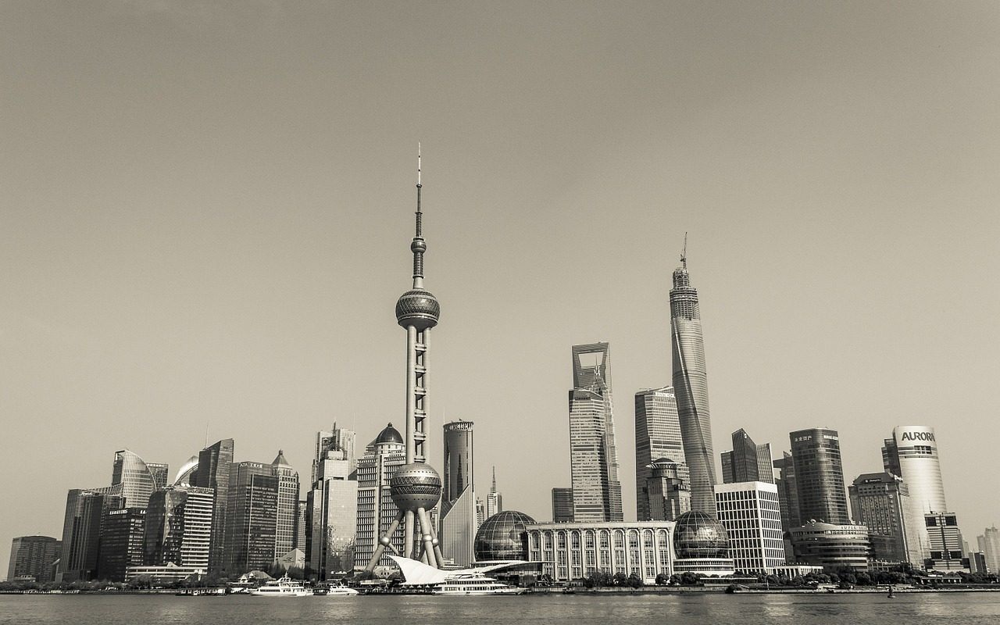

**Day214-215（2018年8月23日-8月24日，周四、周五）**

公寓抽水马桶漏水的事，困扰我很久。公寓用水是免费的，不过长期浪费总是于心不安。我昨天叫房东来看了看。  
 这里抽水马桶水箱里没有铁锈，不知道是配件质量好还是水质好。水箱里的配件与国内常见的完全不一样，看起来是一个不可拆分的整体。房东说这种结构虽然好看，但不如国内的那种结构易于维修，整体更换很贵，大概要两百纽币。他动了动某处，又不漏水了，估计是控制进水的配件复位存在问题。  
 结果是，现在我如果发现漏水，就打开盖子去手动“操作”下，将就着使用。

记得某人曾经说过：中国至少需要被殖民三百年。  
 出生与浙江杭州的孙杨肆无忌惮、屡次践踏“契约精神”，对比出生于上海的姚明为运动员颁奖时阻止其露出个人代言品牌，对商业文明的认知高下立分。孙杨都不配给姚明提鞋。  
 我无意于搞什么地域歧视，我只说一个事实：上海的商业文明向来是傲视全国的，这必须归功于被国人视为屈辱的殖民史。“上海1843年开埠，这个城市本身就是全球化的产物，没有全球化，就没有上海。”

> 8月19日，孙杨获得男子200米自由泳金牌。身着黄色的361°外套的孙杨似乎与获得男铜牌的季新杰白色安踏领奖服有些格格不入。  
>  据悉，361°既是孙杨个人的赞助商，又是中国游泳队的赞助商。同时，361°还是本届亚运会的服装赞助商，以及亚奥理事会的赞助商。而本届亚运会，中国代表团的领奖服官方赞助商为安踏。  
>  安踏方面发声，表示一套领奖服不止于成绩更是国家形象，规则和底线不容辱没。  
>  孙杨未对此事正面回应，但在20日晚结束的亚运会800米自由泳比赛中，再夺冠军的孙杨更换了安踏的领奖服，但身披五星红旗入场，胸前的安踏logo也用五星红旗贴纸遮住。  
>  8月21日晚间，登上男子400米自由泳领奖台的孙杨又有了新花样——用吉祥物遮挡右胸处的安踏logo。颁奖仪式结束后，孙杨还用国旗裹住了身体，并首次对领奖服风波时做出正面回应：“这种事对我来说，已经见怪不怪了，真的，小事情，不会影响我。”  
>  对于该事件，《体坛周报》副总编杨毅第一时间表态，在他看来，一名中国运动员在领奖台上身穿和其他中国运动员完全不同的服装，在近代奥林匹克运动建立起自己的商业体系和规则之后，这是前所未见的，是完全无视规则和契约精神的特例。
> 
> 
> 
> 在刚刚结束的全运会男篮成年组决赛颁奖仪式上，一段视频引发热议，中国篮协主席姚明在给冠军辽宁队颁奖时，要求郭艾伦和周琦把衣服拉链拉上才为他们颁奖。  
>  姚明要求两人拉上拉链的举动与注重仪容仪表无关，而是因为两位球星郭艾伦和周琦在庆祝时有意无意将外套拉链大幅度拉开，令他们各自代言的品牌标识醒目露出，显然，这有损辽宁代表团官方赞助商的利益。  
>  所以姚明在给他们两人颁奖时，没有直接把金牌戴到他们的脖子上，而是表情严肃地低声要求他们 “把拉链拉上”，等到这两名球星按要求拉上拉链后，姚明才为其戴上金牌。姚明的举重若轻避免了又一则有关品牌暗战的负面新闻被扩大，也是姚明以老大哥的身份给郭艾伦和周琦这批中国篮球新生代、甚至是中国体育新生代上的 “生动一课”。
