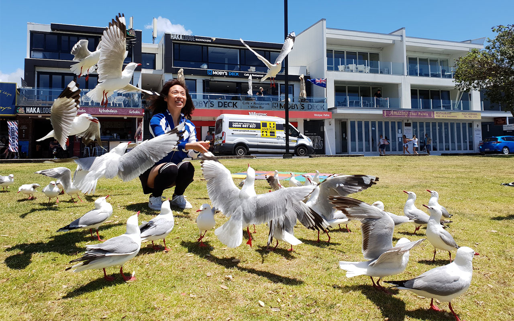
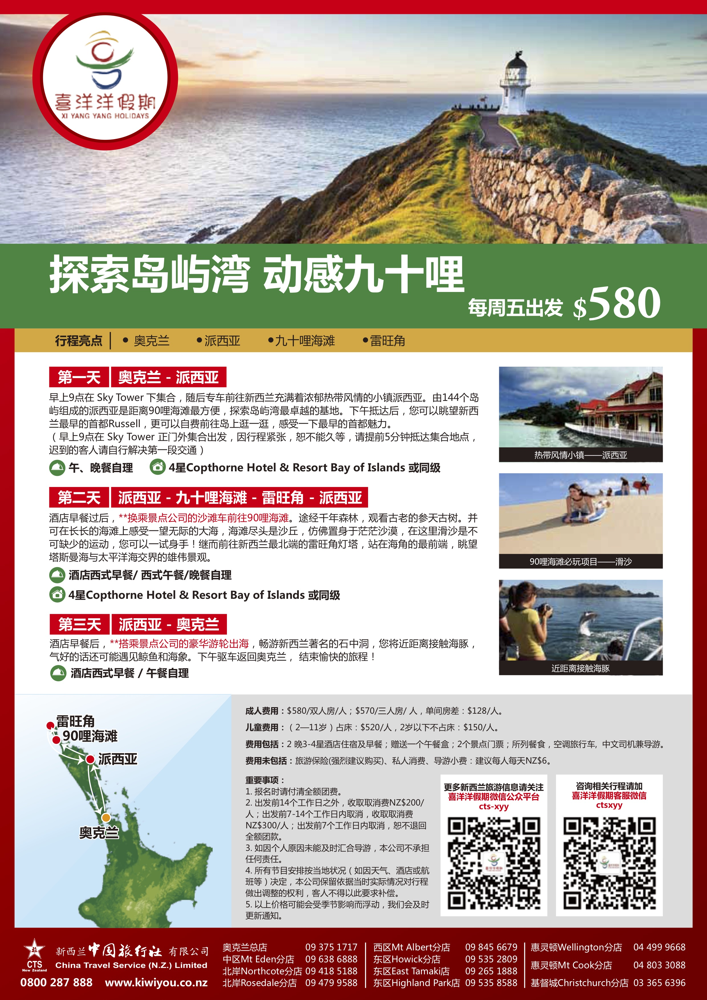
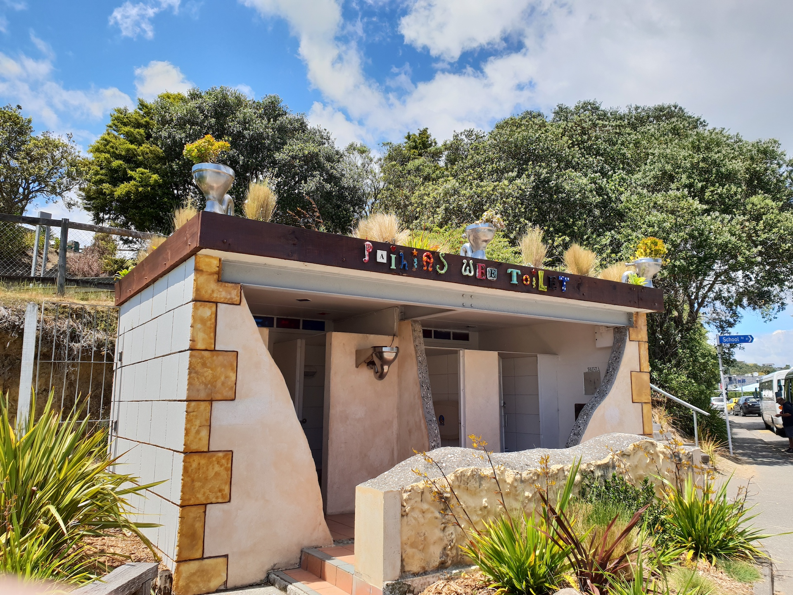
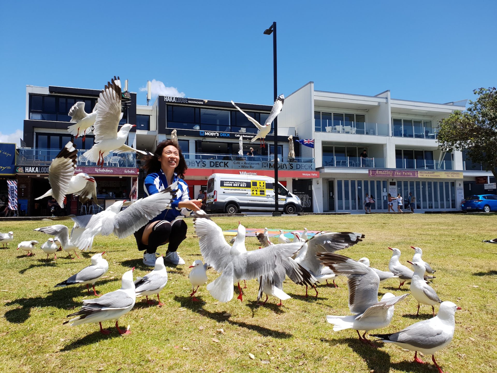
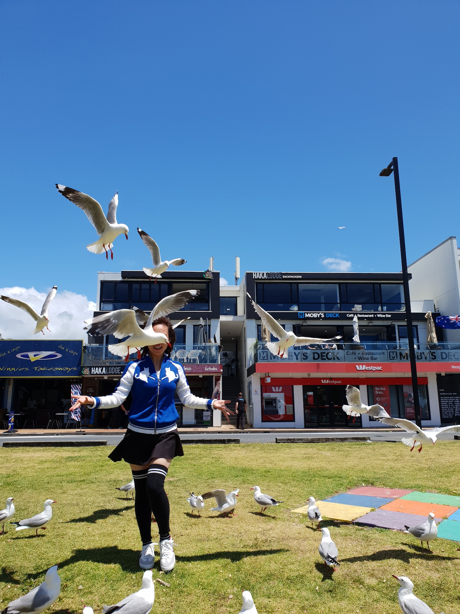
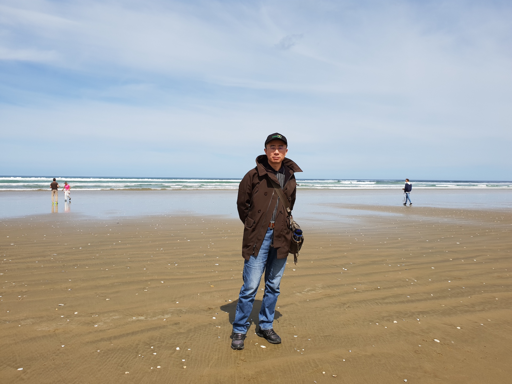
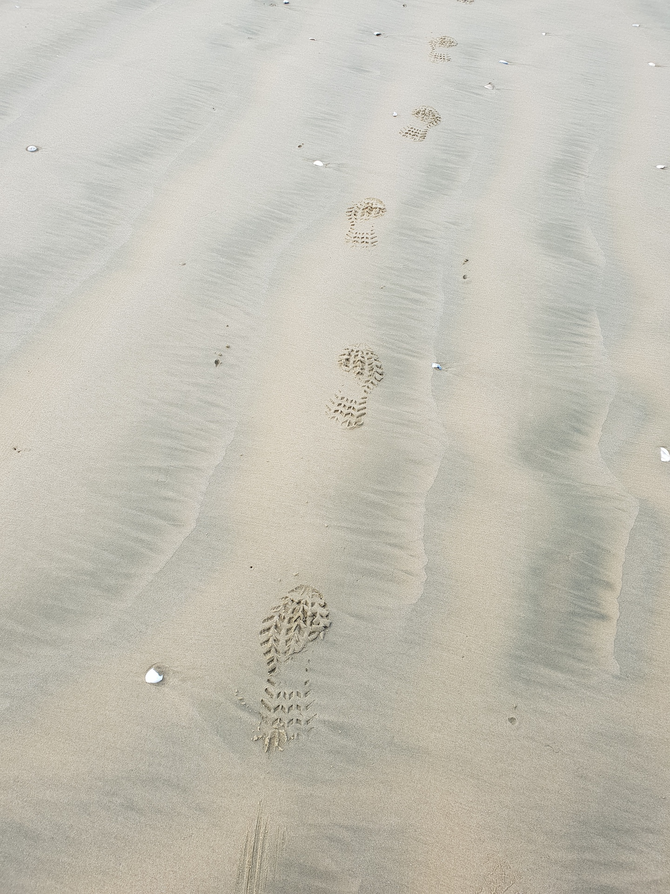
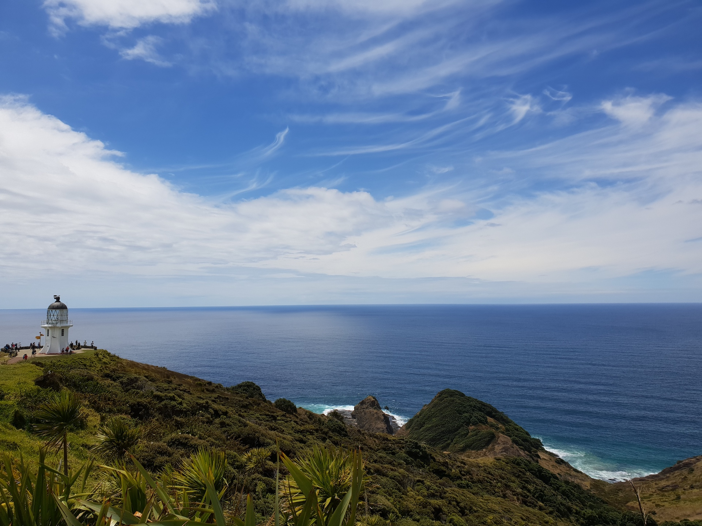
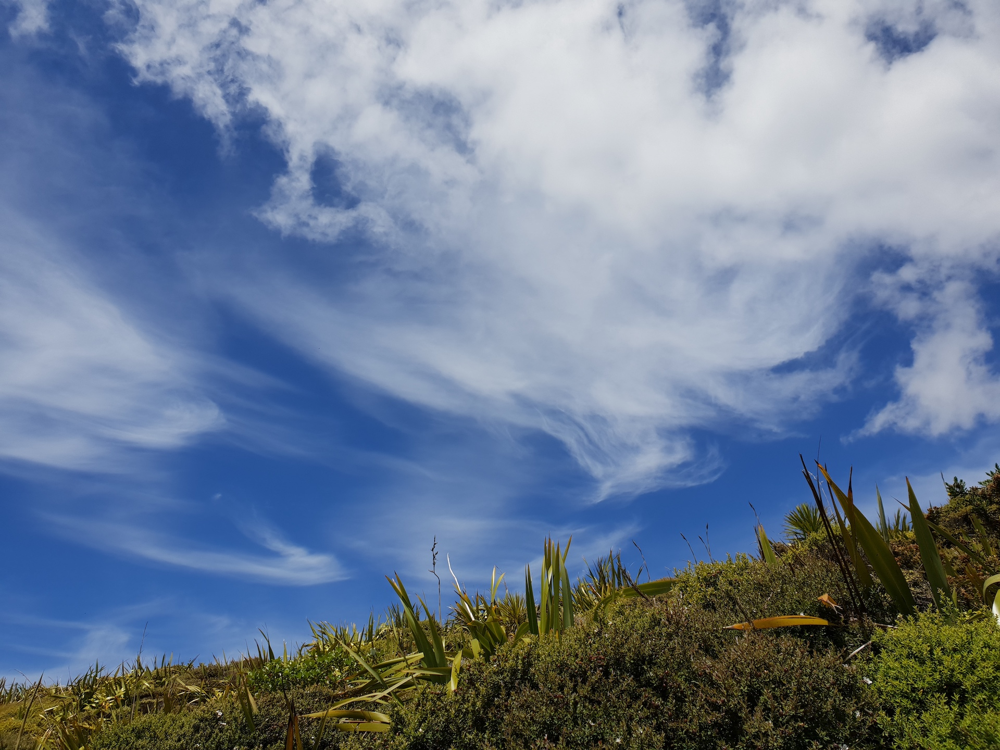

**11月16日-18日**

接下来的旅行，我选择了跟团游。我不喜欢开车，更何况新西兰是右舵驾驶，我怕因不习惯而引发事故。  
为方便大家了解这段行程，我直接将旅行社的广告单贴在下面。必须声明，我没有收取旅行社的任何广告费。  
出发之前，我对单子上“建议”给导游小费这一点是有疑惑的，要知道在新西兰没有给小费的习俗。我甚至怀疑这是华人旅行团才有的“规矩”。不过，后来遇到一个移民澳洲的上海人聊起这事，他说好象旅行团都是这个德性。他还提醒我注意，到国外遇到餐厅收取你10%服务费后，那么你就不必再给服务员小费。

　　新西兰人工成本贵，因此导游和司机是同一人。我们的导游是个胖子，低头只见自己肚子不见脚趾的那种。他来自天津，可没有天津口音。有段时间我常去天津，对天津口音的普通话是再熟悉不过了。他和他老婆是在新西兰上的大学，之后回国发展了五年，后因天津雾霾孩子哮喘，不得不重回新西兰定居——不然他老婆要跟他离婚。  
他是个话唠，一路说个不停，除了介绍沿途风景，时不时还能扯上国事家事。有人问他年收入，他笑而不答。结合他的前言后语：“父亲是个不大不小的干部，退休整了一个“农家乐”养老；夫妻曾想购入一套260万纽币的房子，现有两套房子”，我基本推测出他大概有2000万人民币的身家。这么多钱，干导游肯定挣不出来，多半是从国内带出来的。

第一天，派西亚。下车后见到的第一个“景点”是马桶装在屋顶上、墙上的厕所，幸亏设计师没有忘记在厕所里安装马桶，否则……

接下来，除了我和我老婆，旅行团全被导游忽悠去了对面的拉塞尔（Russell），新西兰初创国时的首都。  
我们走到树荫底下，拿出早上在Countdown买的面包，准备随便对付一顿午餐。我看见几只海鸥在草坪上散步，于是我建议老婆去喂海鸥，我来拍照。  
起初老婆是蹲着喂，我蹲着拍，试了几张，感觉效果不佳——和喂鸽子没啥区别。我琢磨能不能让海鸥飞起来，便掰开面包往空中一扔，几只海鸥迅速飞过来将面包叼走。  
哈哈，这下可热闹了。

第二天，90里海滩。顾名思义，海滩长度绵延90里（英里？）——旅游巴士可以直接奔驰在海滩上，将海滩当作高速公路。途中时不时见到徒步者，我拍下的一串脚印，就是徒步者留下的。

雷旺角是新西兰的最北端。前人一定没有想到，灯塔在今天也能成为一种景观。

第三天，游轮出海看海豚。我最担心的事，终于发生了——晕船。当我捧着垃圾袋“酝酿”呕吐的时候，导游站我身前表示着关切，跟我老婆说：你老公晕船了。我老婆将水杯往他怀里一塞：麻烦你照顾一下，我到上层甲板去拍照。导游差点没背过气去：你老公都这样了，你都不管……更让他抓狂的是，我对我老婆说：我没事，你去吧。导游一声叹息：上海男人啊……  
等我呕吐结束，慢慢缓过劲来，我发现话唠导游突然失声了。他低头靠着前排座椅背上，不知道是睡觉呢，还是闭目养神——后来我知道他也在晕船中。问题是，他自称每周带一个团来一回，怎么可能晕船呢？  
这次出海运气不错，我们看到海豚了。听说没看到海豚，下次来再坐船出海可以免费。
