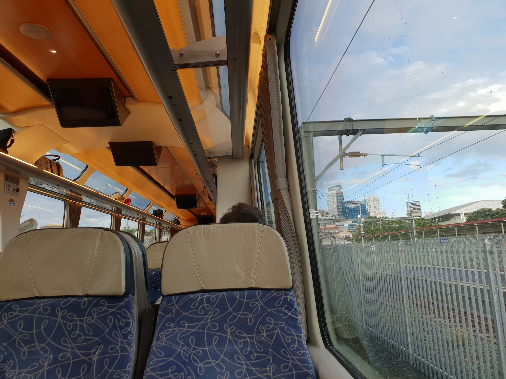
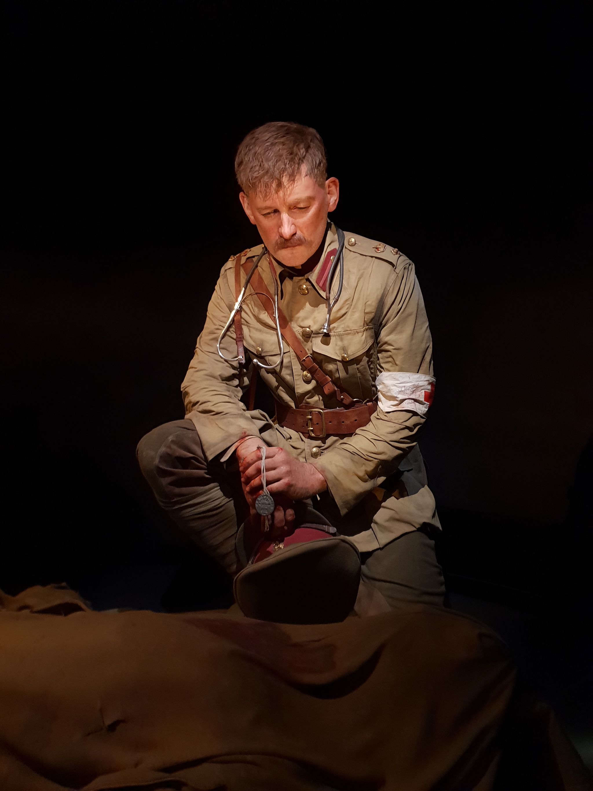
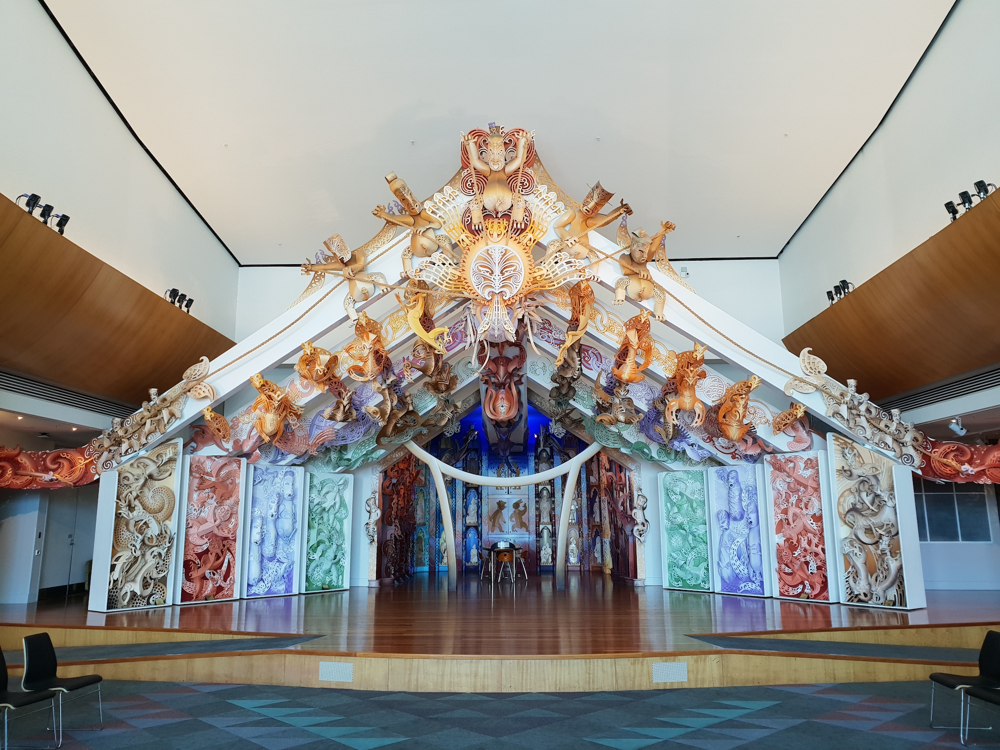
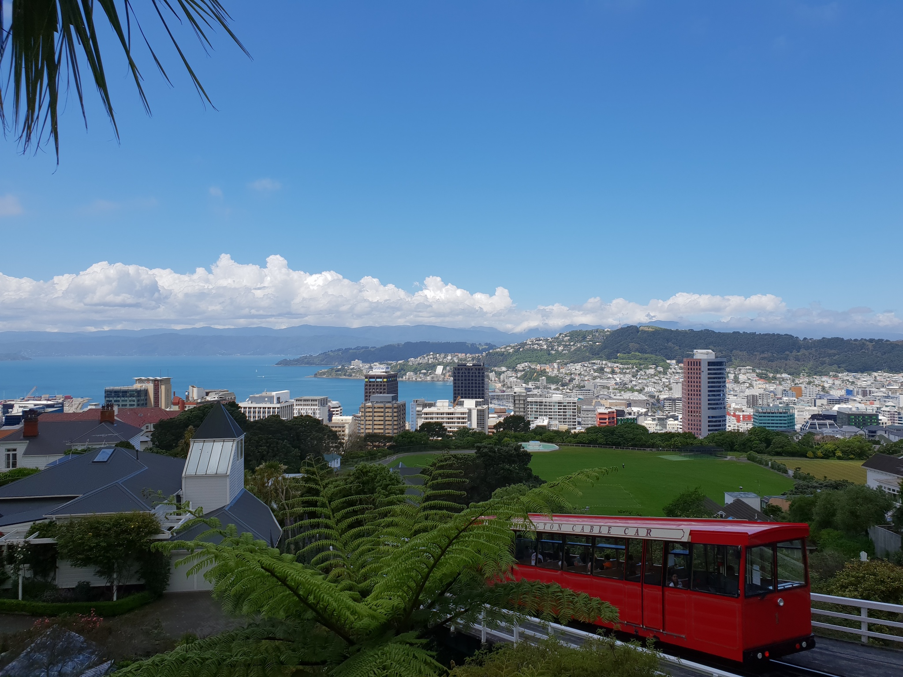
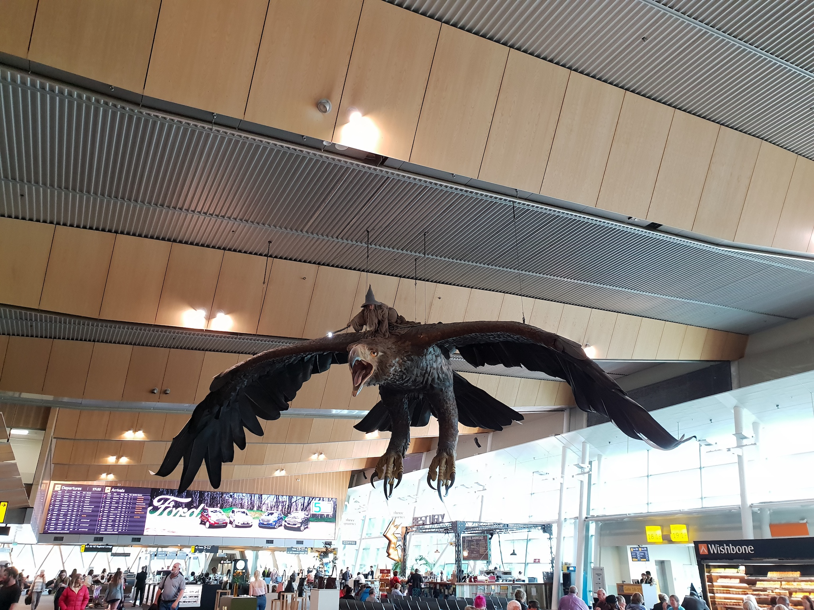

**11月11日**

11月11日，在奥克兰机场接到老婆之后，开启了我“颠沛流离”的旅游季。  
11月29日，全家一起离开奥克兰。  
12月3日，我重返工作岗位。  
时至今日，我的心情方得安顿，可以坐下来写点东西。

**11月12日-11月13日**  
在David的推荐下，我和我老婆坐火车去惠灵顿。就最终的体验来说，将近11个小时的车程有点长，同时我们对沿途的风景产生了严重的审美疲劳。

火车发车前，还是有点小兴奋。

后来，对面来了一对印度母子。儿子包着头巾，应该是印度锡克教的。我很纳闷，整日包着头巾，夏天不捂出痱子来么？

惠灵顿之夜。我们住的是民宿。

蒂帕帕国家博物馆值得逛一天，可惜我们时间不够，只呆了半天。  
二楼有个专题展览——战争之殇：这个里程碑式的展览由蒂帕帕和威塔工作室(Weta Workshop)合作完成。通过八位普通战士的视角，为您讲述新西兰在一战期间加里波利战役的故事。什么叫栩栩如生，请看下图。在现场，我们仔细观瞧，人物的汗毛、汗珠都清晰可见。  
维塔工作室是一家曾5次获得奥斯卡金像奖的全球领先的电影制作公司，总部设在新西兰首都惠灵顿，由理查德·泰勒与《指环王》导演彼得·杰克逊共同创建。我们熟知的电影如《指环王三部曲》、《霍比特人三部曲》、《金刚》、《阿凡达》、《纳尼亚传奇》等片中的人物设计、模型道具以及视觉特效均出自于维塔的制作团队。

蒂帕帕国家博物馆5楼有个厅，可谓美轮美奂，设计师充分运用了新西兰毛利人文化的元素，发扬光大。

惠灵顿有轨电车，确切地说应该叫（上山的）有轨缆车，我们坐着它来到植物园和天文台。

惠灵顿机场甘道夫骑老鹰的形象，也是出自威塔工作室之手。
