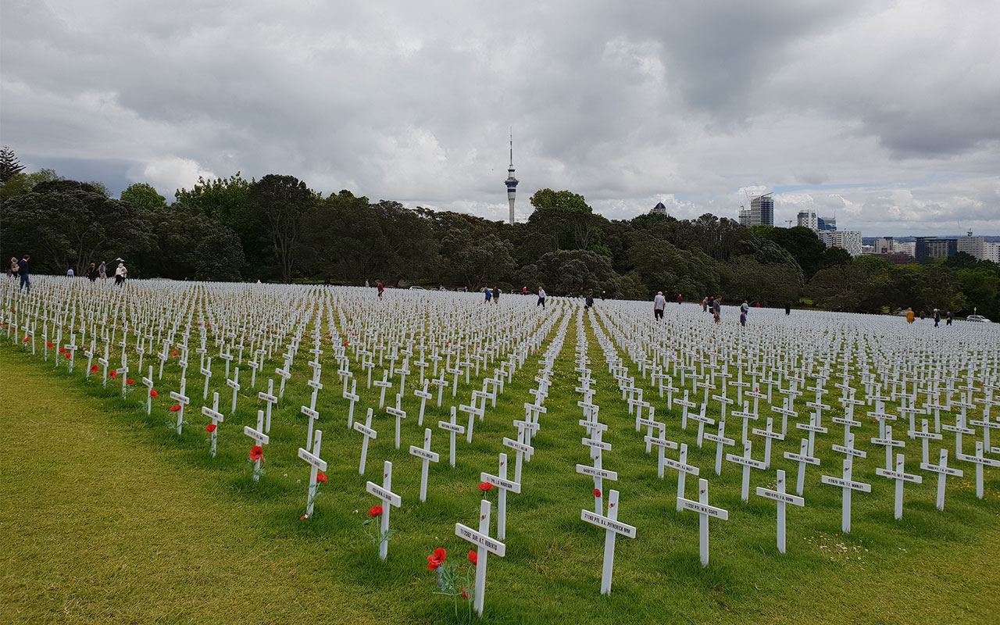
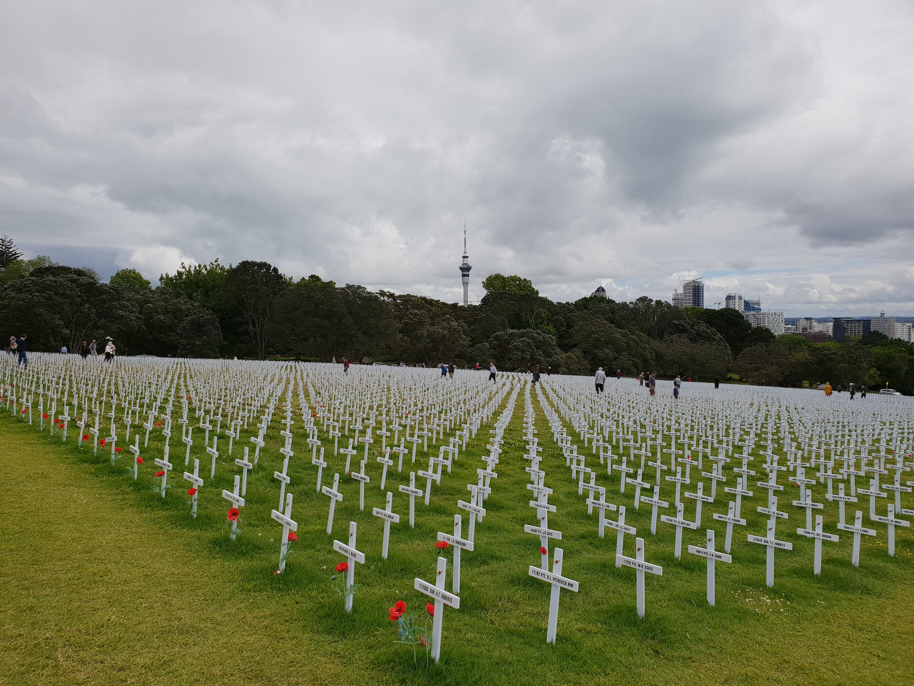
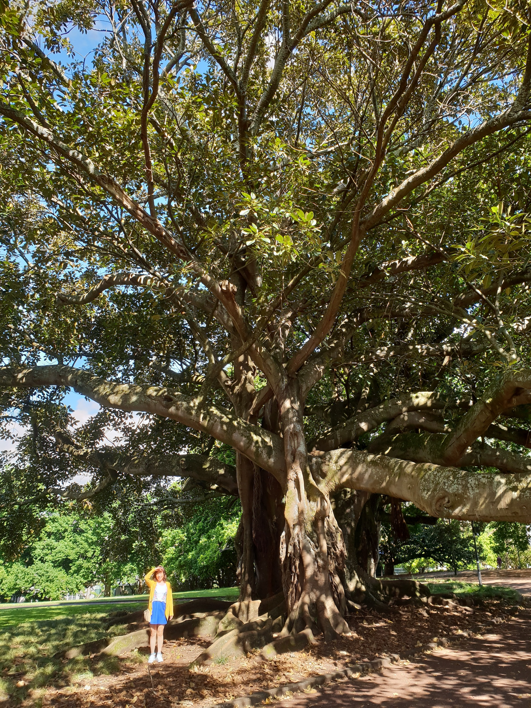
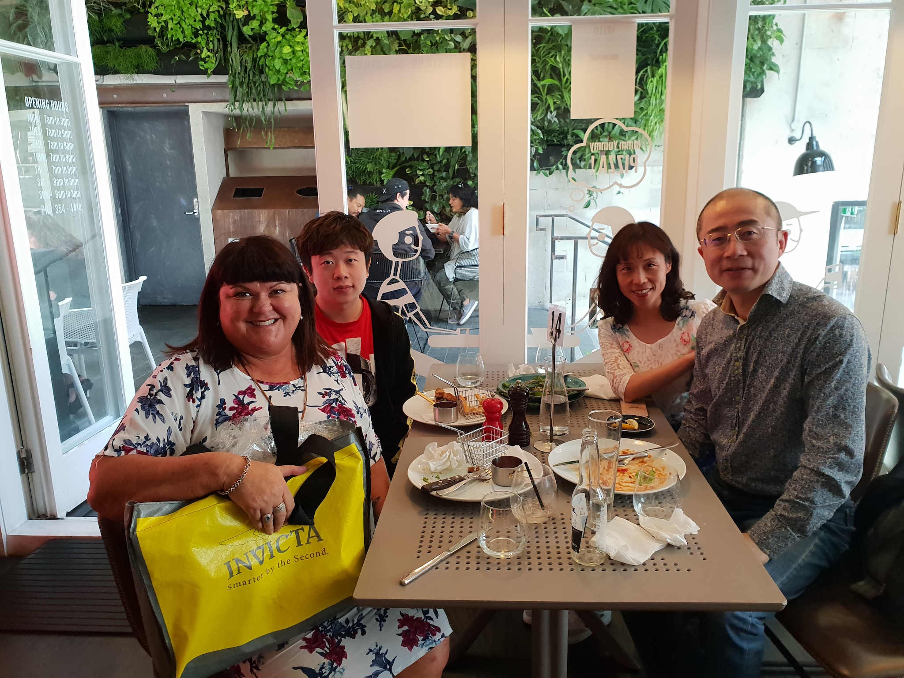

**11月14日-15日**

去年第一次到奥克兰，曾路过奥克兰战争纪念馆。6月份语言学校组织学生参观的时候，恰逢我回国。这回老婆来，本想带她去参观，可看了门票价格，想想还是算了。再说，它能更胜蒂帕帕国家博物馆一筹？

步行穿越 Auckland Domain，就可以看到奥克兰战争纪念馆

恰逢纪念一战百年，纪念馆外的草坪上树着六千八百多个十字架，代表着新西兰在一战中牺牲的六千八百多名将士。每个十字架上都写着士兵的姓名，极少数十字架上还挂着士兵的照片影印件，我猜想应该是他们的家族后人所为，因为那些士兵很年轻，出征前多半未能娶妻生子。  


阿尔伯特公园离我住的公寓虽然很近，但是掐指一算，这一年充其量就去过四五次，有点亏。  


第一次来奥克兰的时候，我住了一个月的民宿，主人名叫Lisa，她是一名IT项目经理，为人友善。我为儿子办理2018年学生签证的时候，她的推荐信也作为解释材料的一部分提交给签证官。11月15日中午，我们一家三口与她道别。
