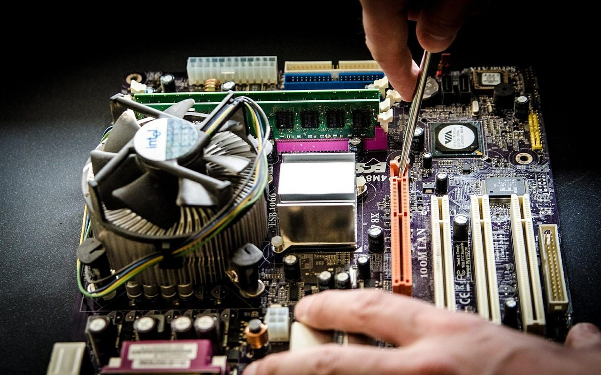

**Day248-249（2018年9月26日-9月27日，周三、周四）**

本周学校开设了一个LEVEL 1的班。原因是LEVEL 2里有零基础的学生，两眼一抹黑，完全跟不上，强烈要求学校开低级班。  
 本来PETER希望安排几个LEVEL 2的“差生”转到LEVEL 1，没想到这些人不愿意——大概是中国人爱面子，降级实在不好看。所以周一的时候，只有2个人在上LEVEL 1。  
 不过，今天我瞥了一眼，有人最终还是转入LEVEL 1了。本来嘛，学习这事，适合自己的就是好的。小学没毕业，硬要上中学，毫无必要。  
 这一轮LEVEL 3的教材回归剑桥的Face2Face，对我来说就是复习一遍。幸亏我没扔掉以前发的教材，于是又拿出来使用，上课便轻松许多，还能抽个空背背单词啥的。多数习题我都做过，基本不需要动笔。

前天课间休息，工作人员跑来找我，问我是不是很擅长修电脑？我想这不废话嘛，电脑老军医从来不是浪得虚名。她说有台电脑点不亮，她不知道是什么原因。  
 那台联想电脑已经被她开膛剖肚，躺在办公桌上。开机，蜂鸣器响五声。我问她你上网查过这是什么报错信息，她说：“CPU坏了”。  
 我说我这么多年从来没遇到过CPU坏掉的情况，捋起袖子，将靠外的第一根内存条拔出来插回去，卡紧。开机，还是点不亮。  
 不能啊。第二根内存条被光驱挡掉部分，我观察后，决定不拆光驱，重新插拔内存条，虽然操作起来有些别扭。  
 末了，这台电脑起死回生。我呢，事了拂袖去，深藏功与名。  
   
 来点鸡汤：插拔内存条这个动作只值1纽币，知道插拔内存条可以拯救电脑值99纽币。  
 然而，学校并不会给我钱，即使给了咱也不能要，不然我就是违法打工。
