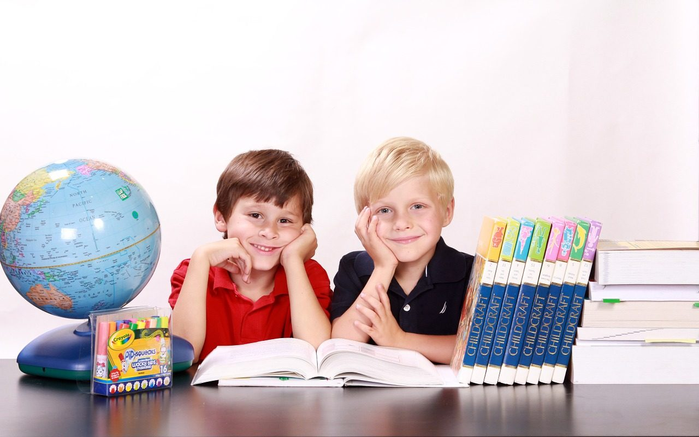

**Day244-245（2018年9月22日-9月23日，周六、周日）**

前两天看到一篇文章《我花上百万移民国外，本想给孩子最好的教育，结果还不如国内》。文章内容不在此赘述，[点击这里](https://view.inews.qq.com/a/20180913B0Q90R00?uid=&from=timeline&isappinstalled=0)阅读此文。  
 一看标题，大家马上就明白怎么回事。我觉得这篇文章的作者和当事人，都没有弄明白三个基础问题：  
 什么是教育？  
 教育的目的是什么？  
 什么是最好的教育？

什么是教育？  
 《中国大百科全书，教育》(1985)：“从广义上说，凡是增进人们的知识和技能、影响人们的思想品德的活动，都是教育”；  
 “狭义的教育，主要指学校教育，其涵义是教育者根据一定社会（或阶级）的要求，有目的、有计划、有组织地对受教育者的身心施加影响，把他们培养成为一定社会（阶级）所需要的人的活动”；  
   
 教育的目的是什么？  
 将人培养成为一定社会（阶级）所需要的人。  
 换一种说法就是，一个人能够在社会分工中找到属于自己的位置。  
   
 什么是最好的教育？  
 能够将人培养成为一定社会（阶级）所需要的人，同时又令其具备良好的科学和人文素养。

在此摘录另一位家长在新加坡一所私校的亲身体验：  
 先讲人格培养。开学不久，澳大利亚籍的老师Christina就和我恳谈了一次，提到Arthur有着中国孩子特有的小皇帝性格，惟我独尊，具体表现是：经常大声喧哗，打断别人说话，缺乏饭桌礼仪，不时欺负同学。  
 我问老师Arthur的成绩如何，毕竟那是每个中国老师第一句话就会告诉我的。老师意味深长地看了我一眼，说：  
 “Arthur的数学和英语都是全班最好的，但那不是重点。重点是，他缺乏教养。教养，就是懂得为他人着想。我希望他将来成为一位真正的绅士，这比成绩优秀要重要的多得多。”  
 看着我略微迷茫的眼神，老师补充说：  
 “成绩是一时的，做人是一世的。如果只看重成绩，成绩好就成功，成绩不好难道生活就毁灭了吗？做人却不同，无论成绩好不好，一个素质优秀的人总是能生活得更好。作为老师，我认为自己最大的责任是培养孩子成为有爱心、负责任、懂教养、爱学习的人，而不是冷冰冰的学习机器。”

“教育”本身，东西方各有所长，但是“最好的教育”一定不在中国。
