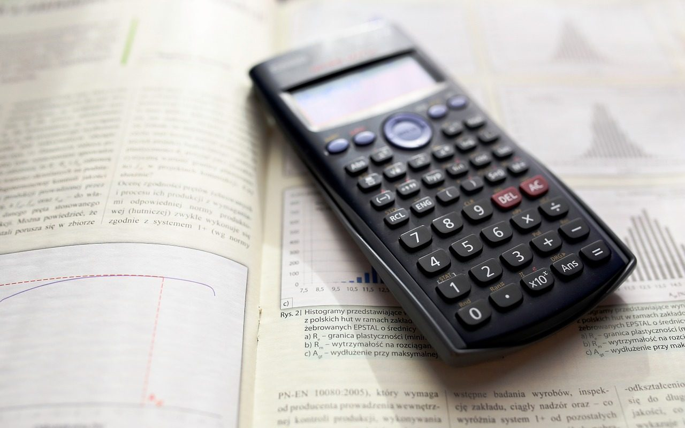

**Day274-275（2018年10月22日-10月23日，周一、周二）**

一个移居新西兰2年的妈妈说：[女儿不会乘法口诀也挺好。](https://mp.weixin.qq.com/s/P5jMAY_MxMnjVdLh33QbqA)  
   
 在我看来，中西两套数学教育方式之所以截然不同，归根到底是因为教育的目标是不同的。  
 我们传统的数学教学注重的还是考试，而乘法口诀之类高效而统一的演算方法，无疑是实现应试效率的最佳途径。  
 而西方数学教育，就我目前的个人体验来看，它更注重的是保护兴趣、在孩子面对实际应用问题时，能够发散性地构建有逻辑性的数学思维，提升解决实际问题的能力，这种方式的平均应试效果，显然是差强人意。  
 到底是应试重要，还是发散逻辑思维和解决问题的能力重要？这点真的很难说，孩子数学思维力再强，没有应试标准做评估，又如何体现出来呢？显然这些东西，并不能为孩子将来的层层考试筛选保驾护航。  
 孰轻孰重，能下定论的只有每个家长自己。  
 对我来说，如今8岁的女儿确实数学运算能力远低于国内同龄孩子。但是她所表现出来的快乐、求知欲、好奇心、学习热情，以及总在变着法子思考各种问题的状态，是我所乐于见到的、满意的一个8岁孩子应有的状态。

这篇文章引发我另一个思考，某些专家（包括西方）、家长提出的东西方教育应取长补短，实际是个伪命题。  
 道不同，不相为谋。东西方教育的出发点完全不同。天朝自隋唐开科取士至今，“学会文武艺、货卖帝王家”仍然是读书人一生不变的追求。某贪官敛财600亿、情妇148个，但凡还处在十年寒窗无人问阶段的读书人，谁没有深受鼓舞？  
 尺有所短，寸有所长。世界本无完美之人或事。一种教育体制，有长处必有其短处，其短处也是因长处而生。以《女儿不会乘法口诀也挺好》提到的乘法口诀表为例，同是阿拉伯数字，英文与中文发音完全不同，英文的发音制约了口诀的背诵。另外，即便可以背诵，西方人会自豪地说：我们不想背这劳什子的乘法口诀表，所以发明了电子计算器！（扬长避短！）  
 话说语言班老师教我们听写英文数字，我的头立马就大一圈，更别说用英文来加减乘除了。  
 因此，奉劝各位专家、家长不要再煞费苦心研究什么东西方教育取长补短，所谓取长补短，结果是苦了孩子、折腾家长，南橘北枳。  
 依我看，这三十年的教改越改越糟糕，越改越没方向，越改越没信心。不忘初心方得始终，咱们不如回到“学会文武艺、货卖帝王家”的起点，老老实实践行已有上千年历史的中式教育体制，不指望复兴中华文明吧，至少整个社会不会像今天这样礼崩乐坏。
