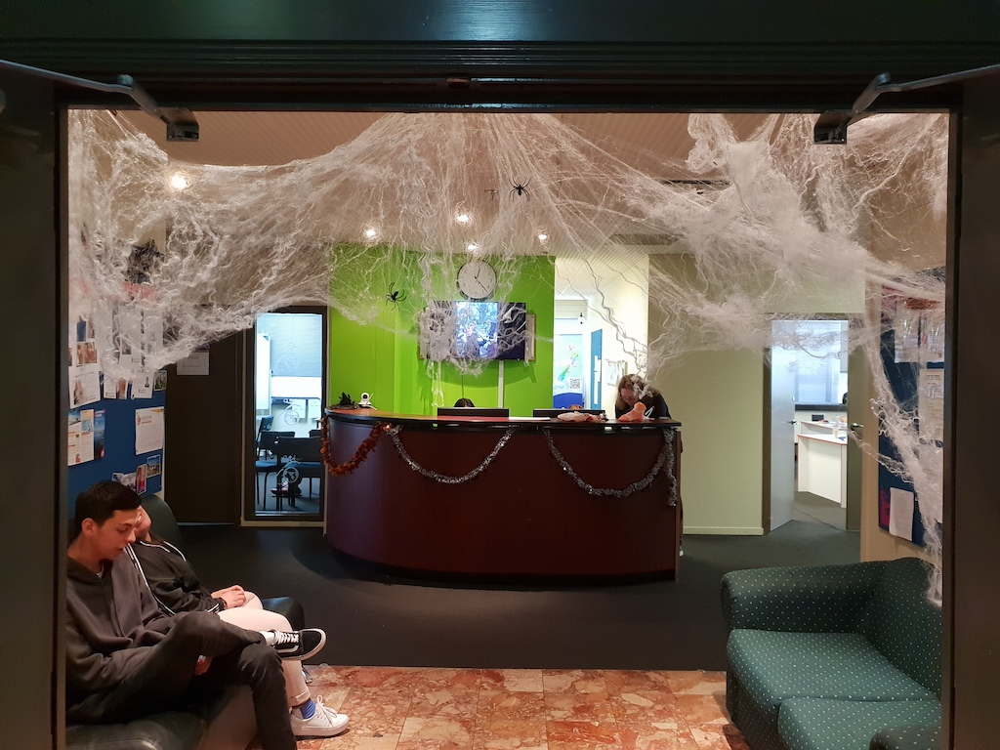
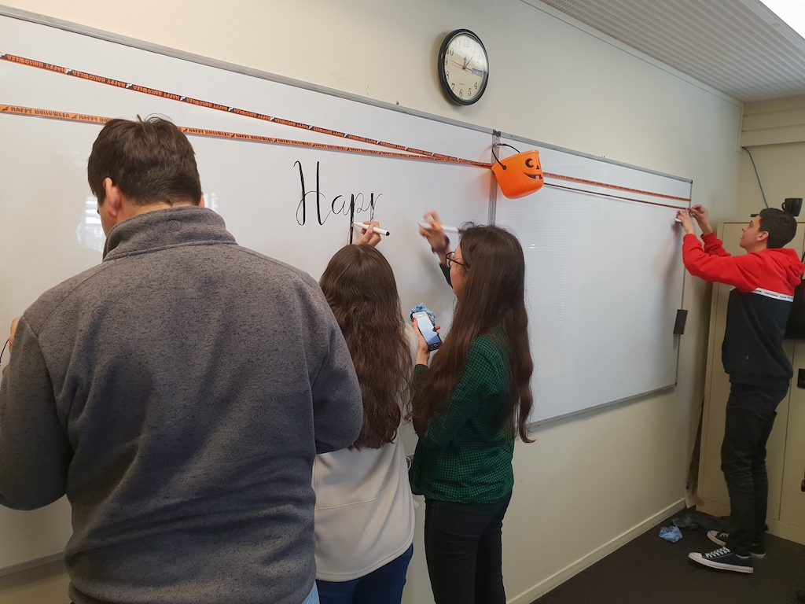
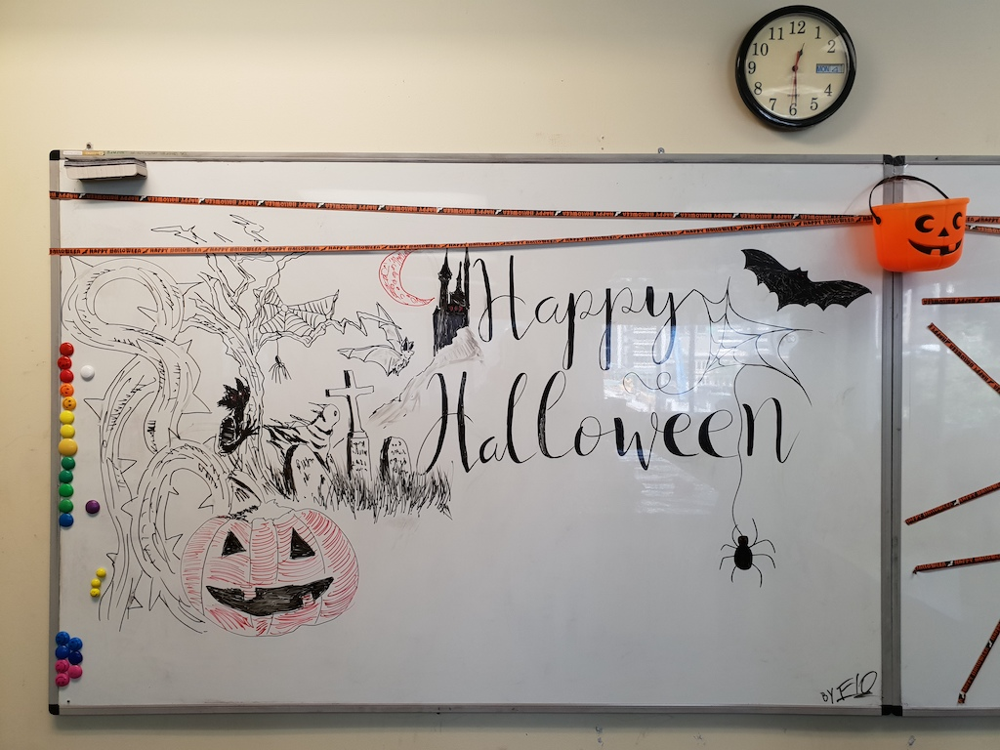
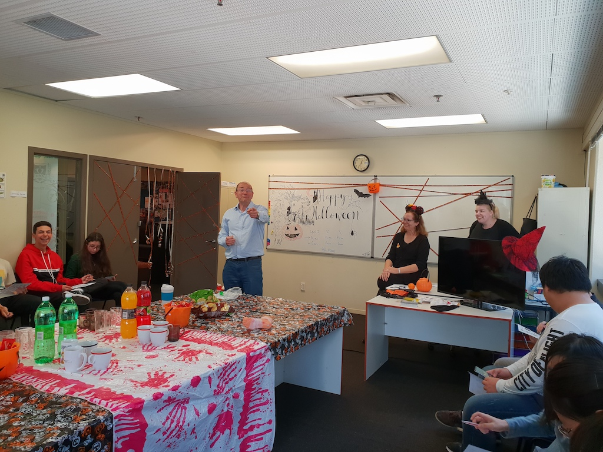

**Day284-285（2018年11月1日-11月2日，周四、周五）**

周三的“期中考试”，尽管口语发挥有点失常，但依靠其他几项的成绩，我的总分仍然排在全班第一。10个月的英语学习，这回算是完美收官。

10月31日是万圣夜（英语：Halloween或Hallowe'en，为“Hallows' Even”或“Hallows' Evening”的缩写，意为“诸圣节的前夜”），也常被称作万圣节，是西方世界的传统节日，主要流行于盎格鲁撒克逊人后裔云集的美国、不列颠群岛、澳大利亚、加拿大和新西兰等西方国家。当晚小孩会穿上化妆服，戴上面具，挨家挨户收集糖果。万圣节通常与灵异的事物联系起来。西洋传统上认为万圣夜是鬼怪世界最接近人间的时间，这与中国的中元节以及日本的百鬼夜行类似。  
   
 10月31日，校门口挂上了蜘蛛网，学校成了盘丝洞。我拍照发了朋友圈，朋友们异口同声问我：漂亮的蜘蛛精在哪里？  
 按理说今天已不是万圣节，不过下午学校还是组织了一场庆祝活动，我想更多是出于让大家体验异国风情的目的吧。



智利的同学真是有才，在网上找了个图，三个人分工协作临摹。  
 

完稿，真心赞啊！  
 

三个班级的老师一同出镜。  
 

开吃！
