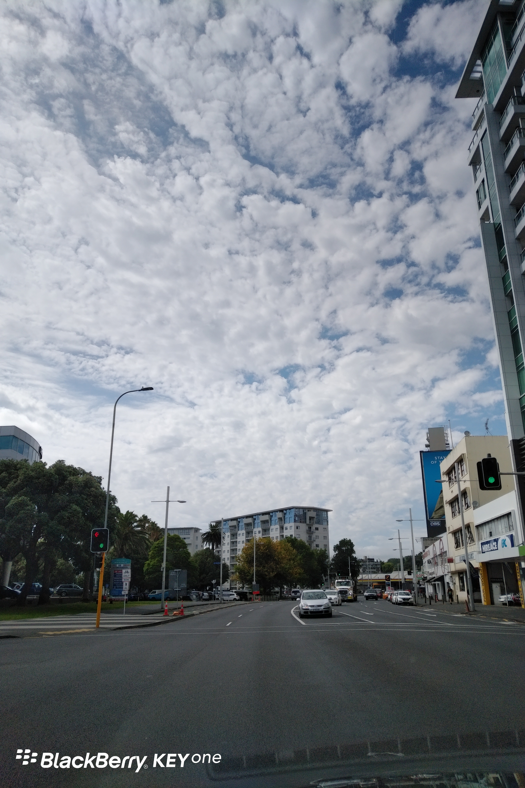
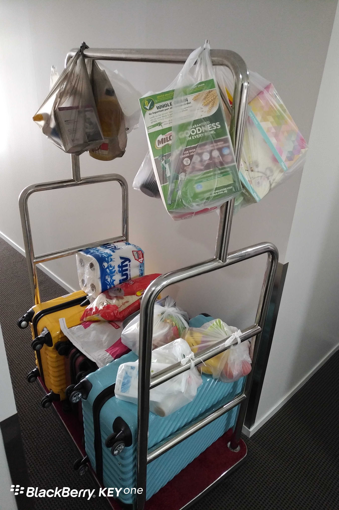
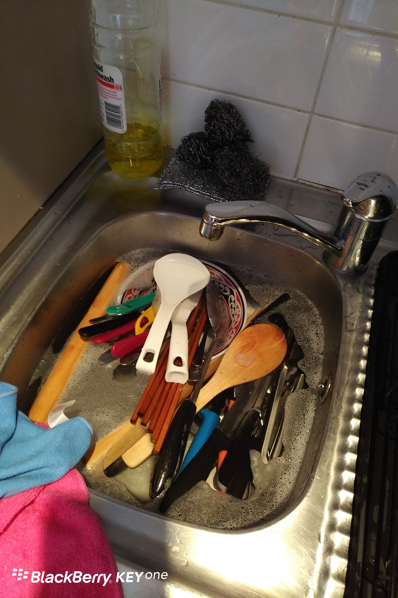

教授很久没有冒泡了
……主要是怕冒了泡，大家立马取消关注。
……哈哈，开个玩笑。其实取消关注，说明你懂得说“不”，这是个人成熟的标志。
话说未来一年，我将在新西兰“陪太子读书”。
早在去年，我就确定了这个计划，并且向校方请了个长假。
计划的来龙去脉，容我以后慢慢道来。
为防止懶癌发作，我先给自己定了个小目标，就是每日一更。
拿罗胖的话来说，就是死磕自己，愉悦大家。

Day1
北京时间14:15 我和我儿子从上海浦东国际机场出发
关键词：在路上

Day2
新西兰时间次日06：45 我们抵达新西兰奥克兰国际机场
出关后提取行李，坐机场穿梭巴士到Mission Bay
朋友开车送我们到达市中心公寓

奥克兰的天，是明朗的天……
奥克兰的人民好喜欢……

到超市置办生活必需品带回公寓……就差一个拨浪鼓了。
之后又跑出去买床上用品N件套。

上半辈子都没洗过这么多碗筷。

关键词：累趴了
