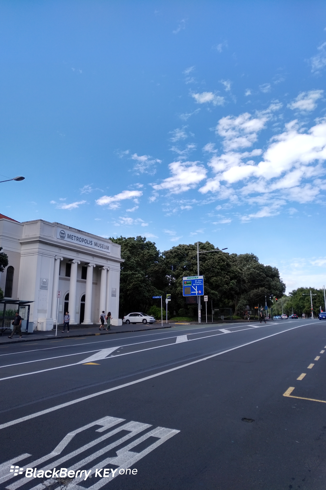
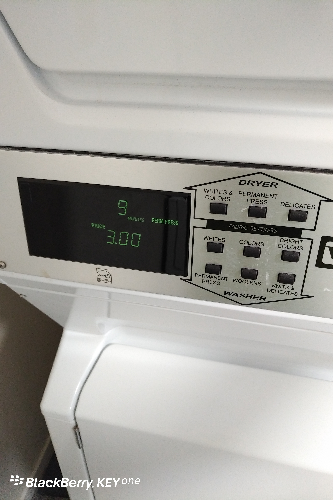
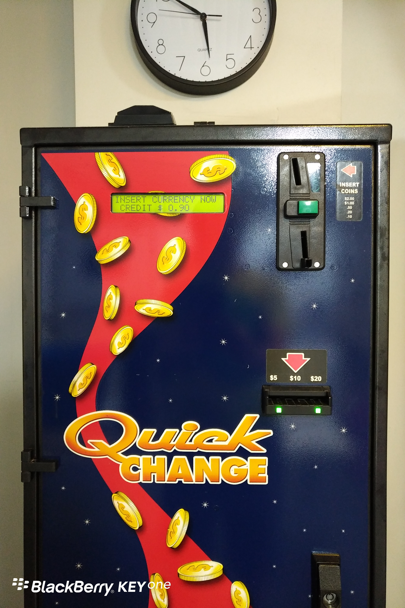

教授胆战心惊地打开“职场小强”公众号后台，发现只有1个取关，不由长舒一口气——同学们还是很给面子的。其实，这不是真相，真相是只有20个人打开，其中1个还是我自己。

Day3
奥克兰的天依然是晴朗的天
资本主义国家的人民生活在水深火热之中

其实公寓的洗衣房藏着的是“老虎机”，洗衣每次3个纽币也就罢了，烘干每10分钟1个纽币！
一开始我还纳闷了，为啥投1个纽币进去衣服没法烘干呢？
掐指一算，要是每周洗一次，烘干一次，6个纽币。一年下来，可以买一台洗衣机了。

更坑爹的是放在洗衣房的兑币机。
原本我挺高兴，终于能把讨厌的角分硬币全换成1元硬币。稀里哗啦投了一阵，成功兑换出一大堆1元硬币。
投啦投……显示屏最终停留在了0.90元，呃，我手里并没有0.10元。绿色的键（我觉得它是退币键）按了半天没反应……只好哀怨地转身离去。

关键词：心疼钱
