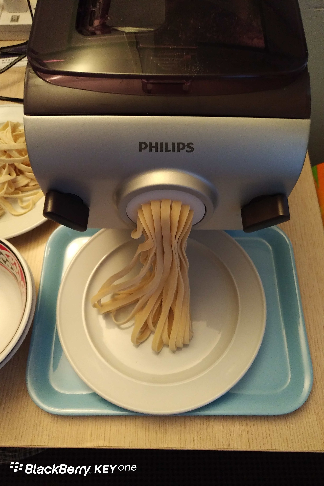
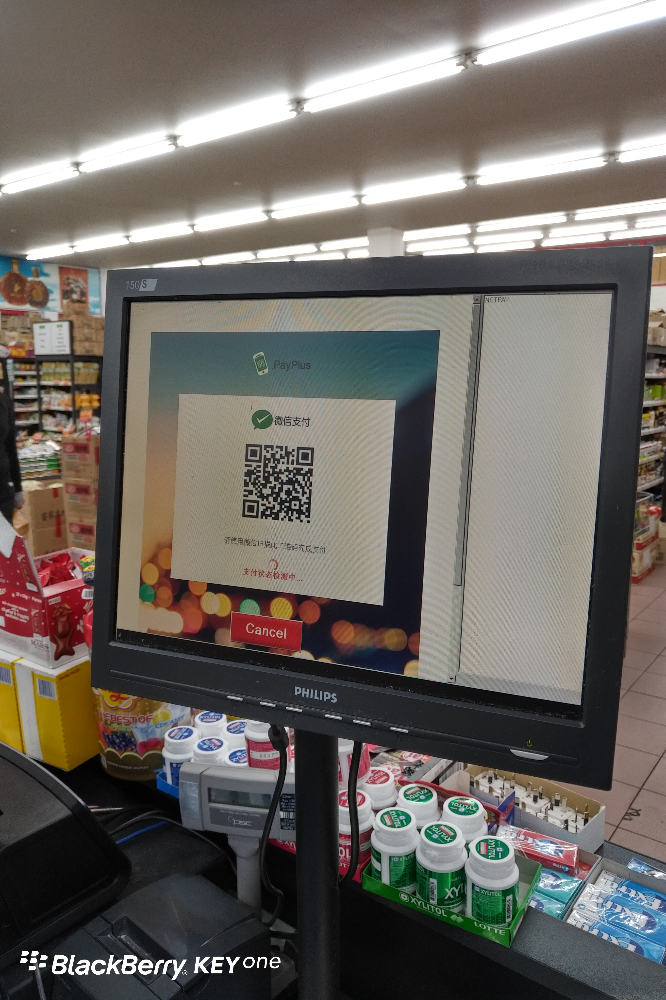

Day4 (2018年1月11日）
早上4：30醒了，睡不着。
6点起床鼓捣面条机，一次轻松出面。
一般来说，面条界的成功人士肯定不会告诉你，一次轻松出面之前有几次失败的经历。
那样显得太笨，不聪明。
而真诚的我，则轻轻地告诉你，在国内我失败过三次。
成功有什么秘诀吗？只有一条：相信产品说明书。

微信支付很强大！

第一次独立制作蛋炒饭，不幸失败——太烂。
我用了刚烧好的米饭……
汇报之后，老婆大人传来蛋炒饭成功秘诀：米饭必须用隔夜冷饭。

关键词：第一次
