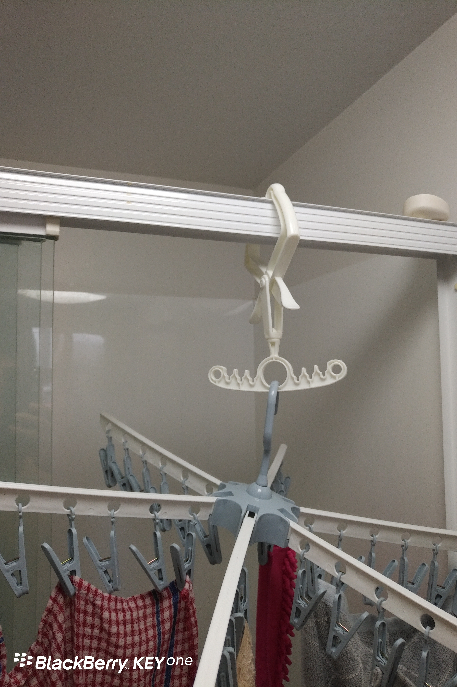
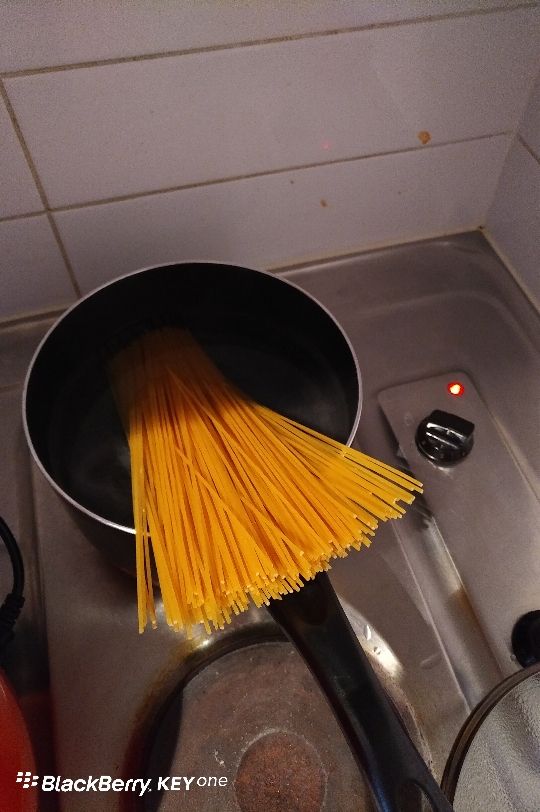

Day9 (2018年1月16日，周二）

下午去我的语言学校踩点归来，路过Queen St.上那家名叫DAISO的日本超市，淘了几样日本货，呃，包括日本设计中国制造。咱不得不佩服日本人的小聪明，就这么一只小小的带夹子挂钩，解决了我的多头衣架无处悬挂的问题。

前一家房客在橱柜里留了半包意大利的“卷子面”（我自己命名的），我研究了半天，决定煮了它。这货面对一锅沸水，坚强不屈……为让它屈服，我可是费了一番功夫才将它按入锅中……　　

关键词：淘

欲知后事如何，且等 学择新西兰（Choose NewZeaLand）Day10
