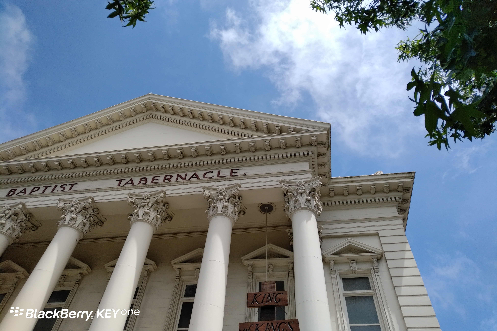
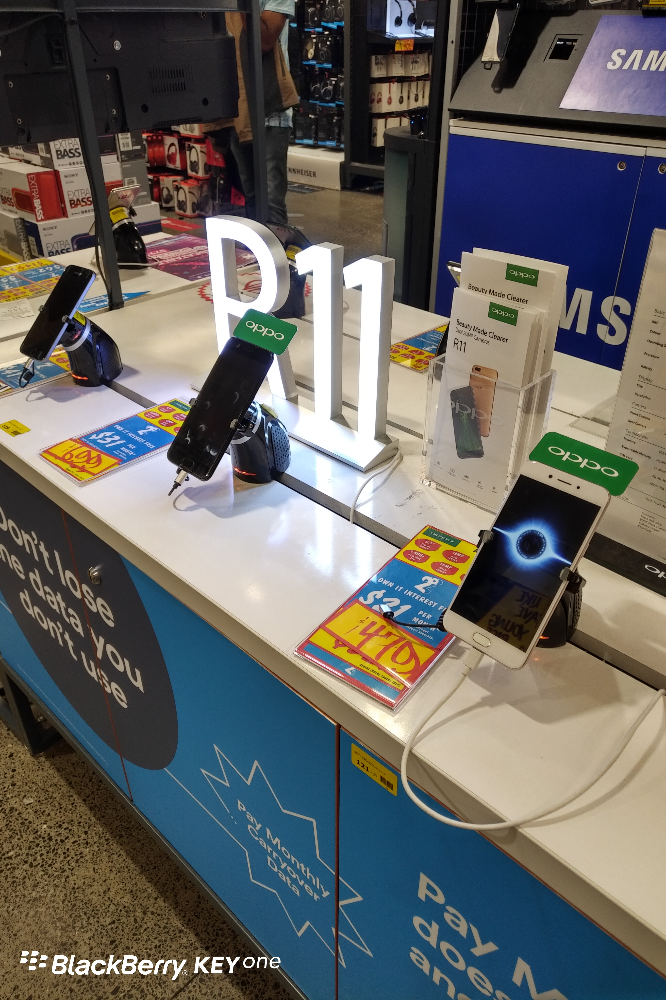
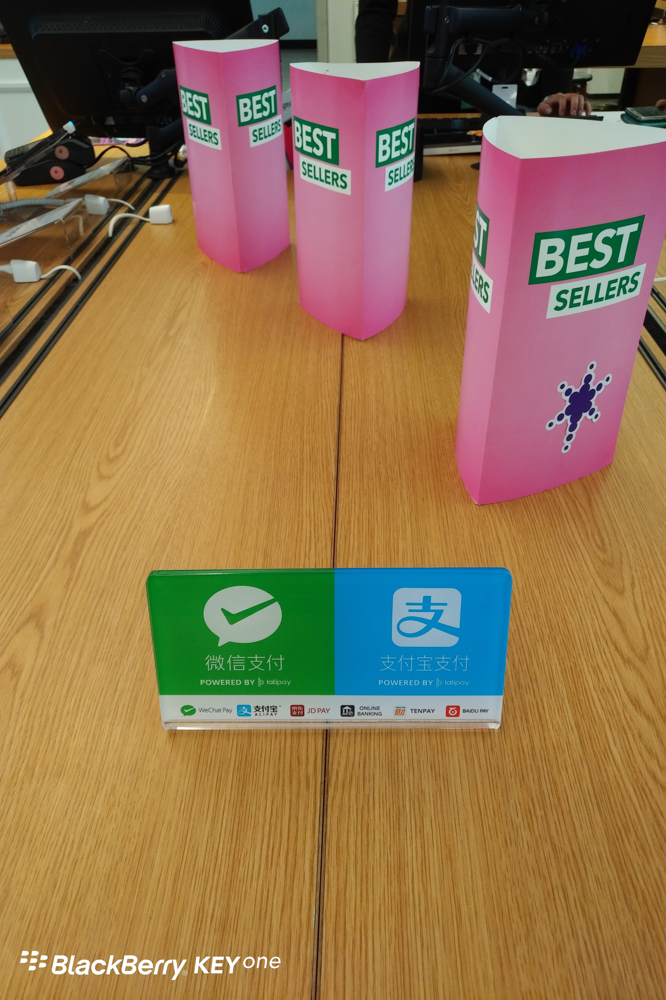

Day12 (2018年1月20日，周五）

出了点小状况，我的iPad Pro更新后变砖头了，咨询了苹果客服，折腾了小半天，也没搞好，现在是相当郁闷。

西方社会，教堂通常是一个城市中比较“弹眼落睛”的建筑。而在天朝，官府的建筑向来是最辉煌的。

OPPO威武伐？摄于Queen St.的某数码店。

AT也不甘落后，终于在一起。摄于Queen St. Spark营业厅。Spark好比是咱们的中国电信。

关键词：瞎逛

欲知后事如何，且等 学择新西兰（Choose NewZeaLand）Day13
