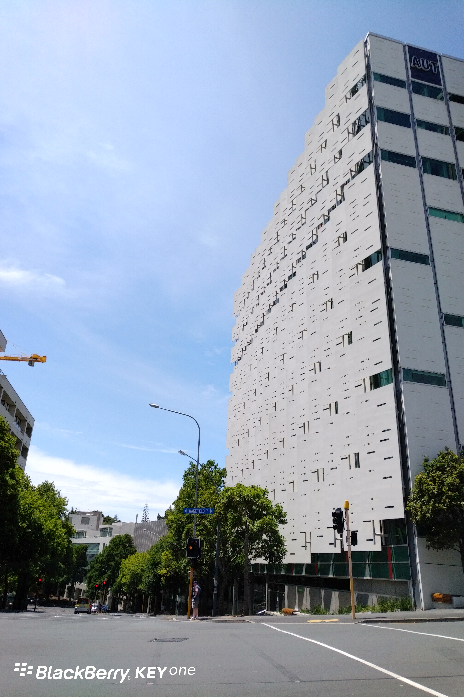
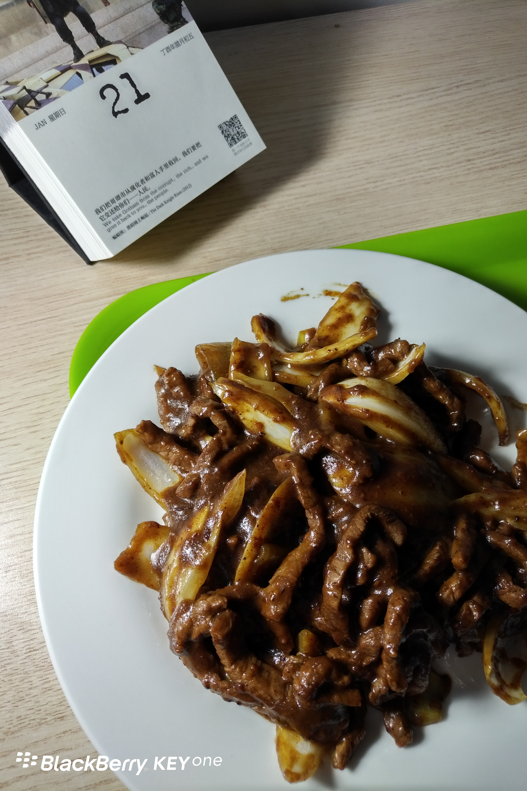

Day14 (2018年1月21日，周日）

把日子钉在墙上，看到时间的流逝。

我从住所去Queen St.购物，必经AUT(奥克兰理工大学）的一栋楼，这个角度还不是最好看的，改天换个角度再拍。

晚上试制了一道菜：黑椒洋葱牛柳。原料是安格斯牛肉（切好的条），600多克，纽币17.24元，今天用了一半。从未切过洋葱，于是上YouTube恶补。重点是超市有售黑椒酱料包，现成的！照着说明书按部就班，Perfect!

欲知后事如何，且等 学择新西兰（Choose NewZeaLand）Day15
