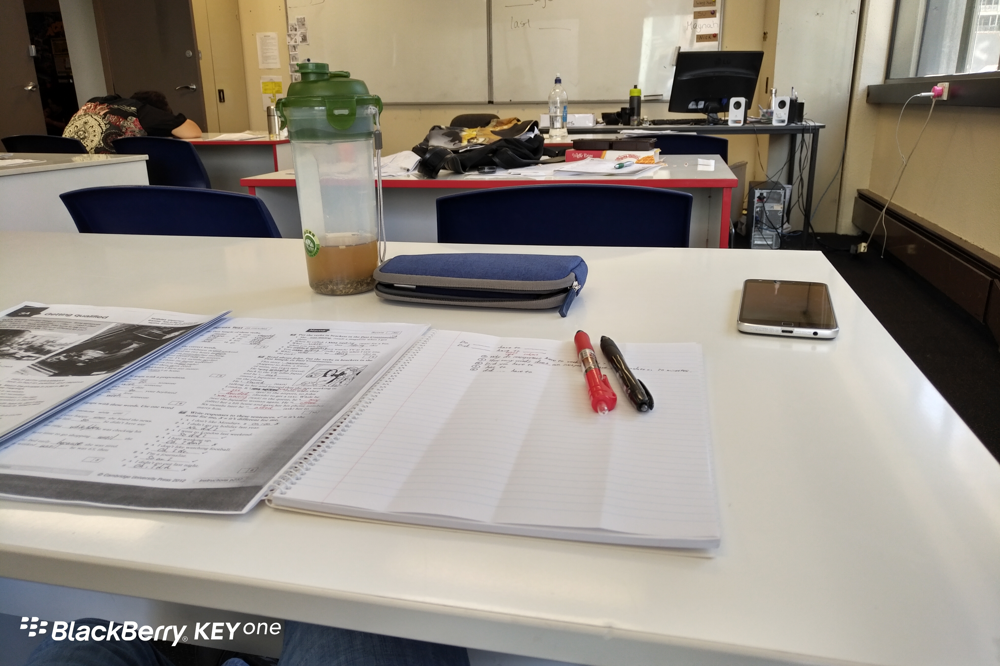

Day16 (2018年1月23日，周二）

英语老师名叫Maynah，据她介绍，她妈妈也是老师——看来老师这职业很容易祖传。我父母都是老师，因此我从小一直立志当老师。

观察成人的语言课，你会发现一个有趣的现象，就是一个人的努力程度和年龄成正比。翻译成人话，就是老年人听课最认真——呃，老年人包括我吗？我得好好想想。

午休时间，一个广东大妈用广东口音英语，居然还能和老师聊几句（貌似是超市购物的话题），我也是惊了。我惊的不是广东大妈英语好，我惊的是老师竟然可以听懂广东口音英语——本来中国人说日常英语，我一般能听懂50%以上的，而这位大妈的英语让我彻底懵圈——问题是，她和我分在同一个班啊!

晚餐是塔菜炒年糕。年糕提前煮过，但没煮透，偏硬。下次改进。

欲知后事如何，且等 学择新西兰（Choose NewZeaLand）Day17
