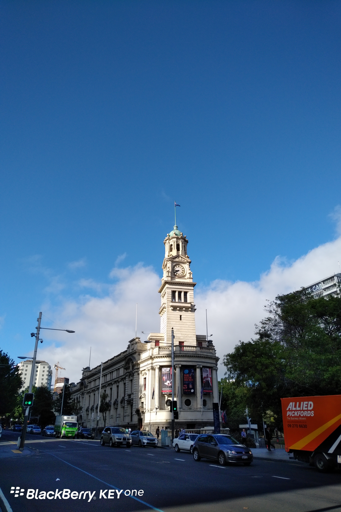
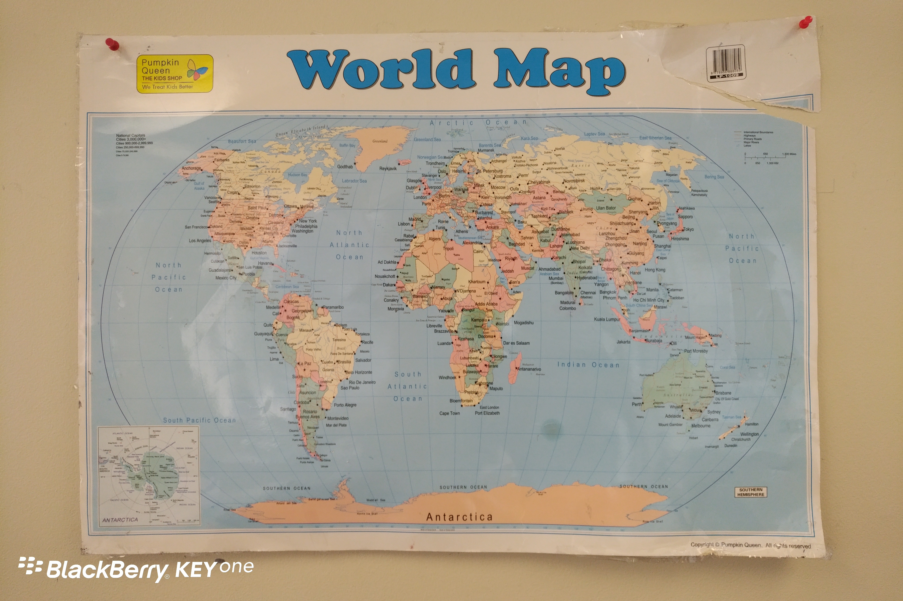
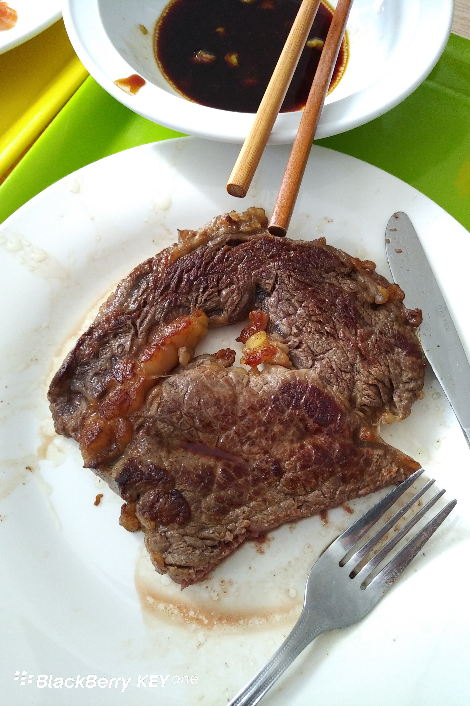

Day17 (2018年1月24日，周三）

奥克兰的天是晴朗的天。我并不是说这里不下雨——下雨的时候我很少拍照。

纠正一件事，昨天我说的那个广东大妈，其实是韩国大妈。她和广东人坐在一起，我就以为是广东人。

教室里悬挂着一副世界地图，我总感觉哪里不对。略一沉吟，终于明白，以前我们看到的是假的世界地图——中国位于世界的中心。自秦皇汉武到慈禧太后，帝国的领袖们非常享受万邦来朝的感觉。今天，即使到处都是404，我们还是乐衷于组织全球互（Ｇ）联（Ｆ）网（Ｗ）大会。

忽然想起一部电影《楚门的世界》，主角从小到大生活在一个安静祥和的小镇，而这个小镇实际上是一座无比巨大的摄影棚。

一生中的独立煎制的第一块牛排，得到了儿子的肯定。其实食材好，才是关键。

欲知后事如何，且等 学择新西兰（Choose NewZeaLand）Day18
