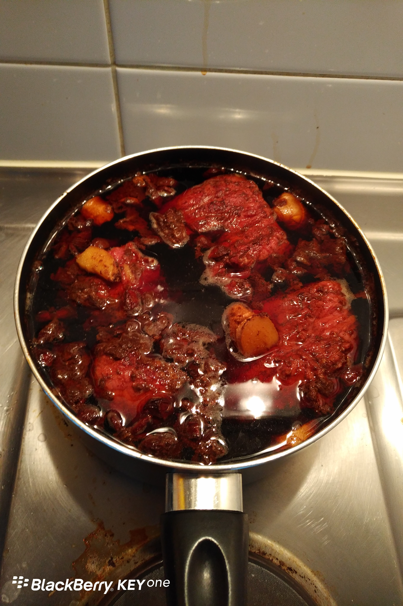

Day22 (2018年1月29日，周一）

在Day20，我提到过，我的儿子到新西兰留学，纯粹是一个偶然的决定。委托David来安排我儿子的留学事宜，中间我没有丝毫的犹豫。

其实2014年我在同学会与David重建联系之前，我们已经失联大约20多年。20多年，沧海是不会变桑田，但是家乡的桑田早变了高楼大厦。人当然也会变。

同学之间的亲切感和信任感是天然的，而要长期保持这种亲切感和信任感，最好的方式是【不要轻易】发生利益关系。朋友之间何尝不是这样呢？割席断交，十之八九者是因为钱。

有人会嚷嚷说，同学或朋友不就应该“相互利用”吗？否则要同学要朋友干嘛呢？呵呵，那活该你人缘越混越差。

那究竟什么样的同学（或朋友）关系之间【可以】发生利益关系？

三个字：三观合。三观即：世界观、价值观、人生观。

三观合不合，平时看不出来，大家吃吃喝喝唱唱歌，感觉挺合得来。这种合充其量是貌合。

一个人的三观会在什么时候暴露呢？

一、遭遇大事件时。比如汶川地震当中的人民教师范跑跑，抛下全班学生先逃命；比如深圳的罗一笑事件，当事人编造不实信息发起网络捐款。

二、遇到一些争议话题时。比如方舟子指责韩寒作品由其父亲代笔；比如阿里工程师写程序抢月饼被开除。

对这些事件、话题，每个人都有自己的一套看法（结论、为什么），这套看法就是一个人三观的表现。

对这些事件、话题，看法相似的人就是三观相合的人。

20多年前，我们的三观还没有定形。20多年后，人过不惑，三观已经固化。上面我说的“人当然也会变”，实质就是三观的变。

20多年后再见David，他介绍说他在新西兰办一所学校。非常巧的是，这次我在新西兰租的公寓，背后就是他当初办的学校。

办一所学校，在教授我看来是稀松平常。令我刮目相看的是，David为体验生活和补贴家用，他居然在一家工厂做了十八月的体力劳动者，抗麻袋，开铲车——与北大学生卖猪肉有得一拼。拿得起书本，放得下架子，真汉子也！

不是我自己往脸上贴金，我也是拿得起放得下的人。在IT公司，除了正儿八经地写代码，你绝对找不出一项我没干过的工作。就算是写代码，凭我以前打下的基础，我只需要3-6个月全职，边学边干，就能达到三年工作经验的普通码农水平。我更不介意中断事业，在多数亲朋好友惊诧之中，跑到新西兰来陪太子读书（确切地说是面壁）。

因此，伴随着更多的沟通和共识的达成，我把儿子留学托付给David是自然而然的事。对于同道中人，有什么不放心的？

今天试制炖牛肉，明天检验成果。昨晚的煎牛排大获成功，儿子称赞我有煎牛排的天赋。可惜我忘记拍照片了。

我是按照youtobe上的两段视频指导来煎牛排的，步骤我都背出来了：

1. 不用任何其他油，就从牛排上切几小块肥肉；牛排两面上撒少许盐，黑胡椒随便，爱加不加。
2. 平底锅热锅后，用肥肉熬出少许油，就用这个油抹开来铺底。
3. 第一轮煎：牛排放进平底锅，就不要乱动；牛排的边缘怎么煎？倾斜平底锅，利用平底锅的边缘。我觉得火候实际是依灶头而定的，第一次煎，两面（包括边缘）看起来熟而不焦，不见血色即可。
4. 将牛排夹出，放置盘中，盘子倾斜30度放置，约8分钟，这时可能有血水流出。（我没有沥干的架子，只能这样将就）据视频中的大厨介绍，这是让牛排内部起化学反应——我并不理解其中的科学原理。
5. 第二轮煎：把牛排再丢进平底锅，两面煎，感觉差不多就出锅。不放心就来一刀，看看几分熟。我觉得这种两轮煎方式煎出来的牛排，基本都有五六分。

实事求是地说，煎牛排这事，七分食材，三分手艺。

欲知后事如何，且等 学择新西兰（Choose NewZeaLand）Day23
