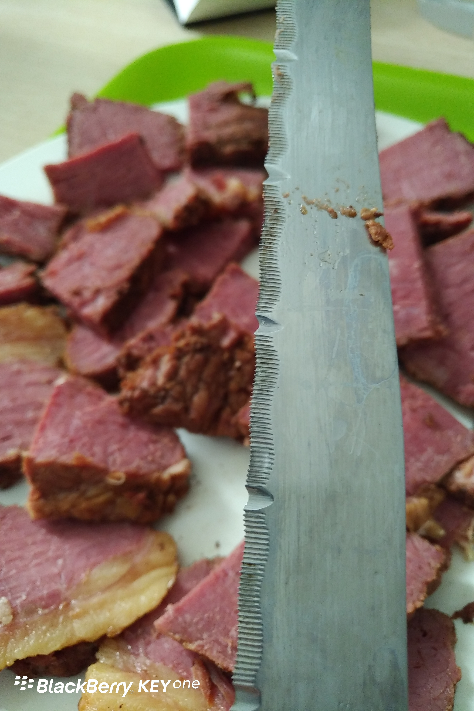

Day23 (2018年1月30日，周二）

本应该接着讲我儿子的留学故事，但是今天实在太忙。到现在我连语言学校的回家作业都没做，所以只好改天再扯。

今天换了新的英文老师，Fiona，她是一个略显传统的老师，估计年龄有五十了。学的是法律专业，还出过诗集。上周的Maynah老师被安排做前台和学生工作去了。

上一家房客留下的这把刀，绝对是切肉利器。工欲善其事，必先利其器。有了这样的利器，我更加爱切肉了。昨天炖的牛肉，味道比熟食店卖的还要好。

欲知后事如何，且等 学择新西兰（Choose NewZeaLand）Day24
