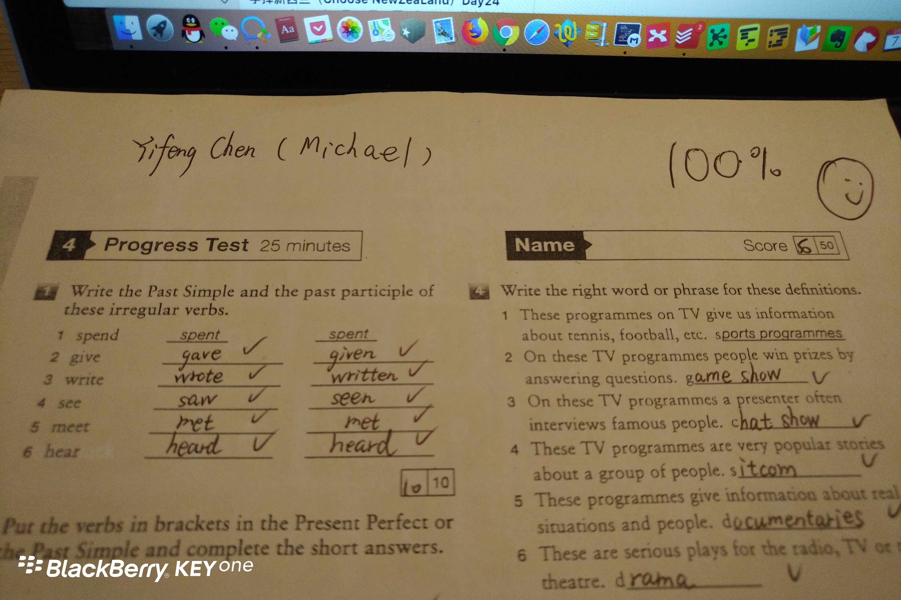
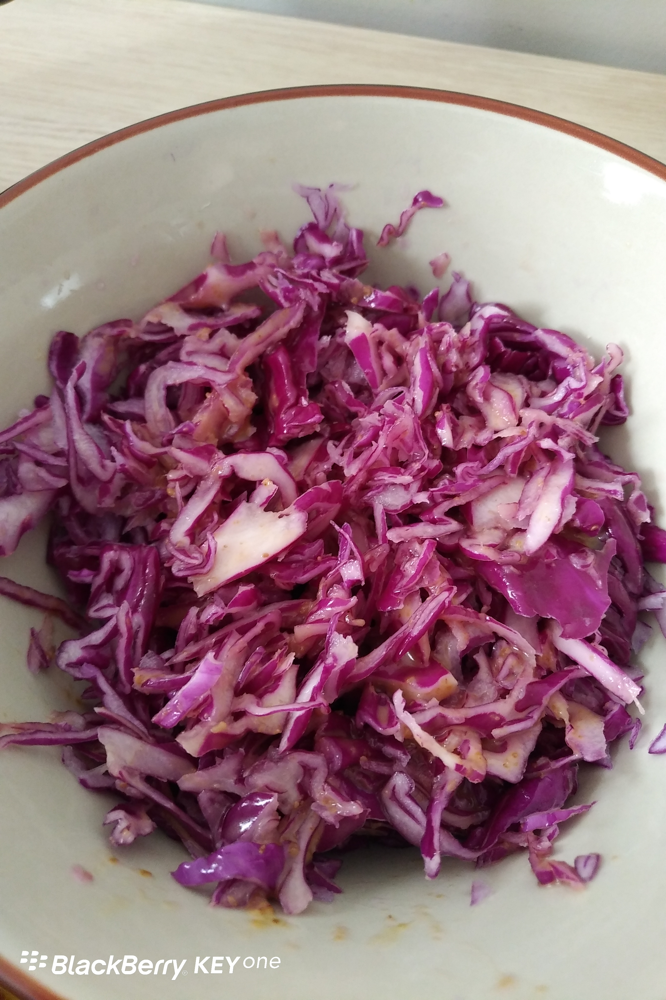

Day31 (2018年2月7日，周三）

上周的单元小测验，我得了100分。印象中打小学3年级之后，我就没见过我的哪张试卷上有100分。

我童年时天空很蓝，像新西兰这么蓝；河水不是很清澈但水质还挺好，有人洗衣服，有人游泳。作业量也不像现在动不动要做到深更半夜这么夸张，至少我在小学阶段我没有讨厌过学习。

前两天看到鬼首天龙的文章《你会让自己的孩子每天写五个小时的家庭作业吗？》，他的答案是让老师们见鬼去吧。

有人说不可能，在中国这个环境中BALABALA，咱们可以讲出一万个不可能的理由。

鬼首天龙生活在新西兰，我不确定他换到国内后会不会让老师们见鬼。

但是我的（榕树下）前同事，真的让老师们见鬼了。他的孩子被老师派去抓课后在走廊里奔跑的孩子（学校规定不得奔跑），抓到后奖励小红花一朵。同事闻知此讯，这不是培养鹰犬吗？于是他愤然带孩子退学回家，因为他是自由的艺术工作者，所以他每天教孩子一些“无用的东西”——认字、写字、涂鸦、画画、陶艺……当然，他也不确定这样做对孩子的未来是不是最好的安排。

自己教孩子，其实是有先例可循的，比如童话大王郑渊洁，不满意中国的教育理念，他的儿子小学毕业就辍学，完全由父亲在家展开私塾式教育。

不管怎么说，当初我是没有这样的勇气挑战中国的教育体制，纵然我有一万个不满意。

有意思的事，所有的人都知道中国的教育体制有严重弊端，所有的人除了抱怨，都说自己无能为力。

没错，我同意高考是一个最不坏的制度设计，是一个相对公平的制度设计。问题是，我们能不能把莘莘学子奔向高考的过程设计得更加科学？

##人人都能成为莫扎特

年幼的莫扎特听到某种乐器演奏出来的调子时，不论是哪种调子，马上便能准确地辨别出来：是高于中央C音的第二个八度音的升A调，还是低于中央C音的降E调。莫扎特甚至能在某个房间里听得出另一间房间里的人弹奏的调子，而且，他不但能分辨小提琴和古钢琴演奏出来的调子，还能分辨任何一种乐器的调子。

在音乐上，这种能力被称为“绝对音高”（absolute pitch）[更多的人称之为“完美音高”（perfect pitch）]。至少在200多年的时间里，人们普遍是认为这是一个人与生俱来的天赋，往往只有少数一些幸运的人才会天生拥有，其他大多数人并不具备。大约在每万人中，只有1个人具备这种能力。贝多芬有，勃拉姆斯却没有；弗拉基米尔·霍洛维茨有，伊戈尔·斯特拉文斯基却没有；弗兰克·辛纳屈有，迈尔斯·戴维斯却没有。

2014年，东京的一音会（Ichionkai Music School）开展了一项实验，并将实验结果在《音乐心理学》科学杂志上发表，揭示了完美音高的真正特性。日本心理学家榊原彩子（Ayako Sakakibara）招募了24个年龄为2~6岁的孩子，组织他们进行长达数月的训练，目的是教他们如何通过声音来辨别钢琴上弹奏的各种各样的和弦。这些和弦全都是带三个音高的大和弦，比如带中央C、E和G音符的C大调和弦，后两者的音高，高于中央C。

研究人员给孩子们上了四五节时间较短的训练课，每节课仅持续几分钟，一直训练到孩子们能够辨别榊原彩子选择的所有14首和弦为止。**有些孩子在不到一年的时间里完成了练习，另一些则花了一年半时间。**然后，一旦某个孩子学会了辨别那14首和弦，榊原彩子便会对他进行测试，以观察他能否正确说出单首和弦的音高。完成了训练之后，参与研究的每个孩子都被培养出了完美音高，并且可以辨别出在钢琴上弹奏的单曲的音高。

这是一个令人震惊的结果。尽管在正常的条件下，每万人中只有1人具有完美音高，但参加了榊原彩子研究的那些孩子，却个个都拥有。这显然意味着完美音高根本谈不上是只有幸运的少数人才拥有的天赋，而是一种只要经过适度的接触和训练，几乎人人都可以培养和发展的能力。这项研究彻底颠覆了我们对完美音高的理解。

以上内容摘编自《刻意练习》一书。

从“完美音高”的研究案例中我们可以得出以下结论：
1. 不要相信所谓的天赋。（我没有XX天赋，这是你的老师无形中给你加上的锁链，通常这个老师是你不喜欢的。没有教不好的孩子，只有不会教的老师。）
2. 人的接受能力，有快和慢的差别。**有些孩子在不到一年的时间里完成了练习，另一些则花了一年半时间。**（举个极端的例子，富士康的流水线，工龄1年的熟练工和2年的熟练工，他们的工作效率区别大吗？）

中国的教改，只要一个动作，九年制义务教育改为8-10年义务教育。直接取消掉年龄划分，按孩子的接受能力快慢来分班。越是低龄，分班越要多。每个班的教学进度不一样，让孩子学会为止。基础打不扎实，上去就吃力了。现在学校教育主要的矛盾是，80%的孩子跟不上。

接受能力快的孩子，8年就升高中——咱们不是喜欢选拔尖子吗？那让尖子们早点上高中早点念大学成为栋梁之才啊！接受能力慢的孩子，读上10年又何妨？慢慢学，同样上高中念大学。人生又不差这2年吧？

雪崩时，没有一片雪花是无辜的。从这个角度来说，我们对中国现行教育体制弊端的形成，都有贡献。

话说今天的凉拌紫甘蓝挺成功，这是第三次研发。心得是：不用刀切，用刨刀直接刨成丝。

欲知后事如何，且等 学择新西兰（Choose NewZeaLand）Day32
