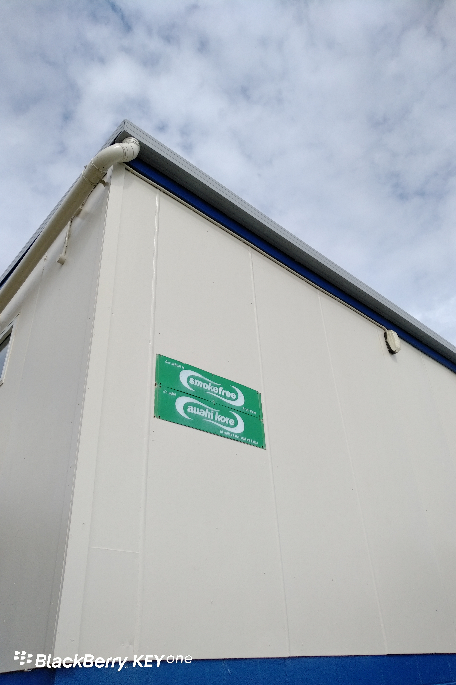

Day32(2018年2月8日，周四）

来新西兰，经常看到大楼门口挂着smokefree的牌子。在英文里，smoke是“吸烟”，free是“不受限制”。我认为这就是大楼特别划出来的室外吸烟区，和中国没啥区别。有时候我还能在smokefree牌子底下看到几个香烟屁股。

直到有一天，我观察到有一栋建筑物的smokefree边上还有一块牌子no smoking。我就纳闷了，老外也挺奇怪的，这是让人吸呢，还是不让人吸呢？我和儿子探讨，他也不能确定，说这个smokefree看起来是不让吸烟的意思。我一查字典，晕，smokefree真的是禁止吸烟的意思。

擦，歪果仁是怎么造单词啊，这不科学啊！
