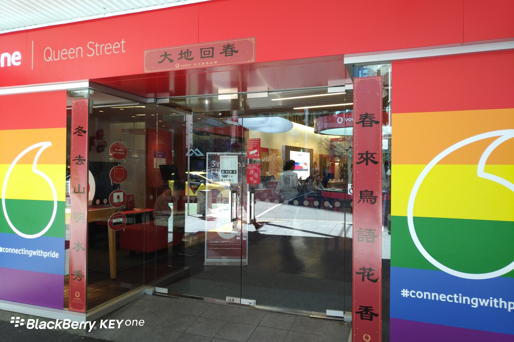

**Day39(2018年2月15日，周四）**

昨天大测试，听力和语法，韩国大妈87，我77。我分析了下，差距主要在词汇。

我有两个单词拼错失2分，另一个地方是给单词加前缀变反义词（老师还没教到），总共12分，吃老本拿了4分，失去8分。

显然韩国大妈的词汇基本功比我扎实许多。熟悉她的同学说韩国大妈本来在LEVEL 3上课, 因为想上Maynah老师的课，所以主动降级——反正她也不考雅思。

可惜的是Maynah老师改做前台和学生工作了。昨天校长关起门问我们Fiona怎么样，意思是若不满意他可以再去找新老师。大家都希望Maynah回来，校长说这是不可能地……

有的同学不太理解，我说这是中国人办的学校，肯定需要老外来做前台撑门面啦。

我带头说：Fiona is OK.

我绝不是怕砸了人家的饭碗而敷衍表态，Maynah和Fiona相比，除了亲和力强一些，两者的教学技术没有太多的差异。以中国传统的眼光看，Fiona更像一个站在讲台上的老师。

在David家吃过年夜饭出来，喊了一辆Uber，遇到一个非常好玩的司机。　　我先出门，等在车内。我告诉司机明天是我们中国人的新年，司机瞪大眼睛：”WOW!HAPPY NEW YEAR!“然后很开心地冲着正在走路的其他人招手，用中文喊道：“你好！”，也不管人家理不理他，一脸的欢乐。

我很惊讶：”You can speak chinese!“这时儿子上车了，司机发动车子到前面迅速掉了个头，一边踩油门，一边夸张地把头伸出窗外，挥手大喊：“Happy New Year！”……

后来聊天中得知他是伊拉克人，39岁，来新西兰四年，娶了新西兰本地的姑娘。

平生第一次在异国他乡过年，过一个没有年味的春节。

**Day40(2018年2月16日，周五）**

一到教室，Maynah老师就跑过来问我愿不愿意升级到LEVEL3去上课，因为我达到了LEVEL3的水准。

我一愣，不知道怎么表达，于是提出先看看LEVEL3的教材再说。翻了翻，感觉生词比现在多。考虑到前天考试失分的原因——LEVEL2的内容没学全，最后我拒绝了升班的提议。

中国有个成语叫：按步就班。嗯，咱们要多听听祖训。

Queen Street沃达丰的门口居然挂着对联，他家市场部很会做营销。

欲知后事如何，且等 学择新西兰（Choose NewZeaLand）Day41
