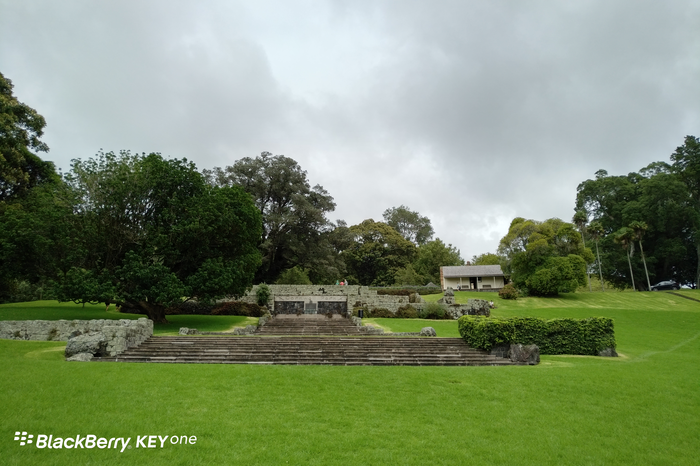
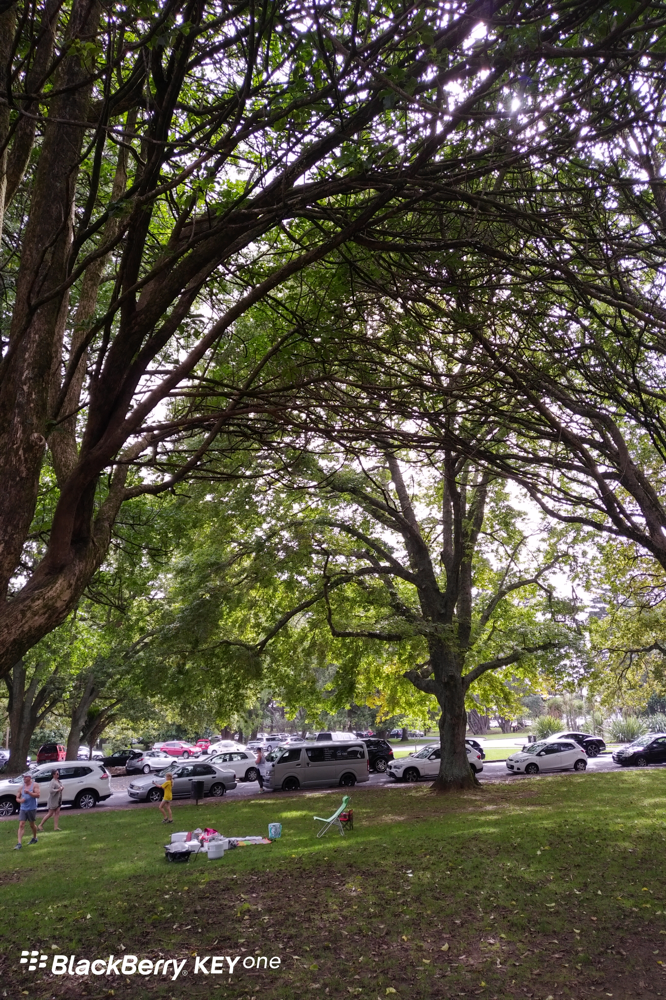
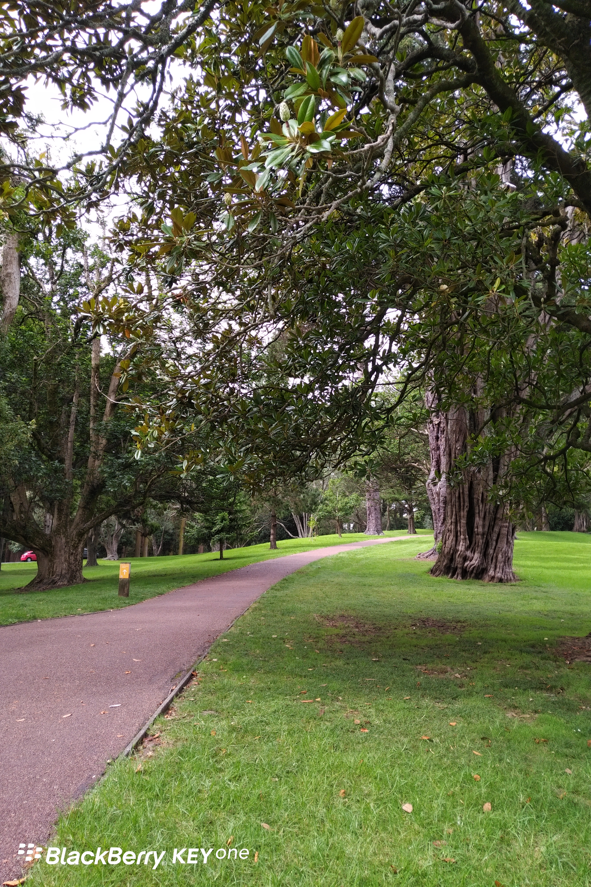
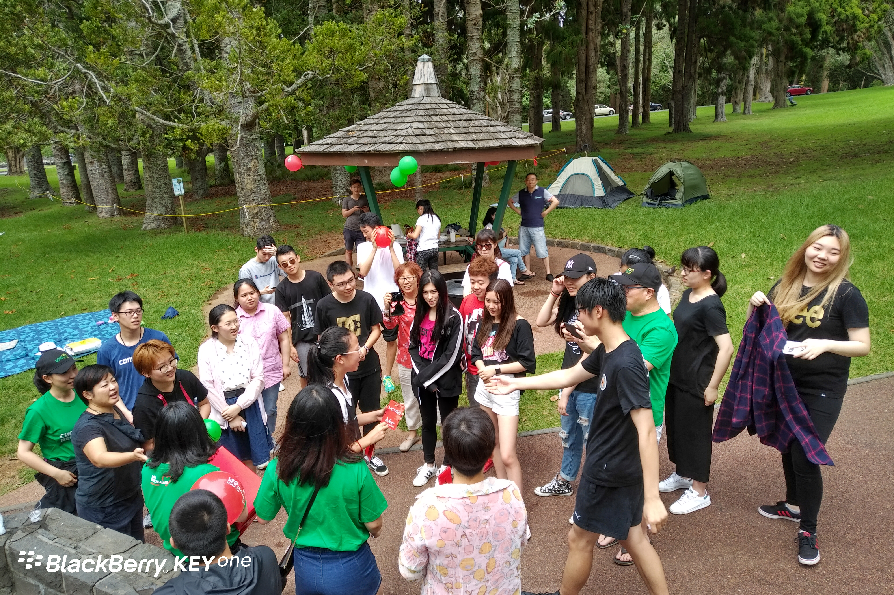

**Day41(2018年2月17日，周六）**

今天带儿子参加David的公司组织的留学生迎新烧烤日。地点是在Cornwall Park。

Cornwall Park占地425英亩/172公顷，100多年前是私人领地。1901年，约翰·洛根坎贝尔爵士将Cornwall Park赠予新西兰。他的愿望是公园将为所有新西兰人永远免费享受。

到目前为止，我在奥克兰还没发现过收费的公园。

公园没有大门和围墙，随便进出，说实话我还真还不太习惯，怕冷不丁窜出个红袖章，大喝一声：买票了没？

我想要是某国政府来管理，怎么可能让老百姓这么开心？绿地、海滩统统围起来卖门票，高速公路收费口全部建起来……

那天我和旅游中巴的司机聊天，他说同样挣3000元（不考虑汇率），在上海是生存，在新西兰是生活。

下图右上角小屋就是当年Cornwall Park主人居住过的地方。

公园内有停车场。园内随处可见休闲的大小家庭。

处处皆风景

抽奖是活动的高潮，当学生们听到奖品是“免费补课券”，一等奖周六周日免费补课2天……全笑翻了，纷纷表示拒绝。当然，这是个玩笑，奖品是“电影券”。

欲知后事如何，且等 学择新西兰（Choose NewZeaLand）Day42
