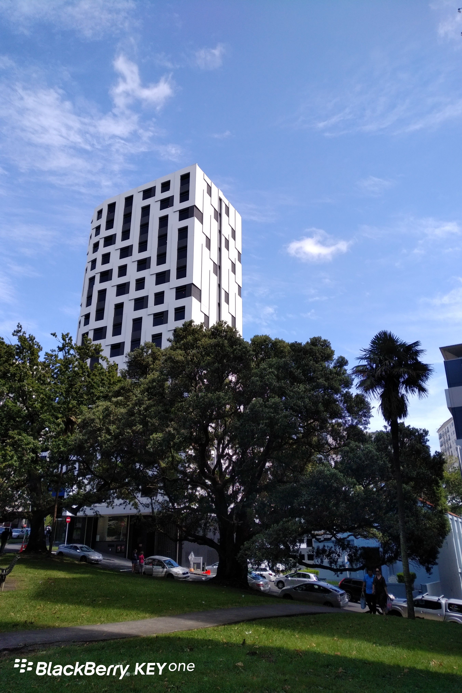

**Day55（2018年3月3日，周六）**

明显不满足签证条件，材料又不造假，我们是如何成功说服素未谋面的移民官网开一面的呢？

对于99.99%的中介来说，不对材料做点手脚，这就是个不可能完成任务。

我的老同学David则始终秉持一个思想原则，用西方的思维和西方的体制打交道。

简言之：直面问题，提出解决方案并且证明方案可行，请求获得纠错机会。

1. 成绩单和出勤记录：不忍直视，但还是要交，这是必要材料。
2. 移民顾问解释信：老外顾问用地道的英语交代了事情的来龙去脉，我们已经或者即将采取的措施，请求批准签证。其中提到我已经在新西兰学习英语、顺便陪读。
3. 我的解释及承诺函：我以父亲身份解释并承诺给予督促。
4. 学校证明：今年1月份开学以来，出勤率100%。
5. 房东介绍信：去年我在新西兰住民宅1个月，老外房东对我们父子的评价。

如果说其中有什么小技巧，那就是我们使用了两个老外。一个是经验极其丰富的老外移民顾问，他负责这个案子，确保与签证官的沟通理解无丝毫偏差。一个是老外房东，她为我们背书，是个加分项，老外相信老外。我从最近的新闻总结出来一点：中国人在新西兰签证官的眼里，信誉度只比印度人好一些。

我们在2月23日（周五）提交了签证申请，差不多一周时间，签证官给予批复：根本不符合签证条件！现法外开恩，给予批准。你一定要好好学习、天天向上，再像去年这样我绝对不会再给你机会了，直接卷铺盖滚蛋！（意译）

欲知后事如何，且等 学择新西兰（Choose NewZeaLand）Day56
