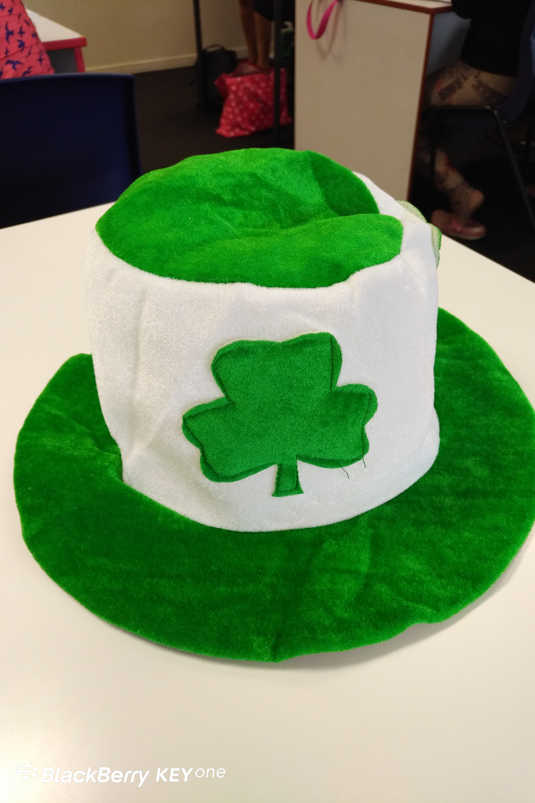

**Day68（2018年3月16日，周五）**

今天进了学校，感觉有点过节的意思。等到上课后听老师介绍，才知道明天是西方的圣特里克节（英语：Saint Patrick's Day）。中午学校还请大家吃披萨！

我忽然发现老师的讲台上，居然放着一顶绿帽子！原来绿色是圣特里克节的喜庆色。这东西，咱们中国的男人们，坚决不戴！而两个智利小朋友百无禁忌，乐呵呵地戴上绿帽子跑来跑去。

下午有个小游戏。同学们被划分为AB两组。老师把长得像Ben的智利小朋友A和另一个智利大妈R叫上去，分别代表A组和B组。老师给他们看同一个关于物品的单词，请他们在白板上画出来。

代表我们A组的智利小朋友A，画什么不像什么，画个Bra(胸罩)像眼镜，皮带、围巾像条蛇……哎，见过不会画画的，没见过这么不会画画的，大家笑得前仰后合。

B组的智利大妈R貌似有绘画功底，寥寥数笔就勾勒得有模有样。我被逼无奈，只好看着B组的画抢答，为A组捞回点颜面。

Saint Patrick's Day是纪念爱尔兰的主保圣人——圣帕特里克主教（约385–461年）的节日，在每年3月17日举行。

公元432年，圣帕特里克受教皇派遣前往爱尔兰劝说爱尔兰人改信基督教。圣帕特里克从威克洛上岸后，当地愤怒的非基督徒企图用石头将他砸死。

圣帕特里克临危不惧，当即摘下一棵三叶酢浆草，形象地阐明了圣父、圣子、圣灵三位一体的教义。他雄辩的演说使爱尔兰人深受感动，接受了圣帕特里克主施的隆重洗礼。

461年3月17日，圣帕特里克逝世，爱尔兰人为了纪念他，将这一天定为圣帕特里克节。

这一节日5世纪末期起源于爱尔兰，这一天后来成为爱尔兰人的国庆节，同时也是北爱尔兰的银行休假日与爱尔兰共和国、蒙特塞拉特和加拿大纽芬兰与拉布拉多省的法定节假日。在加拿大其他地区、英国、澳大利亚、美国和新西兰，圣帕特里克节虽然广为庆祝，但不是法定的节假日。

美国的圣帕特里克节这一天，人们通常要举行游行、教堂礼拜和聚餐等活动。美国的爱尔兰人喜欢佩带三叶酢浆草，用爱尔兰的国旗颜色——绿黄两色装饰房间，身穿绿色衣服，并向宾客赠送三叶酢浆草饰物等。

除了服装外，食品、玩具等在节日期间都会带上绿色。圣帕特里克节前后，爱尔兰酒吧总是挤满顾客，其他各种酒吧也比平时多了不少人，酒吧在节日期间还会出售特制的啤酒，颜色是绿色的，这种绿色啤酒很受欢迎，口味也很独特，销量很好。　

欲知后事如何，且等 学择新西兰（Choose NewZeaLand）Day69
