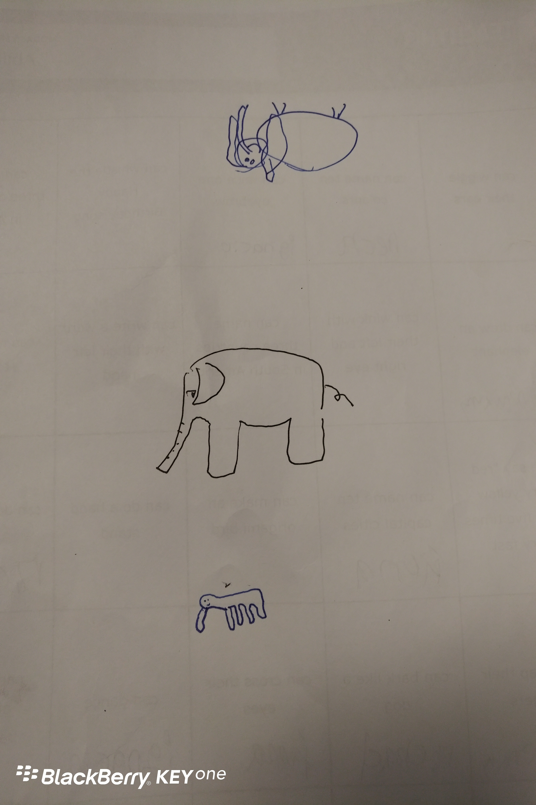

**Day78（2018年3月26日，周一）**

今天又换成了代课老师，那个严厉的老头Ewen。他一天都在帮我们复习，因为明天有一场大考。大考每隔六周举行一次，通过大考的学生，可以升班到LEVEL 3（intermediate）。上个月14日，我已经通过了大考，只是我为打好基础，放弃了升班。

抱歉，没时间闲扯了，我得复习迎考去。贴个图，供大家一乐。我和两个智利小朋友画的“大象”，最像大象的那个，是我画的。

欲知后事如何，且等 学择新西兰（Choose NewZeaLand）Day79
