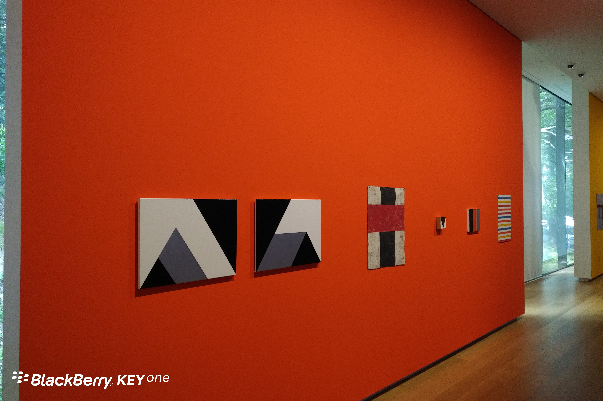
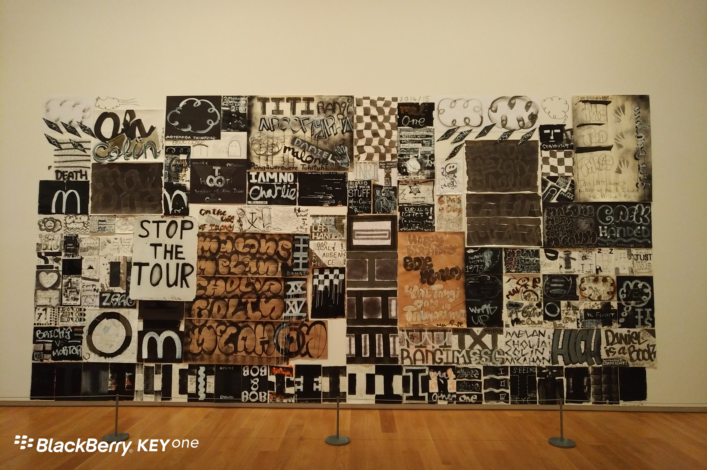

**Day81（2018年3月29日，周四）**

今天是复活节大假的前一天，学校组织去艺术馆参观。回想小时候，学校组织参观活动，第二天都得写作文：今天的天气真好，蓝蓝的天空飘着朵朵白云……

说实话，艺术馆大部分艺术作品，我是不会欣赏。最夸张的是一块三夹板，稍微搞点小破坏，刷上银漆挂墙上，给人的感觉就是这面墙装修还未完工，我真搞不懂艺术家要表达什么。依我看，把这块板挂到建筑工地去，绝对没有人会多看一眼。这不由得让我想起一则新闻：

2015年，荷兰网络频道Lifehunterstv主持人鲍里斯（Boris）做了一项有趣的实验。他将家居品牌宜家（IKEA）贩卖的10欧元廉价印刷画放到荷兰阿纳姆博物馆（Museum Arnhem）展示，并说这幅画出自瑞典知名美术家IKE Andrews之手。

他请馆内民众一起欣赏后鉴价。结果几乎所有人都对这幅画赞誉有加，还头头是道的评论起来，惊叹它的高艺术成分和画家的热诚。有人甚至愿意花250万欧元来收藏。

最后鲍里斯揭露这幅超棒的画来自IKEA，民众不是放声大笑，就是尴尬快闪。看来一项艺术品的价值高低，可能要视其摆设的环境而定。

欲知后事如何，且等 学择新西兰（Choose NewZeaLand）Day82
